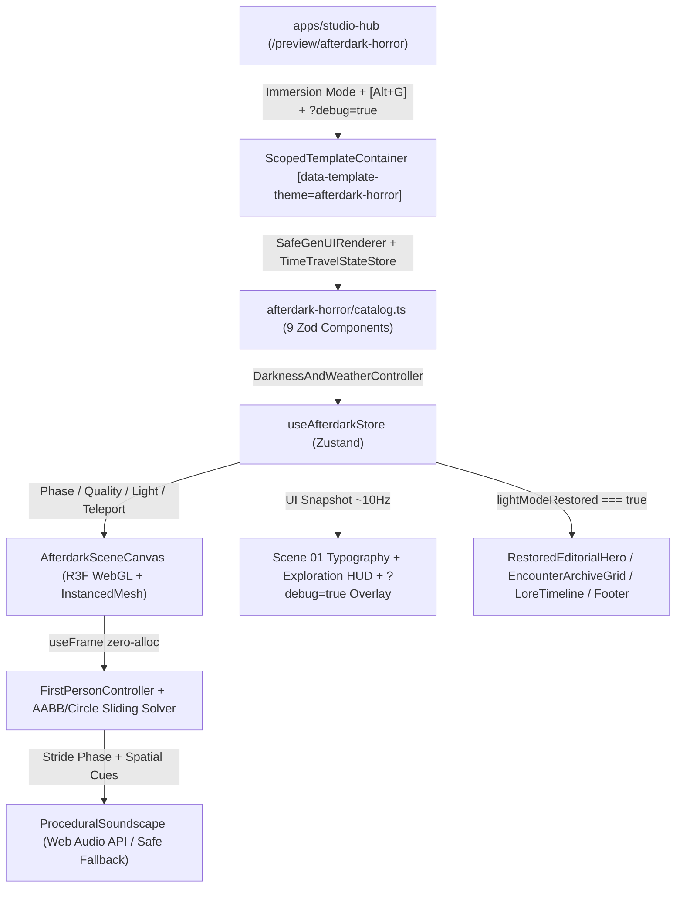

# Design Document: AFTERDARK (`packages/templates/src/afterdark-horror`)

## 1. System Architecture Diagram

---

## 2. Module Layout (`packages/templates/src/afterdark-horror/`)
- `manifest.json` — Mode A manifest (`slug: "afterdark-horror"`, `immersiveExperience: true`, category `"3D / WebGL"`, remix presets).
- `types.ts` — Domain types (`AfterdarkPhase`, `QualityPreset`, `QualityBudget`, `AABBCollider`, `CircleCollider`, `CemeteryZoneId`).
- `store.ts` — Zustand store (`useAfterdarkStore`) managing sequence phase, quality budgets, collision wireframe / light override toggles, throttled HUD telemetry, and catalog director synchronization.
- `engine/collision.ts` — Pure deterministic 3D world collision map (`CEMETERY_BOUNDS`, `STATIC_AABB_COLLIDERS`, `CIRCLE_COLLIDERS`), `resolvePlayerMovement()` sliding solver, gate blocker toggle, zone classifier (`resolveZoneAtPosition`), and safe teleport waypoints.
- `engine/procedural-geometries.ts` — Seeded procedural `BufferGeometry` & `InstancedMesh` layout generators for gothic tombstones, twisted dead trees, iron pickets, gate wings, path lanterns, mausoleum arches, and chapel facade, paired with explicit `.dispose()` helpers.
- `audio/soundscape.ts` — Pure Web Audio API synthesis engine (bandpass wind LFO, detuned 38/41.5 Hz sub-rumble, rear spatial breath cue, FM gate creak/slam, seeded owl call, gravel vs stone footsteps, thunder rumble).
- `components/FirstPersonController.tsx` — Pointer Lock + `WASD`/`Shift` damped physics + head-bob stride detector + mobile virtual joystick integration.
- `components/CemeteryWorld.tsx` — `<Canvas>` scene graph: sky dome, exponential fog, moonlight rim light, lightning controller, gatehouse, perimeter walls, instanced graveyard & trees, lanterns, mausoleum, crimson/amber stained-glass chapel, and debug collision wireframes.
- `components/SceneOverlays.tsx` — Scene 01 `#000000` shutdown overlay, sequential typography (`2:17 AM` -> `Why did you come here?` -> `Something is waiting.` -> `ENTER THE CEMETERY`), mobile virtual controls, crosshair/zone whisper, and `?debug=true` inspector overlay.
- `components/Sections.tsx` & `components/index.ts` — Full implementations of all 9 catalog components + SSR-safe WebGL guard (`typeof window !== "undefined"` + WebGL capability / context-loss handler).
- `catalog.ts` — `verifiedCatalog` (`createVerifiedCatalog`) + `initialPageSpecs.home` + `buildRemixJsonl`.
- `theme.css`, `steering.md`, `index.ts`.

---

## 3. World Coordinate & Collision Topology (Meters, `y = 0` Ground)
- **Outer Perimeter Walls:** `x ∈ [-36, +36]`, `z ∈ [-44, +34]` (`thickness = 1.2m`), interrupted only at central south entrance gatehouse `x ∈ [-2.5, +2.5]` (`z = 29.0`).
- **Scene 01/02 Spawn & Dolly:**
  - Camera starts outside wrought-iron gatehouse at `(0, 1.75, 36.2)` facing North (`yaw = 0`, `-Z`).
  - Gate leaves hinge at `(±2.5, 0, 29.0)` and swing inward to `1.35 rad` during `gate_transition`.
  - Camera dollies smoothly to `(0, 1.70, 24.8)`, gates swing shut (`gateLockedBehind = true`), engaging dynamic gate blocker `x ∈ [-2.5, +2.5], z ∈ [28.6, 29.4]`.
- **Landmark Zones:**
  - `gatehouse`: `(0, 1.7, 25.2)` — South wrought-iron archway & twin flanking lanterns
  - `central_path`: `(0, 1.7, 8.0)` — Flagstone avenue flanked by tilted gothic headstones & flickering iron sconces
  - `weeping_grove`: `(-16.0, 1.7, 4.0)` — Dense twisted dead tree copse & ancient plots
  - `mausoleum`: `(15.5, 1.7, -14.0)` — Weathered stone crypt portico & columned archway
  - `chapel_steps`: `(0, 1.7, -30.5)` — Elevated stone steps facing the glowing gothic chapel stained glass (`z = -39.5`)
  - `crypt_entrance`: `(0, 1.7, -23.5)` — Sunken threshold reserved for Milestone 2/3 descent

---

## 4. Hardware Performance Budget Matrix
| Preset | DPR | Dynamic Point Lights | Tombstone Instances | Tree Instances | Picket Instances | Fog Density |
| :--- | :--- | :--- | :--- | :--- | :--- | :--- |
| `low` | `[1, 1]` | `1` (Moon/Lightning + 1 beacon) | `48` | `20` | `96` | `0.068` |
| `medium` (default) | `[1, 1.5]` | `2` (Path lanterns + lightning) | `84` | `36` | `140` | `0.056` |
| `high` | `[1, 2]` | `3` (Gate + Path + Chapel glow) | `120` | `52` | `180` | `0.050` |

*Zero GC rule:* All `useFrame` ticks reuse pre-allocated module `THREE.Vector3`, `THREE.Euler`, and `THREE.Object3D` scratch instances. UI store telemetry syncs at ~10 Hz (`telemetryTimerRef`), preventing React reconciliation from blocking WebGL frames.
