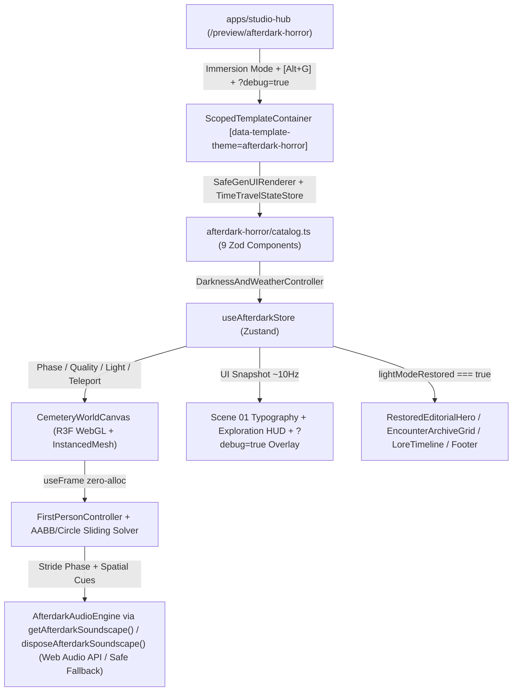

# Design Document: AFTERDARK (`packages/templates/src/afterdark-horror`)

## 1. System Architecture Diagram

---

## 2. Module Layout (`packages/templates/src/afterdark-horror/`)
- `manifest.json` — Mode A manifest (`slug: "afterdark-horror"`, `immersiveExperience: true`, category `"3D / WebGL"`, remix presets).
- `types.ts` — Domain types (`AfterdarkPhase`, `QualityPreset`, `QualityBudget`, `AABBCollider`, `CircleCollider`, `CemeteryZoneId`).
- `store.ts` — Zustand store (`useAfterdarkStore`) managing sequence phase, quality budgets, collision wireframe / light override toggles, throttled HUD telemetry, and catalog director synchronization.
- `engine/collision.ts` — Pure deterministic 3D world collision map (`WORLD_OUTER_BOUNDS`, `STATIC_AABB_COLLIDERS`, `buildCircleColliders()`), `resolvePlayerMovement()` sliding solver, gate blocker toggle, zone classifier (`resolveZoneAtPosition`), and safe teleport waypoints.
- `engine/procedural-geometries.ts` — Seeded procedural `BufferGeometry` & `InstancedMesh` layout generators for gothic tombstones, twisted dead trees, iron pickets, gate wings, path lanterns, mausoleum arches, and chapel facade, paired with explicit `.dispose()` helpers.
- `audio/soundscape.ts` — Pure Web Audio API synthesis engine (bandpass wind LFO, detuned 38/41.5 Hz sub-rumble, rear spatial breath cue, FM gate creak/slam, seeded owl call, gravel vs stone footsteps, thunder rumble).
- `components/FirstPersonController.tsx` — Pointer Lock + `WASD`/`Shift` damped physics + head-bob stride detector + mobile virtual joystick integration.
- `components/CemeteryWorld.tsx` — `<Canvas>` scene graph: sky dome, exponential fog, moonlight rim light, lightning controller, gatehouse, perimeter walls, instanced graveyard & trees, lanterns, mausoleum, crimson/amber stained-glass chapel, and debug collision wireframes.
- `components/SceneOverlays.tsx` — Scene 01 `#000000` shutdown overlay, sequential typography (`2:17 AM` -> `Why did you come here?` -> `Something is waiting.` -> `ENTER THE CEMETERY`), mobile virtual controls, crosshair/zone whisper, and `?debug=true` inspector overlay.
- `components/Sections.tsx` & `components/index.ts` — Full implementations of all 9 catalog components + SSR-safe WebGL guard (`typeof window !== "undefined"` + WebGL capability / context-loss handler).
- `catalog.ts` — `verifiedCatalog` (`createVerifiedCatalog`) + `initialPageSpecs.home` + `buildRemixJsonl`.
- `theme.css`, `steering.md`, `index.ts`.

---

## 3. World Coordinate & Collision Topology (Meters, `y = 0` Ground)
- **Outer Perimeter Walls (`STATIC_AABB_COLLIDERS`, `thickness = 1.2m`):** west/east walls centred on `x = ±36` spanning `z ∈ [-44.6, +29.6]`; south walls at `z ∈ [28.4, 29.6]` with the central gatehouse opening at `x ∈ [-3.5, +3.5]`; north wall split with a gap at `x ∈ [-8.1, +8.1]` for the chapel. Walkable bounds (`WORLD_OUTER_BOUNDS`): `x ∈ [-35.4, +35.4]`, `z ∈ [-43.2, +38.4]` (crypt extends to `z = -58.4`).
- **Scene 01/02 Spawn & Dolly:**
  - Camera starts outside wrought-iron gatehouse at `(0, 1.7, 36.2)` (`PLAYER_EYE_HEIGHT`) facing North (`yaw = 0`, `-Z`).
  - Gate leaves hinge at `(±2.42, 0, 29.0)` and swing inward by `gateOpenProgress * 1.42` rad (up to `1.42 rad`) during `gate_transition`.
  - Camera dollies smoothly to `(0, 1.70, 24.8)`, gates swing shut (`gateLockedBehind = true`), engaging dynamic gate blocker `GATE_DOOR_COLLIDER` `x ∈ [-2.45, +2.45], z ∈ [28.65, 29.35]`.
- **Landmark Zones** (`resolveZoneAtPosition` classifier; teleport points from `ZONE_TELEPORT_TARGETS`):
  - Zone A `gatehouse`: `(0, 1.7, 25.0)` — South wrought-iron archway & twin flanking lanterns (`z ≥ 21.5`)
  - Zone B `forgotten_graves`: `(0, 1.7, 10.0)` — Central avenue flanked by gothic headstones (`1.5 ≤ z < 21.5`)
  - Zone C `dead_garden`: `(-16.0, 1.7, -2.5)` — Crumbling fountain, stone benches & weeping statues (`x ≤ -8.0`, `-28.5 ≤ z < 1.5`)
  - Zone D `chapel_steps`: `(0, 1.7, -31.5)` — Stone steps and enterable gothic chapel (`z ≤ -28.0`, `|x| ≤ 10.5`; also the classifier fallback)
  - Zone E `crypt_entrance`: `(4.0, -2.8, -53.2)` (`y = -4.5 + 1.7`) — Underground crypt beneath the chapel (eye `y < -0.5` or `z ≤ -45.0`)
  - `mausoleum`: classifier-only zone with no teleport target (`x ≥ 10.5`, `-20.5 ≤ z ≤ -7.5`) — Weathered stone crypt portico

---

## 4. Hardware Performance Budget Matrix
| Preset | DPR | Dynamic Point Lights | Tombstone Instances | Tree Instances | `picketDensityStep` | Fog Density |
| :--- | :--- | :--- | :--- | :--- | :--- | :--- |
| `low` | `[1, 1]` | `1` (Moon/Lightning + 1 beacon) | `48` | `20` | `2` | `0.068` |
| `medium` (default) | `[1, 1.5]` | `2` (Path lanterns + lightning) | `84` | `36` | `1` | `0.056` |
| `high` | `[1, 2]` | `3` (Gate + Path + Chapel glow) | `120` | `52` | `1` | `0.050` |

*Zero GC rule:* All `useFrame` ticks reuse pre-allocated module `THREE.Vector3`, `THREE.Euler`, and `THREE.Object3D` scratch instances. UI store telemetry syncs at ~10 Hz (throttled in `components/FirstPersonController.tsx`, which calls `setPlayerTelemetry` in `store.ts`), preventing React reconciliation from blocking WebGL frames.
