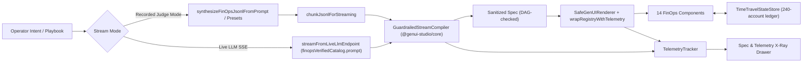

# Design Document: Application #1 — RevOps / FinOps Generative Command Center

## 1. Architecture Overview



The application owns **zero** stream-parsing, validation, or error-boundary logic. Everything
safety-related is imported from `@genui-studio/core`; the app contributes only:

| Layer | File | Responsibility |
|---|---|---|
| Catalog | `src/catalog/finops-catalog.ts` | 14 Zod component schemas + `fallbackProps`, 4 action param schemas |
| Registry | `src/catalog/finops-registry.tsx` | React implementations, ledger action handlers, telemetry wrapping |
| Data | `src/data/ledger-seed.ts` | Deterministic Mulberry32-seeded 240-account ledger + `executeFinOpsMutation` |
| Streams | `src/streams/finops-streams.ts` | 3 playbook specs, intent synthesizer, live SSE adapter, chaos packet batch |
| Shell | `src/App.tsx`, `src/components/XRayDrawer.tsx` | Command bar, undo/redo, X-Ray inspector |

## 2. State Model (`TimeTravelStateStore`)

```text
/ledger/metrics          FinOpsMetrics (recomputed from accounts after every mutation)
/ledger/accounts         CustomerAccount[240]
/ledger/mrrHistory       MrrHistoryPoint[12]
/ledger/cohorts          CohortRow[6]
/ledger/webhooks         WebhookEventRecord[]
/ledger/auditLog         FinOpsAuditEntry[] (newest first)
/ledger/filters/*        searchQuery, status, region, sortField, sortDirection, page
/ledger/selectedAccountId
```

Mutations call `store.update({...})` with all four changed paths at once, so a single
undo restores accounts, webhooks, audit log, and metrics atomically.

## 3. Mutation Semantics

| Action | Effect |
|---|---|
| `issuePartialRefund` | Reduces `disputedAmountCents`; clears to `ACTIVE`/`PAID` at zero balance; MRR −25% of credit |
| `extendTrialPeriod` | `trialDaysRemaining += [3..60]`, status `TRIALING` |
| `retryFailedWebhook` | Webhook → `DELIVERED`; account → `ACTIVE`, disputed balance cleared |
| `applyRetentionDiscount` | MRR × (1 − pct), pct clamped to [5, 50] |

All numeric inputs are clamped **twice**: once by the Zod catalog at render time, and again
inside `executeFinOpsMutation` (defense in depth against UI-bypassing callers).

## 4. Chaos Packet Design
`buildCorruptedChaosPackets(rootKey)` emits 6 RFC 6902 lines that exercise every core
resilience layer simultaneously: prototype-pollution path, cyclic edge back to root,
out-of-bounds props (999% → 50%), synchronous render throw, unregistered component type.

## 5. Accessibility Decisions
See `requirements.md` Requirement 3 — sortable table, responsive container-query table,
light-dismiss dialogs, and post-interaction validation patterns are applied verbatim.
