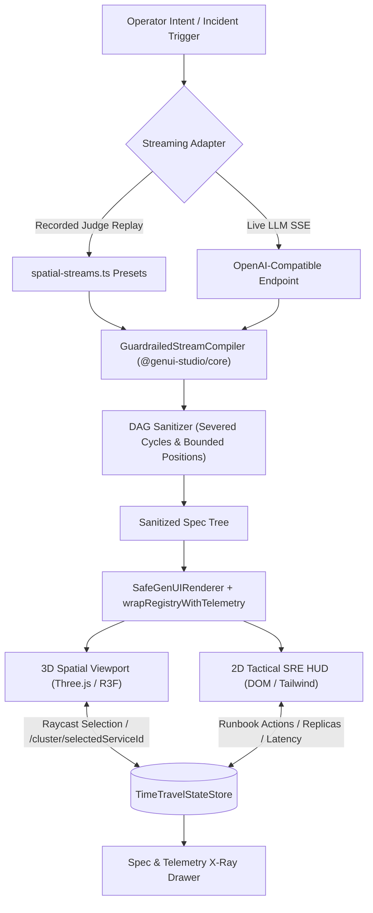

# Design Document: Application #2 — Aegis 3D Spatial Infrastructure & Incident War-Room

## 1. System Architecture & Viewport Split
Aegis 3D demonstrates that `@genui-studio/core` is not bound to 2D HTML/DOM layouts. The single shared runtime orchestrates both WebGL spatial scenes and 2D tactical HUD overlays over the same bidirectional `TimeTravelStateStore`.



---

## 2. Component Catalog Decomposition (14 Components)

### 3D Spatial Infrastructure Components
1. **`AegisWarRoomShell`**: Top-level hybrid split-screen layout organizing 3D spatial viewport (left/center) and 2D tactical telemetry drawer (right/bottom).
2. **`ClusterTopologyCanvas`**: R3F `<Canvas>` wrapper configuring perspective camera, orbit controls, ambient light, fog, and grid helper with WebGL memory disposal guards.
3. **`ServiceMeshNode3D`**: 3D geometric mesh (rounded box/cylinder/sphere) representing a microservice with status-driven emissive shaders, floating HTML nameplate, and raycast pointer selection.
4. **`TrafficFlowEdge3D`**: Directional bezier curve connecting upstream/downstream services with animated particle packets signaling throughput (rps) and error rate.
5. **`BlastRadiusSphere3D`**: Volumetric pulsating translucent sphere showing the projected fault blast radius centered on a degraded service.
6. **`RegionZoneBoundary3D`**: Wireframe bounding zone marking regional datacenter clusters (`US-East`, `EU-West`).

### 2D Tactical HUD & Telemetry Components
7. **`IncidentHeroBanner`**: Executive severity indicator (SEV-0/SEV-1/SEV-2), incident elapsed time, root-cause summary, and one-click mitigation trigger.
8. **`ServiceDiagnosticPanel`**: Detailed inspection card for the currently selected 3D node showing CPU/Memory saturation, ingress/egress RPS, and deployment version.
9. **`LatencyHistogramCard`**: Live p50/p95/p99 latency distribution sparklines and SLO burn rate bound to `/cluster/services/{id}/latency`.
10. **`ErrorLogTailer`**: Live streaming tail of raw JSON structured logs with error stack traces and HTTP 5xx codes.
11. **`BlastRadiusDependencyTree`**: Upstream callers and downstream dependencies tree showing cascading fault propagation paths.
12. **`RunbookActionDesk`**: Interactive guardrailed mutation forms: Trip Circuit Breaker, Trigger Regional Failover, Scale Pod Replicas, and Rollback Canary.
13. **`ClusterMetricsGrid`**: High-level cluster health metrics (Global Error Rate, Active Nodes, Dropped Packets, MTTD).
14. **`SreAuditTrailBanner`**: Live timeline of all executed SRE mitigation actions with Time-Travel Undo/Redo hints.

---

## 3. Bidirectional State Store Model (`/cluster/*`)

```json
{
  "cluster": {
    "summary": {
      "activeIncidents": 1,
      "severity": "SEV-1",
      "globalErrorRatePercent": 14.8,
      "totalNodes": 16,
      "unhealthyNodes": 3,
      "clusterMttdMinutes": 3.4
    },
    "selectedServiceId": "srv-api-gateway",
    "services": {
      "srv-api-gateway": {
        "id": "srv-api-gateway",
        "name": "API Gateway Core",
        "tier": "GATEWAY",
        "region": "US-East",
        "position": [0, 1.2, 0],
        "status": "CRITICAL_OUTAGE",
        "rps": 18400,
        "errorRatePercent": 28.4,
        "p99LatencyMs": 840,
        "replicas": 12,
        "circuitBreakerTripped": false,
        "dependencies": ["srv-auth", "srv-billing", "srv-order-proc"],
        "callers": ["ext-ingress"]
      }
    },
    "edges": [
      {
        "id": "edge-gw-auth",
        "from": "srv-api-gateway",
        "to": "srv-auth",
        "status": "NOMINAL",
        "latencyMs": 12
      }
    ],
    "logs": [],
    "auditLog": []
  }
}
```

---

## 4. WebGL Memory Safety & Performance Invariants
Per `/.kiro/steering/spatial-3d-rules.md`:
1. Shared `THREE.BoxGeometry`, `THREE.SphereGeometry`, and `THREE.CylinderGeometry` cache singletons.
2. Temporary vector allocation in file scope: `scratchVec3 = new THREE.Vector3()`.
3. Auto-disposal of custom mesh instances upon stream-driven unmount.
4. Auto-pause render loop when tab is hidden via `document.addEventListener("visibilitychange")`.
