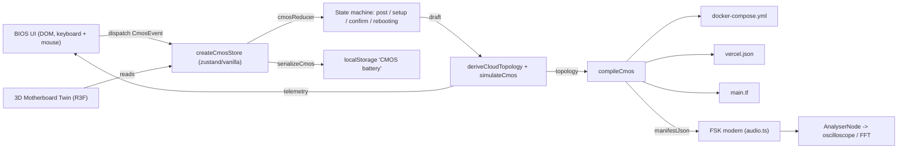
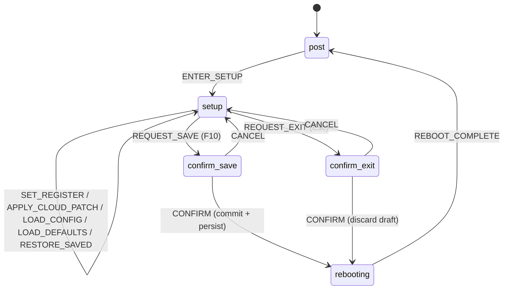

# Design: BIOS // NECROMANCER (`packages/templates/src/cmos-cloud-bios`)

## 1. Architecture


## 2. Core modules
| File | Responsibility |
| --- | --- |
| `lib/cmos/engine.ts` | Register tables, `CmosConfigSchema`, defaults, checksum, IRQ resolver, topology, simulator, POST, cloud patch, reducer, store, persistence |
| `lib/cmos/emitters.ts` | Deterministic YAML (JSON-quoted scalars, block literals) and HCL (blocks, aligned attributes, `tpl`/`raw`/`call`) emitters |
| `lib/cmos/compiler.ts` | `compileCmos` and per-artifact builders, deployment notes, compact cloud manifest |
| `lib/cmos/audio.ts` | Pure FSK framing/encoder, plus the Web Audio engine (PC speaker, beep codes, ticks, alarm, transmitter, analyser) |
| `lib/cmos/index.ts` | Public barrel |

## 3. Register → cloud mapping
| BIOS register | Values | Cloud meaning |
| --- | --- | --- |
| `standard.timeZone` | 9 zones | AWS region + Vercel region + price multiplier |
| `cpu.fsbMhz × cpu.multiplier` | 75–600 MHz | vCPU per instance (0.25–4); concurrency = 8 × vCPU |
| `cpu.coreVoltageMv` | 2.80–3.60 V | Autoscaling ceiling = 4 × 2^((mV−2800)/100), i.e. 4–1024 instances |
| `memory.systemRamMb` | 4–128 MB | Function memory = RAM × 32 (128–4096 MB); Lambda memory raised to cover vCPU (1769 MB per vCPU) |
| `memory.ecc` | disabled / ecc / ecc-scrub | Data checksums, backup retention 1/7/14 d, Multi-AZ + synchronous standby |
| `storage.primaryMaster` | none / ide-hdd / scsi / nvme | No DB / `db.t4g.medium` / `db.m6g.large` / `db.r6g.xlarge` |
| `storage.raid` | none / 0 / 1 / 5 / 10 | Read replicas 0 / 0 (striped IOPS, no redundancy) / 1 / 2 / 3 |
| `storage.primarySlave` | none / pgvector | pgvector extension (pgvector image in Compose) |
| `storage.secondaryMaster` | none / 0.5–6 GB | Redis node `cache.t4g.micro` … `cache.m6g.large` |
| `bus.slots[4]` | empty / api-gateway / edge-middleware / webhook-queue + IRQ | HTTP API throttling, CloudFront + WAF + security headers, SQS + DLQ + worker |
| `bus.pciClockMhz` | 25–41 | Gateway rate limit = slots × MHz × 120 rps, minus 25% per IRQ conflict |
| `power.mode` | disabled / min-saving / max-saving | Warm pool: all average load / half / scale to zero |
| `power.standbyMin` | 1–60 | Scale-in cooldown; cold-start frequency |
| `power.watchdogSec` | 10–300 | Function timeout / `maxDuration` |
| `power.budgetCapUsd` | 25–50000 | AWS Budget limit + alarm |
| `health.fanRpm` | 1200–6000 | Target utilization 85% → 40% (scale out earlier) |
| `health.throttleC` | 60–90 °C | Thermal breaker; per-client limit = (C − 50) × 3 rps |
| `workload.*` | avg rps, peak factor | Simulation input |

IRQ resolver: IRQ 14 is reserved by the Primary IDE channel (when a DB exists) and IRQ 15 by the Secondary channel (when a cache exists). Explicit slot IRQs are placed first, then `auto` slots take the first free line in PnP order `9,10,11,12,5,7,3,4,15,14`. A line with more than one holder is a conflict.

## 4. Simulator model
- **Service time:**
  - computeMs = 9000 / coreMHz × memory factor (1.4 below 256 MB, 1.15 below 512 MB).
  - dbMs = drive latency × (1 − hit ratio) + 0.6 ms × hit ratio + ECC cost + 0.8 ms for pgvector.
- **Capacity:**
  - Per-instance RPS = concurrency × 1000 / serviceMs.
  - Max RPS = min(compute, DB, gateway, thermal). The minimum names the bottleneck.
- **Autoscaling:** instances = ceil(demand / (perInstance × targetUtil)), clamped to [warm pool, ceiling].
- **P99:** overhead + Σ serviceMs × (1.9 + 1.2ρ²/(1−ρ)) + cold-start contribution, capped at the timeout. ρ is capped at 0.97.
- **Thermal:**
  - Power P = 16 W × (V/3.3)² × (MHz/200) × (0.3 + 0.7u).
  - Temperature T = 25 + Rth(fan) × P (+2 °C for patrol scrub).
  - If T(1) exceeds the warning temperature, capacity is capped where T equals that threshold.
- **Power:** `powerDrawW` is the rated full-load package power, 16 W × (V/3.3)² × (MHz/200). It never drops when clock or Vcore rises. Temperature still uses live utilization.
- **Monotonicity:** a higher CPU multiplier never lowers rated power or the per-instance price (`instanceHourlyUsd`). More read replicas never lower the monthly burn. Total burn is allowed to drop with a higher multiplier, because faster cores serve the same traffic with fewer instances. This is the real trade-off the simulator shows.
- **Cost:** compute instance-hours (Fargate-like vCPU/GB rates) plus invocations, HTTP API, CDN+WAF, RDS instances × nodes + gp3 storage, ElastiCache, SQS + worker, NAT and the secret. The total is multiplied by the region multiplier. Rates are in `PRICING`.
- **Stability:** starts at 100, with penalties for undervolt and overvolt, thermal excess, IRQ conflicts, ECC level, missing redundancy, unthrottled ingress, ≥90% utilization, rejected traffic and budget overrun.

## 5. State machine

The CMOS battery uses the record `{ v: 1, checksum, config }`. Persisted data is re-validated with Zod and its checksum on load. Any failure loads `SETUP_DEFAULTS` with `checksumError`.

## 6. Compiler output
- **docker-compose.yml:**
  - Traefik `edge` (when a gateway or edge slot exists) with an aggregate gateway limit (`sourcecriterion.requesthost`), a per-IP DDoS limit and security headers.
  - `app` with replicas = warm pool (1–8) and a Node `fetch` health check.
  - `db` (pgvector image when vector storage is on) with an inline init script (`configs.content`) that creates the `vector` extension, the replicator role, the `pg_hba` entry and synchronous standby settings.
  - `db-replica-N` built with `pg_basebackup --write-recovery-conf`.
  - `cache` (LRU, no persistence), and `queue` (AOF, `noeviction`) plus `worker`.
  - Networks: `edge` and an internal `backend`.
- **vercel.json:** `$schema`, `fluid`, `regions`, `functions[glob].maxDuration`, security headers and `RateLimit-Policy`. The Function CPU size is set in the dashboard (see the deployment notes).
- **main.tf:**
  - AWS provider `~> 6.0`, plus a `us-east-1` alias for the CloudFront WAF.
  - `terraform-aws-modules/vpc ~> 6.0`.
  - RDS with `manage_master_user_password`, ElastiCache with TLS.
  - Lambda arm64 `nodejs22.x` with alias, reserved and provisioned concurrency.
  - HTTP API with a 30 s integration cap.
  - CloudFront with response headers policy and WAF rate-based rule.
  - SQS + DLQ + worker event source mapping.
  - AWS Budget, outputs.

Determinism: no clocks or randomness, ordered emission, `canonicalJson` + FNV-1a checksum in every header.

## 7. Audio
```
oscillators / buffer source -> bus (gain) -> AnalyserNode (fft 2048) -> master (mute) -> destination
```
- **FSK frame:** `SYN SYN STX LEN_HI LEN_LO payload CRC_HI CRC_LO ETX`, 8-N-1 LSB first.
- **Signal sequence:** 0.5 s of 2025 Hz, 80 ms of silence, 0.3 s of mark idle, then data (1270 Hz mark / 1070 Hz space, phase-continuous), then a 0.1 s mark tail.
- **Verified:** a Goertzel demodulator decodes the 302-byte manifest losslessly with a valid CRC at 300 and 600 baud. 1200 baud failed (200 Hz shift is below one cycle per bit) and was removed.

## 8. Known limits
- Costs are list-price estimates, not quotes.
- Terraform and Docker CLIs are not installed in this workspace. Outputs are checked by parsing (PyYAML, JSON, brace balance), not by `terraform validate` or `docker compose config`.
- pgvector on RDS needs a one-time `CREATE EXTENSION` after apply (reported in the notes).
- Reserved Lambda concurrency above 900 needs a quota increase (reported in the notes and as a `main.tf` comment).
