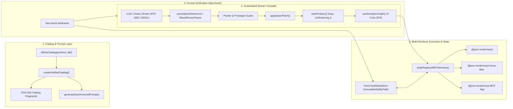
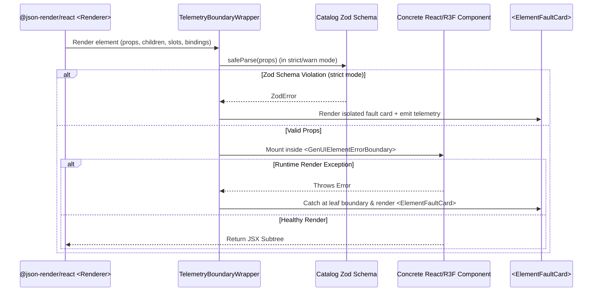

# System Design Document: `@genui-studio/core` Skeleton Engine

**Spec ID:** `core-skeleton`  
**Version:** `1.0.0`  
**Target Workspace:** `packages/genui-core` (`@genui-studio/core`)

---

## 1. High-Level Architecture

`@genui-studio/core` is designed as a zero-bloat, framework-aligned verification and runtime safety layer over `@json-render/core@0.22.0` and `@json-render/react@0.22.0`.



---

## 2. Subsystem 1: Catalog Registry & Prompt Synchronizer (`src/catalog/`)

### 2.1 Data Structures & Interfaces
```typescript
import type { Catalog, PromptOptions, SchemaDefinition } from "@json-render/core";
import type { ComponentRegistry, DefineRegistryOptions } from "@json-render/react";

export interface CatalogContractMetadata {
  /** Deterministic fingerprint of component names, prop schemas, and actions */
  readonly catalogHash: string;
  /** Registered component names sorted lexicographically */
  readonly componentNames: readonly string[];
  /** Registered custom action names sorted lexicographically */
  readonly actionNames: readonly string[];
  /** Built-in schema actions (setState, pushState, removeState, validateForm) */
  readonly builtInActionNames: readonly string[];
  /** Timestamp of contract creation */
  readonly createdAt: string;
}

export interface VerifiedCatalog<
  TDef extends SchemaDefinition = SchemaDefinition,
  TCatalog = unknown
> {
  readonly catalog: Catalog<TDef, TCatalog>;
  readonly metadata: CatalogContractMetadata;
  /** Generate system prompt with embedded safety invariants and catalog fingerprint */
  prompt(options?: PromptOptions): string;
  /** Validate a spec against both the catalog Zod schema and structural DAG invariants */
  validateFull(spec: unknown): FullSpecValidationReport;
}
```

### 2.2 Synchronization Algorithm
1. `createVerifiedCatalog(schema, catalogData)` invokes `defineCatalog(schema, catalogData)` from `@json-render/core`.
2. It serializes `catalog.jsonSchema()` and `catalog.actionNames` into a canonical JSON string and computes a deterministic FNV-1a / SHA-256 hex digest (`catalogHash`).
3. `createVerifiedRegistry(verifiedCatalog, registryOptions)` validates that every key in `verifiedCatalog.metadata.componentNames` exists in `registryOptions.components` and wraps each renderer with per-element telemetry error boundaries.

---

## 3. Subsystem 2: Guardrailed JSONL Stream Patcher & DAG Sanitizer (`src/stream/`)

### 3.1 Why Standard `validateSpec` Needs DAG Augmentation
In `@json-render/core@0.22.0`, `validateSpec(spec)` checks `missing_root`, `root_not_found`, `missing_child`, `invalid_visible`, `repeat_without_children`, `repeat_item_outside_scope`, `repeat_state_mismatch`, and misplaced `visible`/`on`/`repeat`/`watch` in `props`.
However, because `Spec.elements` is a flat lookup table (`Record<string, UIElement>`), an LLM can emit:
- **Direct Self-Cycle:** `elements["card-1"].children = ["card-1"]`
- **Mutual Cycle:** `elements["card-1"].children = ["card-2"]` and `elements["card-2"].children = ["card-1"]`
- **Slot Cycle:** `elements["layout-1"].slots.header = ["nav-1"]` and `elements["nav-1"].children = ["layout-1"]`
- **Diamond Multi-Parent Aliasing / Deep Nesting:** Exceeding call-stack limits during recursive `<Renderer>` traversal.

### 3.2 3-Color DFS Cycle Detection & Sanitization (`sanitizeSpecGraph`)
We implement an $O(V + E)$ graph verifier and deterministic sanitizer:
- **Node Colors:** `0 = UNVISITED (WHITE)`, `1 = VISITING (GRAY - on current recursion stack)`, `2 = VISITED (BLACK)`.
- Traversal begins at `spec.root` (and subsequently visits any unvisited keys in `spec.elements` to detect disconnected cyclic islands).
- For an element $u$ at depth $d$:
  1. Mark `color[u] = GRAY`.
  2. For each child key $v$ in `u.children` and each slot array `u.slots[slotName]`:
     - If `!spec.elements[v]`: record `"missing_child"` (pruned if `pruneMissingChildren === true`).
     - Else if `color[v] === GRAY`: **Cycle detected!** Record `{ code: "cyclic_reference", elementKey: u, targetKey: v, path }` and remove $v$ from $u$'s child/slot list in the sanitized clone.
     - Else if $d + 1 > \text{maxDepth}$: **Depth exceeded!** Record `{ code: "depth_limit_exceeded", elementKey: u, targetKey: v }` and prune edge $u \to v$.
     - Else if `color[v] === WHITE`: recursively traverse $v$ at depth $d + 1$.
  3. Mark `color[u] = BLACK`.

### 3.3 RFC 6902 Prototype Pollution & Unsafe URI Sanitizer
Before calling `applySpecPatch(spec, patch)`:
1. `isSafeJsonPointer(patch.path)` and (if present) `isSafeJsonPointer(patch.from)` verify that:
   - The pointer starts with `/`.
   - No path segment equals `__proto__`, `constructor`, or `prototype`.
2. Any string values inside `patch.value` matching `href`, `src`, or `url` keys are checked against `^(javascript|vbscript|data:text\/html):/i` and neutralized to `"#blocked-unsafe-uri"`.

---

## 4. Subsystem 3: Bidirectional State Store & Watch Cascade Guard (`src/state/`)

### 4.1 Architecture
Built on `@json-render/core/store-utils` (`immutableSetByPath`, `flattenToPointers`, `createStoreAdapter`), `createTimeTravelStateStore` provides a full `@json-render/core` `StateStore` with:
- **Structural Sharing:** Every `set(path, value)` or `update(records)` delegates to `immutableSetByPath(snapshot, normalizedPath, value)`.
- **Time-Travel Ring Buffer:** Stores up to `maxHistory` (default `128`) immutable snapshots `{ id, timestamp, path, prevValue, nextValue, snapshot }`. Exposes `undo()`, `redo()`, `jumpTo(index)`, and `getHistory()`.
- **Watch Cascade Circuit Breaker:** Tracks synchronous re-entrant `set()` calls within the current microtask turn. If `reentrantDepth > maxCascadeDepth` (default `10`), the store halts further synchronous mutation propagation and notifies telemetry listeners.

---

## 5. Subsystem 4: Per-Element Telemetry Error Boundary (`src/boundary/`)

### 5.1 Granular Isolation Pattern
Instead of wrapping the entire `<Renderer />` in a single top-level React Error Boundary (which wipes out the whole screen when a single leaf component fails), `wrapRegistryWithTelemetry()` wraps **each individual component renderer** in the `ComponentRegistry`:



---

## 6. Subsystem 5: Property-Based Chaos & Fuzzing Engine (`src/testing/`)

Using `fast-check@4.10.2`, `@genui-studio/core/testing` exports composable Arbitraries and an in-process verification runner (`runCatalogFuzzSuite`) that can execute both in `vitest` CLI and live inside the `apps/workbench` browser UI:
1. **`arbitraryValidSpec(catalog)`:** Generates valid DAG specs conforming to the given catalog's component schemas, `$state`/`$bindState` expressions, and `VisibilityCondition` trees.
2. **`arbitraryAdversarialSpec(catalog)`:** Injects deliberate cyclic references (`A -> B -> A`), self-loops (`A -> A`), deep chains (`depth > 25`), dangling children, misplaced `visible`/`on`/`repeat`/`watch` inside `props`, and `javascript:` XSS URIs.
3. **`arbitraryPatchStream()`:** Generates sequences of valid, out-of-order, truncated, and prototype-polluting RFC 6902 JSONL lines.
