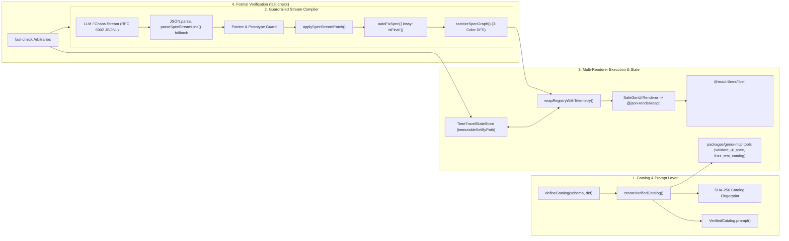
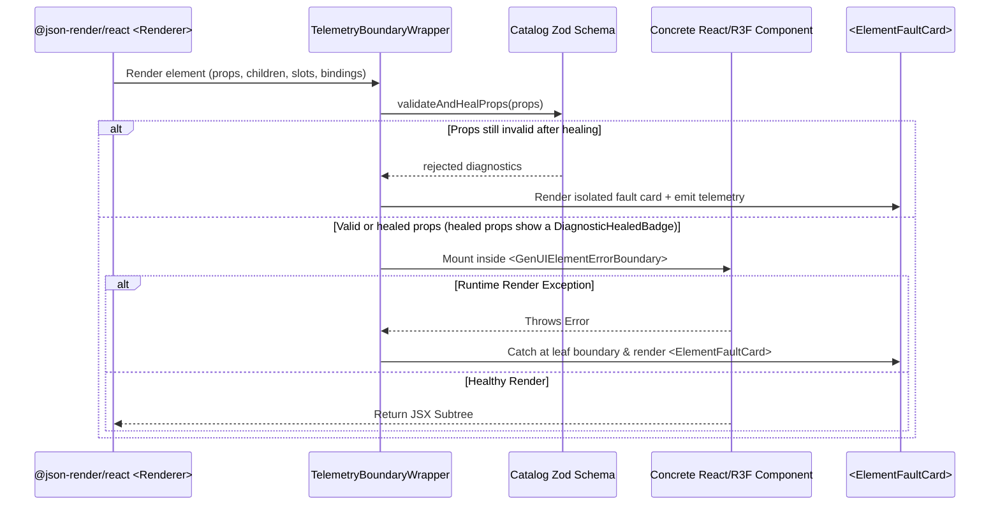

# System Design Document: `@genui-studio/core` Skeleton Engine

**Spec ID:** `core-skeleton`  
**Version:** `1.0.0`  
**Target Workspace:** `packages/genui-core` (`@genui-studio/core`)

---

## 1. High-Level Architecture

`@genui-studio/core` is designed as a zero-bloat, framework-aligned verification and runtime safety layer over `@json-render/core@0.22.0` and `@json-render/react@0.22.0`.



---

## 2. Subsystem 1: Catalog Registry & Prompt Synchronizer (`src/catalog/`)

### 2.1 Data Structures & Interfaces
```typescript
import type { Catalog, PromptOptions, SchemaDefinition } from "@json-render/core";
import type { ComponentRegistry, DefineRegistryOptions } from "@json-render/react";

export interface CatalogContractMetadata {
  /** Deterministic fingerprint of component names, prop schemas, and actions */
  readonly catalogHash: string;
  /** Registered component names sorted lexicographically */
  readonly componentNames: readonly string[];
  /** Registered custom action names sorted lexicographically */
  readonly actionNames: readonly string[];
  /** Built-in schema actions (setState, pushState, removeState, validateForm) */
  readonly builtInActionNames: readonly string[];
  /** Component name -> catalog description (hashed and audited) */
  readonly componentDescriptions: Readonly<Record<string, string>>;
  /** Deterministic contract timestamp (default "2026-01-01T00:00:00.000Z", overridable) */
  readonly createdAt: string;
}

export interface VerifiedCatalog<
  TDef extends SchemaDefinition = SchemaDefinition,
  TCatalog = unknown
> {
  readonly catalog: Catalog<TDef, TCatalog>;
  readonly metadata: CatalogContractMetadata;
  /** Generate system prompt with embedded safety invariants and catalog fingerprint */
  prompt(options?: PromptOptions): string;
  /** Zod props schema for one component */
  getComponentZodSchema(componentName: string): unknown;
  /** Validate and heal one element's props (enum fallback, URI neutralization, fallbackProps) */
  validateAndHealProps(elementKey: string, componentName: string, rawProps: Record<string, unknown>): {
    readonly ok: boolean;
    readonly props: Record<string, unknown>;
    readonly diagnostics: readonly PropDiagnostic[];
    readonly healedCount: number;
    readonly rejectedCount: number;
  };
  /** Validate a spec against both the catalog Zod schema and structural DAG invariants */
  validateFull(spec: unknown, options?: SanitizeGraphOptions): {
    readonly valid: boolean;
    readonly sanitizedSpec: Spec;
    readonly issues: readonly GraphIssue[];
    readonly propDiagnostics: readonly PropDiagnostic[];
  };
}
```

### 2.2 Synchronization Algorithm
1. `createVerifiedCatalog(schema, catalogData)` canonicalizes the key order of `catalogData` and invokes `defineCatalog(schema, canonicalData)` from `@json-render/core`.
2. It serializes the sorted component, custom action and built-in action names, the component descriptions, and `catalog.prompt({ mode: "standalone" })` into canonical JSON and computes a synchronous FIPS 180-4 SHA-256 hex digest (`catalogHash`).
3. `auditCatalogRegistryParity(verifiedCatalog, registryComponents, registryActions)` reports missing and extra components, missing descriptions, and missing action handlers. Wrapping each renderer with per-element error boundaries is a separate step: `wrapRegistryWithTelemetry(verifiedCatalog, registry, options)`.

---

## 3. Subsystem 2: Guardrailed JSONL Stream Patcher & DAG Sanitizer (`src/stream/`)

### 3.1 Why Standard `validateSpec` Needs DAG Augmentation
In `@json-render/core@0.22.0`, `validateSpec(spec)` checks `missing_root`, `root_not_found`, `missing_child`, `invalid_visible`, `repeat_without_children`, `repeat_item_outside_scope`, `repeat_state_mismatch`, and misplaced `visible`/`on`/`repeat`/`watch` in `props`.
However, because `Spec.elements` is a flat lookup table (`Record<string, UIElement>`), an LLM can emit:
- **Direct Self-Cycle:** `elements["card-1"].children = ["card-1"]`
- **Mutual Cycle:** `elements["card-1"].children = ["card-2"]` and `elements["card-2"].children = ["card-1"]`
- **Slot Cycle:** `elements["layout-1"].slots.header = ["nav-1"]` and `elements["nav-1"].children = ["layout-1"]`
- **Diamond Multi-Parent Aliasing / Deep Nesting:** Exceeding call-stack limits during recursive `<Renderer>` traversal.

### 3.2 3-Color DFS Cycle Detection & Sanitization (`sanitizeSpecGraph`)
We implement an $O(V + E)$ graph verifier and deterministic sanitizer:
- **Node Colors:** `0 = UNVISITED (WHITE)`, `1 = VISITING (GRAY - on current recursion stack)`, `2 = VISITED (BLACK)`.
- Traversal begins at `spec.root` (and subsequently visits any unvisited keys in `spec.elements` to detect disconnected cyclic islands).
- For an element $u$ at depth $d$:
  1. Mark `color[u] = GRAY`.
  2. For each child key $v$ in `u.children` and each slot array `u.slots[slotName]`:
     - If `!spec.elements[v]`: record `"missing_child"` (pruned if `pruneMissingChildren === true`).
     - Else if `color[v] === GRAY`: **Cycle detected!** Record `{ code: "cyclic_reference", elementKey: u, targetKey: v, path }` and remove $v$ from $u$'s child/slot list in the sanitized clone.
     - Else if $d + 1 > \text{maxDepth}$: **Depth exceeded!** Record `{ code: "depth_limit_exceeded", elementKey: u, targetKey: v }` and prune edge $u \to v$.
     - Else if $v$ is already mounted (repeated sibling or second parent): record `"duplicate_child_key"` and drop the edge, so every element has at most one parent.
     - Else mount $v$ and, if `color[v] === WHITE`, recursively traverse it at depth $d + 1$.
  3. Mark `color[u] = BLACK`.

### 3.3 RFC 6902 Prototype Pollution & Unsafe URI Sanitizer
Before calling `applySpecStreamPatch(state, patch)`:
1. `isSafeJsonPointer(patch.path)` and (if present) `isSafeJsonPointer(patch.from)` verify that:
   - The pointer starts with `/` (or is the root pointer `""`).
   - No path segment (raw or `~0`/`~1`-decoded) equals `__proto__`, `constructor`, or `prototype`.
2. Every string value inside `patch.value`, under any key, is checked against `/^\s*(javascript|vbscript|data\s*:\s*text\/html)\s*:/i` and replaced with `"#blocked-unsafe-uri"` (`deepCloneAndSanitizeValue`).

---

## 4. Subsystem 3: Bidirectional State Store & Watch Cascade Guard (`src/state/`)

### 4.1 Architecture
Built on `@json-render/core` `getByPath` and `@json-render/core/store-utils` (`immutableSetByPath`; `flattenToPointers` is re-exported), `createTimeTravelStateStore` provides a full `@json-render/core` `StateStore` with:
- **Structural Sharing:** Every `set(path, value)` or `update(records)` delegates to `immutableSetByPath(snapshot, normalizedPath, value)`.
- **Time-Travel Ring Buffer:** Stores up to `maxHistory` (default `128`) immutable snapshots `{ index, timestamp, label, changedPaths, snapshot }`. Exposes `undo()`, `redo()`, `jumpToSnapshot(index)`, and `getHistory()`.
- **Watch Cascade Circuit Breaker:** Counts nested synchronous listener notifications. When a `set()` or `update()` arrives while that depth is `>= maxCascadeDepth` (default `10`), the write is dropped, `getCascadeTripCount()` increments, and the optional `onCascadeTrip(depth, path)` callback fires.

---

## 5. Subsystem 4: Per-Element Telemetry Error Boundary (`src/boundary/`)

### 5.1 Granular Isolation Pattern
Instead of wrapping the entire `<Renderer />` in a single top-level React Error Boundary (which wipes out the whole screen when a single leaf component fails), `wrapRegistryWithTelemetry()` wraps **each individual component renderer** in the `ComponentRegistry`:



---

## 6. Subsystem 5: Property-Based Chaos & Fuzzing Engine (`src/testing/`)

Using `fast-check@4.10.2`, `@genui-studio/core/testing` exports composable Arbitraries and an in-process verification runner (`runCatalogInvariantSuite`, theorems `INV-PBT-01`..`04`, default `numRuns` 50) that runs in `vitest`, in the MCP `fuzz_test_catalog` tool, and live in the browser X-Ray drawers (`apps/spatial-ops/src/components/SpatialXRayDrawer.tsx`, `apps/studio-hub/src/components/TemplateXRayDrawer.tsx`):
1. **`catalogToSpecArbitrary(catalog, options)`:** Generates valid DAG specs whose element props are drawn from each component's Zod schema (`zodTypeToArbitrary`, `catalogToElementArbitrary`).
2. **`arbitraryAdversarialSpec(catalog)`:** Takes a valid spec and applies one of nine corruptions: self cycle, mutual cycle, slot cycle, duplicate children, diamond aliasing, non-finite numbers (`NaN`, `±Infinity`, `-0`), `javascript:` URIs, `visible`/`on` misplaced inside `props`, or an unknown component with a dangling child.
3. **`arbitraryCorruptedJsonlStream()`:** Generates JSONL streams mixing valid patches with prototype-polluting paths, invalid ops, `javascript:` props, self-referencing children, and truncated JSON.
