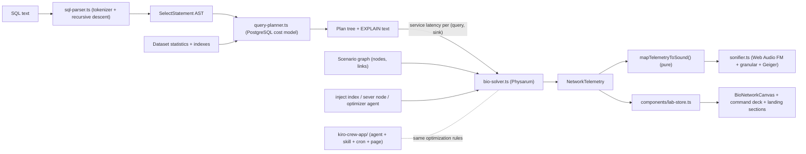

# Design: CHIMERA // LAB (`packages/templates/src/neuro-chimera-synth`)

## 1. Architecture


## 2. Modules
| File | Responsibility |
| --- | --- |
| `lib/chimera/sql-parser.ts` | Tokenizer, recursive-descent SELECT parser, AST types, `printSql`, `SqlParseError` |
| `lib/chimera/query-planner.ts` | Statistics types, selectivity, access-path choice, join planning, sort/aggregate/limit, `explainPlan`, index advice |
| `lib/chimera/bio-solver.ts` | Graph model, Physarum step (per-query Cholesky solve), telemetry, interventions, Optimizer Agent |
| `lib/chimera/scenarios.ts` | Seven scenario definitions (graphs, datasets, queries) |
| `lib/chimera/benchmarks.ts` | Per-scenario before/after figures for the landing page |
| `lib/chimera/compare.ts`, `ast-outline.ts` | SQL deck: before/after plan comparison and parse-tree outline |
| `lib/chimera/cron.ts` | Next-run preview for 5-field cron expressions |
| `lib/chimera/crew-manifest.ts` | Zod schema and install-time rule checks for Kiro Crew `app.json` |
| `lib/chimera/crew-bundle.ts`, `crew-app-files.ts` | Embedded Kiro Crew app (generated by `scripts/embed-crew-app.mjs`), validation and zip |
| `lib/chimera/sonifier.ts` | Pure telemetry→sound mapping, predicted FM partials, and the Web Audio engine |
| `components/` | Lab store, shell, canvas, command deck, landing sections and chemotaxis packets (§9) |
| `kiro-crew-app/` | Installable Kiro Crew app: `app.json`, three agents, skill, dashboard page source, lifecycle hooks |

## 3. SQL subset
```
select     := SELECT [DISTINCT] item {, item} FROM tableRef {join} [WHERE expr]
              [GROUP BY expr {, expr}] [ORDER BY orderItem {, orderItem}] [LIMIT int]
item       := * | ident.* | expr [[AS] ident]
tableRef   := ident [[AS] ident]
join       := [INNER | LEFT [OUTER]] JOIN tableRef ON expr
expr       := or ; or := and {OR and} ; and := not {AND not} ; not := NOT not | predicate
predicate  := additive [cmp additive | [NOT] IN (list) | cmp ANY (expr) | [NOT] BETWEEN a AND b
              | [NOT] LIKE additive | IS [NOT] NULL]
additive   := primary {(<-> | <=> | <#> | + | -) primary}
primary    := literal | param | ident[.ident] | ident(args) | COUNT(*) | ( expr )
```
Limits are 8 KB of SQL, 2,000 tokens and 64 levels of nesting. Identifiers are lower-cased unless double-quoted. The printer emits canonical upper-case keywords, so `parse(print(ast))` equals `ast`.

## 4. Planner model
| Constant | Value |
| --- | --- |
| `seq_page_cost` | 1.0 |
| `random_page_cost` | 4.0 |
| `cpu_tuple_cost` | 0.01 |
| `cpu_index_tuple_cost` | 0.005 |
| `cpu_operator_cost` | 0.0025 |

- **Selectivity** (PostgreSQL defaults from `selfuncs.h`):
  - equality: `1 / n_distinct`, default 0.005
  - one-sided range: 1/3
  - `BETWEEN`, or a lower and upper bound on the same column: 0.005 (`DEFAULT_RANGE_INEQ_SEL`)
  - `LIKE`: 0.005. B-tree indexes are not used for `LIKE`, because the default collation needs `text_pattern_ops`.
  - `IS NULL`: `null_frac`, default 0.005
  - `IN (k items)` / `= ANY` batch of k: `k / n_distinct`
  - `AND` multiplies; `OR` is `a + b − ab`
- **Seq Scan:** `pages × 1 + rows × (0.01 + quals × 0.0025)`.
- **Index Scan:**
  - Cost: a descent of `(⌈log₂ rows⌉ + 50 × (height + 1)) × 0.0025`, then `matched × (0.005 + quals × 0.0025) + min(matched, pages) × 4 + matched × 0.01`.
  - It is usable when predicates hit the leading columns (equalities, then at most one range column), or when the index yields the ORDER BY order after the equality prefix (forward or backward).
  - Single-table queries compare paths after Sort and Limit, so an ordered index can win through early termination.
- **HNSW scan:**
  - Requires a `LIMIT` and a matching operator class.
  - Visits are `40 × ⌈log₂ rows⌉` (ef_search 40), with startup cost `visits × 0.05` and `max(k, 40)` heap fetches.
  - Without the index, every row pays `0.05` for its distance computation in a top-N sort.
- **Joins:** left-deep in written order.
  - A Nested Loop with an inner Index Scan is used when the inner table has an index on the join column.
  - Otherwise a Hash Join is used, with inner build cost `rows × (0.01 + 0.0025)`.
  - Output rows are `outer × inner / max(nd_outer, nd_inner)`.
- **Sort:** `2 × n log₂ n × 0.0025`. It is skipped when an index scan already yields the order.
- **Limit:** scales the child's run cost by `limit / rows`.
- **Latency estimate:** `totalCost × 0.01 ms + 0.25 ms` round trip. This is a calibration constant, not a measurement.
- **Index advice:** for each full scan, recommend `CREATE INDEX CONCURRENTLY idx_<table>_<cols>`.
  - Column order: equality columns (most selective first), then the ORDER BY columns when the query has a `LIMIT`, otherwise the range column.
  - Join inner sides get an index on the join key. Distance ordering gets `USING hnsw (col <opclass>)`.
  - A recommendation is kept only if re-planning with it lowers total cost by more than 5%.

## 5. Physarum model
For each query *q* with source *s* and call rate *λ*:
```
Σⱼ (Dᵢⱼ / Lᵢⱼ)(pᵢ − pⱼ) + Gᵩᵢ · pᵢ = bᵢ      b_s = 1, other bᵢ = 0
Gᵩᵢ = 1 / Rᵩᵢ for candidate sinks of q,  Rᵩᵢ = serviceLatency(q, i) / (1 − ρᵢ)
Qᵢⱼ = (Dᵢⱼ / Lᵢⱼ)(pᵢ − pⱼ),   sink share of i = Gᵩᵢ · pᵢ
```
- The matrix is symmetric positive definite on the component reachable from the source when it contains a grounded sink.
  - It is solved exactly by dense Cholesky. Sink conductances span six orders of magnitude (a 0.3 ms index lookup vs. a 30 s scan), and an iterative solver converges poorly at that range.
  - Shipped scenarios step in 0.07–1 ms. At the bounds (64 nodes, 256 links, 32 queries) one step measured a median of 10.6 ms and p95 of 13.7 ms (Node 24, 2026-11-17 one-off benchmark; no committed timing test).
- Nodes off that component are excluded. A query fails if none of its live sinks is reachable.
- **Statement timeout:** statements slower than 30 s (PostgreSQL `statement_timeout`) are reported as timed out and capped at 30 s. Timed-out statements do not count as completed.
- **Link update:** `|Q|ᵢⱼ = Σ_q w_q |Qᵢⱼ^q|`, where `w_q` is the query's share of total call rate. Then `D' = (D + dt · f(G·|Q|)) / (1 + dt)` with `f(x) = xᵘ/(1+xᵘ)`, G = `FLUX_GAIN` = 4, μ = 1.8, dt = 0.25 and D ≥ 1e-4.
- **Latency:** flow-weighted latency is `Σ_links |Q^q| · L + Σ_sinks share · R`. Potential flow has no cycles, so this equals the mean path latency under flow decomposition.
- **Load:** `ρᵢ = Σ_q share · λ_q · cost_q / capacityᵢ`. It is computed from the previous step, which keeps the iteration explicit and deterministic.
- **Entropy:** the Shannon entropy of the outgoing flux split at each node with more than one outgoing link, normalised by `log(degree)` and averaged with flux weights.
- **Synapse firing:** `Σ |D' − D|` per step.
- **Health:**
  - completed share × (1 − saturation share)
  - minus a full-scan penalty of `min(0.5, fullScanCallShare)`
  - minus a latency penalty of `min(0.3, worst / 2000 ms)`
  - clamped to 0–1

## 6. Optimizer Agent (deterministic)
1. Collect index recommendations for every query on every live sink. Score each by `(costBefore − costAfter) × callRate`.
2. Apply the top three by score, without duplicates.
3. For each query with `perRequestCalls > 1` and a batchable `col = $n` predicate, rewrite the predicate to `col = ANY($n)` through the AST.
   - Add `col` to the select list (and to GROUP BY for aggregates) so each row maps back to its item.
   - Set calls to 1 per request with a batch size of `perRequestCalls`.
   - Queries with LIMIT, OFFSET or DISTINCT are not batched, because that would change results.
4. Return an ordered action log: kind, target, SQL, cost before and after.

## 7. Sonification mapping
| Telemetry | Sound |
| --- | --- |
| health | FM ratio 2.0 (harmonic) → 1.414 (inharmonic); partial detune 0 → 35 cents |
| entropy | FM modulation index 0.5 → 6 |
| flux | low-pass cutoff 300 Hz → 4.5 kHz |
| synapse firing | grain density 2 → 40 grains/s |
| full-scan rate | Geiger rate, `min(MAX_GEIGER_RATE, rate)` |
| worst latency | drone root pitch bend of up to −1 semitone |
| root control | 40–440 Hz; voices at 1×, 1.5× (health ≥ 0.6), 4/3× (health ≥ 0.3) or √2 ≈ 1.414× (below 0.3), and 2× |

Audio graph: `voices + grains + clicks → bus → AnalyserNode → master gain (mute/volume) → DynamicsCompressor → destination`. One 25 ms scheduler interval plans grains and clicks 120 ms ahead on the `AudioContext` clock.

## 8. Kiro Crew app
```
kiro-crew-app/
├── app.json                     manifest (App Kit reference)
├── README.md                    install, configure, trust
├── agents/chimera-architect.json
├── agents/index-surgeon.json
├── agents/deadlock-hunter.json
├── skills/bio-query-optimizer/SKILL.md
├── backend/__init__.py
├── backend/hooks.py             on_startup / on_shutdown (documented ctx API only)
└── ui/                          dashboard page source, built to ../dist/index.mjs
    ├── package.json, vite.config.mjs, tsconfig.json
    └── src/App.tsx, src/kirocrew-app-sdk.d.ts (local type subset)
```
- The cron `chimera-bottleneck-audit` (`0 */6 * * *`) ships paused until the user sets the project path and database URL variable in the app config.
- Only lifecycle hooks are declared. The in-process `routes` hook registry API is not covered by the public docs this was built against.
- Three agents ship: `chimera-architect` (`0 */6 * * *`), `index-surgeon` (`0 3 * * *`) and `deadlock-hunter` (`*/30 * * * *`). All crons are paused.

## 9. Interactive lab
- **State:** `components/lab-store.ts` is a zustand vanilla store plus the live `PhysarumNetwork`. Every intervention (sever, revive, drag, index, batch, SQL edit, agent dispatch, chemotaxis packet) records an activity entry with a content-hash checkpoint and before/after latency and cost.
- **Shell:** `ChimeraLabShell` owns the mode switch (`[MODE: CHIMERA LAB WORKBENCH]` / `[MODE: AI RESEARCH SAAS LANDING PAGE]`), the scenario picker and the solver timer. `stepSchedule(stepHz)` keeps the interval at 100 ms or more and runs up to 2 steps per tick, so the store publishes at most 10 times per second. The timer skips ticks while `document.hidden`.
- **Canvas:** `BioNetworkCanvas` draws on one 2D canvas from typed arrays that a store subscription fills, so the frame loop allocates nothing. Fault nodes pulse at 1.5 Hz (none under reduced motion). Click opens actions (sever/revive, inject index, dispatch an agent); drag calls `moveNode`.
- **Agents in the lab:** dispatching moves an amber worker sprite from the gateway to the target, and the change applies at once: `chimera-architect` runs `runOptimizerAgent`, `index-surgeon` adds the best index for the target's dataset, `deadlock-hunter` batches N+1 loops and reports timeouts and saturated nodes. The night-shift preset dispatches them in that reverse order, 1 s apart.
- **SQL deck:** `compareQuery` plans the query on its dominant sink as-is (BEFORE) and with every recommended index plus N+1 batching (AFTER). Labels show the deciding scan type and per-request planner time. The planner models Seq Scan and Index Scan, not Index Only Scan.
- **Sonification HUD:** draws the analyser FFT on a log axis with `predictPartials` (carrier ± n·modulator at `level·|J_n(index)|`) overlaid, and prints a text equivalent of every audio cue.
- **Landing mode:** hero with live figures, the benchmark matrix (rows load the scenario into the live canvas), an architecture bento grid and example pricing tiers.
- **Catalog and chaos:** `ChemotaxisPacket` carries a pulse and an optional SQL payload. The corrupted preset streams `chaos-a → chaos-b → chaos-a` with strengths `null` and `1e308`, unknown nodes and a recursive CTE. The core severs the cycle and heals strength to 0 and 1; the store then quarantines each invalid part and leaves the network unchanged.
- **Export:** the shared bundler skips `.py`, so `index.ts` appends `CREW_PYTHON_SOURCE_FILES` to the template's source files.
