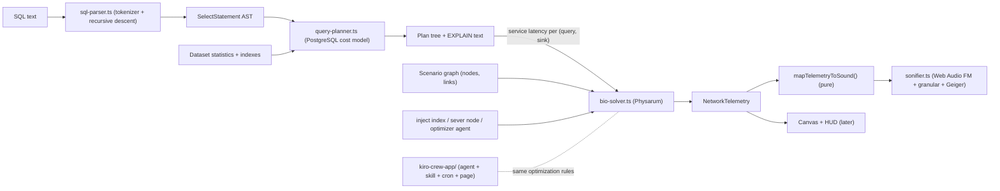

# Design: CHIMERA // LAB (`packages/templates/src/neuro-chimera-synth`)

## 1. Architecture


## 2. Modules
| File | Responsibility |
| --- | --- |
| `lib/chimera/sql-parser.ts` | Tokenizer, recursive-descent SELECT parser, AST types, `printSql`, `SqlParseError` |
| `lib/chimera/query-planner.ts` | Statistics types, selectivity, access-path choice, join planning, sort/aggregate/limit, `explainPlan`, index advice |
| `lib/chimera/bio-solver.ts` | Graph model, Physarum step (per-query PCG solve), telemetry, interventions, Optimizer Agent |
| `lib/chimera/scenarios.ts` | Six scenario definitions (graphs, datasets, queries) |
| `lib/chimera/crew-manifest.ts` | Zod schema and install-time rule checks for Kiro Crew `app.json` |
| `lib/chimera/sonifier.ts` | Pure telemetry→sound mapping plus the Web Audio engine |
| `kiro-crew-app/` | Installable Kiro Crew app: `app.json`, agent, skill, dashboard page source, lifecycle hooks |

## 3. SQL subset
```
select     := SELECT [DISTINCT] item {, item} FROM tableRef {join} [WHERE expr]
              [GROUP BY expr {, expr}] [ORDER BY orderItem {, orderItem}] [LIMIT int]
item       := * | ident.* | expr [[AS] ident]
tableRef   := ident [[AS] ident]
join       := [INNER | LEFT [OUTER]] JOIN tableRef ON expr
expr       := or ; or := and {OR and} ; and := not {AND not} ; not := NOT not | predicate
predicate  := additive [cmp additive | [NOT] IN (list) | cmp ANY (expr) | [NOT] BETWEEN a AND b
              | [NOT] LIKE additive | IS [NOT] NULL]
additive   := primary {(<-> | <=> | <#> | + | -) primary}
primary    := literal | param | ident[.ident] | ident(args) | COUNT(*) | ( expr )
```
Limits are 8 KB of SQL, 2,000 tokens and 64 levels of nesting. Identifiers are lower-cased unless double-quoted. The printer emits canonical upper-case keywords, so `parse(print(ast))` equals `ast`.

## 4. Planner model
| Constant | Value |
| --- | --- |
| `seq_page_cost` | 1.0 |
| `random_page_cost` | 4.0 |
| `cpu_tuple_cost` | 0.01 |
| `cpu_index_tuple_cost` | 0.005 |
| `cpu_operator_cost` | 0.0025 |

- **Selectivity:**
  - equality: `1 / n_distinct`, default 0.005
  - range: 1/3; `BETWEEN`: 1/9 (two ranges)
  - `LIKE 'prefix%'`: 0.02, other `LIKE`: 0.005
  - `IS NULL`: `null_frac`, default 0.005
  - `IN (k items)` / `= ANY` batch of k: `k / n_distinct`
  - `AND` multiplies; `OR` is `a + b − ab`
- **Seq Scan:** `pages × 1 + rows × (0.01 + quals × 0.0025)`.
- **Index Scan:** a descent of `⌈log₂ rows⌉ × 50 × 0.0025`, then `matched × (0.005 + 0.01) + min(matched, pages) × 4`. It is chosen only if a predicate hits the leading index column and it is cheaper than the seq scan.
- **Joins:** left-deep in written order.
  - A Nested Loop with an inner Index Scan is used when the inner table has an index on the join column.
  - Otherwise a Hash Join is used, with inner build cost `rows × (0.01 + 0.0025)`.
  - Output rows are `outer × inner / max(nd_outer, nd_inner)`.
- **Sort:** `2 × n log₂ n × 0.0025`. It is skipped when an index scan already yields the order.
- **Limit:** scales the child's run cost by `limit / rows`.
- **Latency estimate:** `totalCost × 0.01 ms + 0.25 ms` round trip. This is a calibration constant, not a measurement.
- **Index advice:** for each scan with predicates and no usable index, recommend `CREATE INDEX CONCURRENTLY idx_<table>_<cols> ON <table> (eq cols by selectivity, range col, sort col)`.

## 5. Physarum model
For each query *q* with source *s* and call rate *λ*:
```
Σⱼ (Dᵢⱼ / Lᵢⱼ)(pᵢ − pⱼ) + Gᵩᵢ · pᵢ = bᵢ      b_s = 1, other bᵢ = 0
Gᵩᵢ = 1 / Rᵩᵢ for candidate sinks of q,  Rᵩᵢ = serviceLatency(q, i) / (1 − ρᵢ)
Qᵢⱼ = (Dᵢⱼ / Lᵢⱼ)(pᵢ − pⱼ),   sink share of i = Gᵩᵢ · pᵢ
```
- The matrix is symmetric positive definite on the component that touches a grounded sink, so it is solved with Jacobi-preconditioned conjugate gradient (tolerance 1e-10, at most 4N iterations).
- Nodes off that component are excluded. A source off that component makes the query fail.
- **Link update:** `|Q|ᵢⱼ = Σ_q w_q |Qᵢⱼ^q|`, where `w_q` is the query's share of total call rate. Then `D' = (D + dt · |Q|ᵘ/(1+|Q|ᵘ)) / (1 + dt)` with μ = 1.8, dt = 0.25 and D ≥ 1e-4.
- **Latency:** flow-weighted latency is `Σ_links |Q^q| · L + Σ_sinks share · R`. Potential flow has no cycles, so this equals the mean path latency under flow decomposition.
- **Load:** `ρᵢ = Σ_q share · λ_q · cost_q / capacityᵢ`. It is computed from the previous step, which keeps the iteration explicit and deterministic.
- **Entropy:** the Shannon entropy of the outgoing flux split at each node with more than one outgoing link, normalised by `log(degree)` and averaged with flux weights.
- **Synapse firing:** `Σ |D' − D|` per step.
- **Health:**
  - completed share × (1 − saturation share)
  - minus a full-scan penalty of `min(0.5, fullScanCallShare)`
  - minus a latency penalty of `min(0.3, worst / 2000 ms)`
  - clamped to 0–1

## 6. Optimizer Agent (deterministic)
1. Collect index recommendations for every query on every live sink. Score each by `(costBefore − costAfter) × callRate`.
2. Apply the top three by score, without duplicates.
3. For each query with `perRequestCalls > 1` and a batchable `col = $n` predicate, rewrite the predicate to `col = ANY($n)` through the AST. Set calls to 1 per request with a batch size of `perRequestCalls`.
4. Return an ordered action log: kind, target, SQL, cost before and after.

## 7. Sonification mapping
| Telemetry | Sound |
| --- | --- |
| health | FM ratio 2.0 (harmonic) → 1.414 (inharmonic); partial detune 0 → 35 cents |
| entropy | FM modulation index 0.5 → 6 |
| flux | low-pass cutoff 300 Hz → 4.5 kHz |
| synapse firing | grain density 2 → 40 grains/s |
| full-scan rate | Geiger rate, `min(MAX_GEIGER_RATE, rate)` |
| worst latency | drone root pitch bend of up to −1 semitone |
| root control | 40–440 Hz; voices at 1×, 1.5× (healthy) or 1.414× (unhealthy), and 2× |

Audio graph: `voices + grains + clicks → bus → AnalyserNode → master gain (mute/volume) → DynamicsCompressor → destination`. One 25 ms scheduler interval plans grains and clicks 120 ms ahead on the `AudioContext` clock.

## 8. Kiro Crew app
```
kiro-crew-app/
├── app.json                     manifest (App Kit reference)
├── README.md                    install, configure, trust
├── agents/chimera-architect.json
├── skills/bio-query-optimizer/SKILL.md
├── backend/__init__.py
├── backend/hooks.py             on_startup / on_shutdown (documented ctx API only)
└── ui/                          dashboard page source, built to ../dist/index.mjs
    ├── package.json, vite.config.mjs, tsconfig.json
    └── src/App.tsx, src/kirocrew-app-sdk.d.ts (local type subset)
```
- The cron `chimera-bottleneck-audit` (`0 */6 * * *`) ships paused until the user sets the project path and database URL variable in the app config.
- Only lifecycle hooks are declared. The in-process `routes` hook registry API is not covered by the public docs this was built against.
