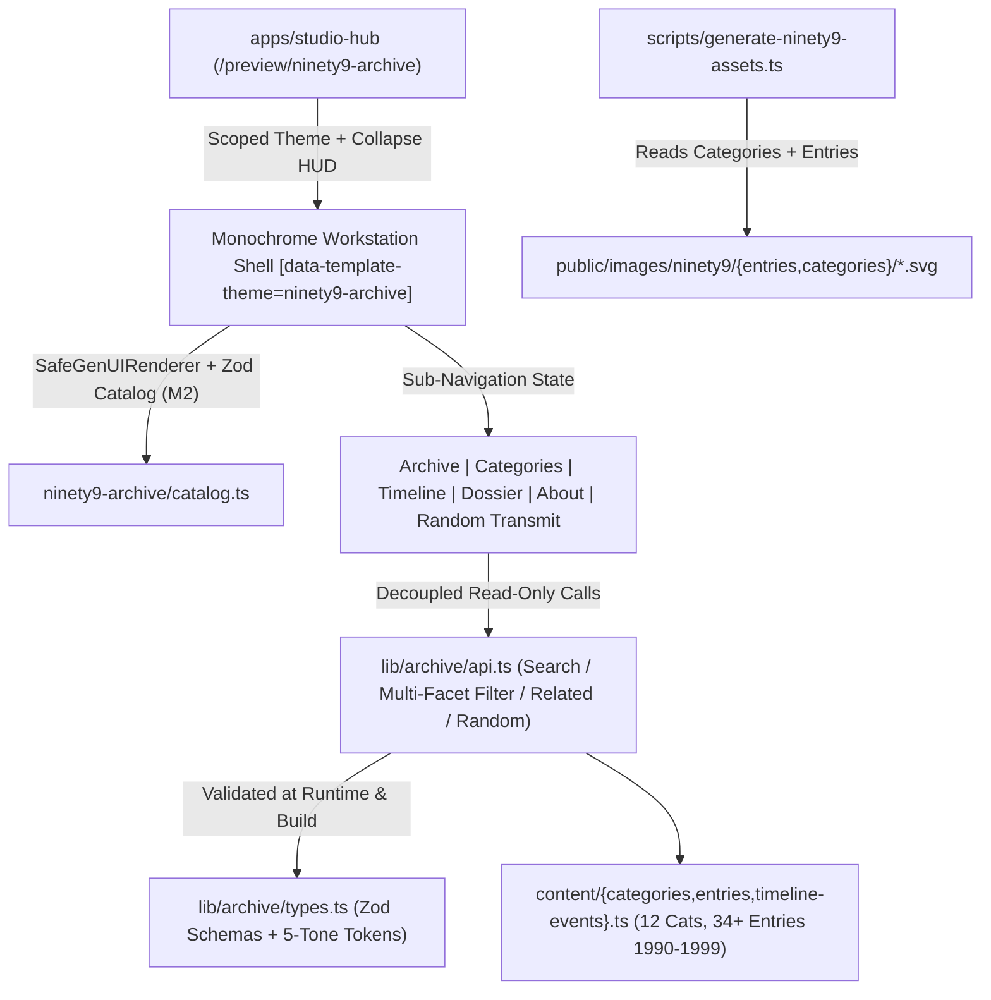

# Design Document: NINETY9 Archive (`packages/templates/src/ninety9-archive`)

## 1. System Architecture Diagram

---

## 2. Module Layout & Milestone Boundaries

### Milestone 1 (Current Phase — Data, Schemas, Query Engine & SVG Assets)
- `packages/templates/src/ninety9-archive/lib/archive/types.ts` — Strict Zod schemas (`ArchiveEntrySchema`, `CategoryManifestSchema`, `TimelineMilestoneSchema`, `ArchiveQueryFilterSchema`, `CRTModeSchema`), palette constant `MONOCHROME_PALETTE`, and TypeScript inferred types.
- `packages/templates/src/ninety9-archive/content/categories.ts` — All 12 numbered cultural categories (`01 — MUSIC` .. `12 — POP CULTURE`) with deep historical essays and decade shift notes.
- `packages/templates/src/ninety9-archive/content/entries.ts` — 34 thoroughly researched editorial entries covering every year `1990–1999`, each with multi-section copy (`01 // ...`, `02 // ...`), 4-cell technical specs, pull quotes, Cultural Impact, Enduring Historical Legacy, verified citations, and motif assignments.
- `packages/templates/src/ninety9-archive/content/timeline-events.ts` — Chronological milestones across `1990–1999` cross-linked to primary dossiers.
- `packages/templates/src/ninety9-archive/lib/archive/api.ts` — Pure TypeScript search, multi-facet filter (`year`, `category`, `type`, `tag`, `sort`), related dossier resolver, category aggregator, and `transmitRandomPacket()` engine.
- `scripts/generate-ninety9-assets.ts` — Node.js script generating 46 bespoke 5-tone monochrome technical SVGs (`34` entries + `12` categories) under `public/images/ninety9/` with built-in hex allowlist auditing.
- `packages/templates/src/__tests__/ninety9-archive.m1.test.ts` — Full Milestone 1 Zod, coverage, historical integrity, API query/fuzzy search, and SVG asset verification suite.

### Milestone 2 (Pending M1 Sign-Off — Monochrome CSS, Workstation Components & Sub-Router)
- `packages/templates/src/ninety9-archive/theme.css` — Scoped `[data-template-theme="ninety9-archive"]` CSS variables (`--n99-white: #FFFFFF`, `--n99-black: #000000`, `--n99-light: #D9D9D9`, `--n99-mid: #808080`, `--n99-dark: #292929`), CSS halftone patterns, brutalist shadows, and Paper-White CRT scanlines (`SUBTLE` / `ACTIVE` / `OFF`).
- `packages/templates/src/ninety9-archive/components/` — Workstation top menu bar, collapsible directory tree / view switcher (`Archive`, `Categories`, `Timeline`, `Dossiers`, `About`, `Random Transmit`), CRT scanline toggle persisted in `localStorage`, full-bleed technical schematics viewer, and monochrome Studio corner pill (`[ALT+G] GENUI STUDIO // EXPORT ARCHIVE`).

### Milestone 3 (Pending M2 Sign-Off — `@genui-studio/core` Catalog, Live Remix & PBT Suite)
- `packages/templates/src/ninety9-archive/catalog.ts`, `manifest.json`, `steering.md`, `index.ts` — Full `@genui-studio/core` Zod catalog integration, live monochrome remix synthesizer, `fast-check` PBT tests, and standalone Next.js `.zip` export packaging.

---

## 3. Monochrome Design Token Contract
| Token | Hex Value | Usage |
| :--- | :--- | :--- |
| `pureWhite` | `#FFFFFF` | Paper-white workstation canvas, SVG field ground, table cards |
| `pureBlack` | `#000000` | Primary typography, `1px`/`2px` rules, hard offset shadows, technical linework |
| `lightGray` | `#D9D9D9` | Halftone dot screen fill, inset specification cell wells, striped rows |
| `mediumGray` | `#808080` | Secondary indices, serial sub-labels, subtle grid hairlines |
| `darkGray` | `#292929` | Body editorial copy, active inverse panels, deep halftone hatching |

---

## 4. Technical SVG Illustration Motif Grammar
Each entry and category maps to a deterministic `MotifKind` rendered by `scripts/generate-ninety9-assets.ts` on an `800 x 500` drafting plate:
- `optical-disc` — Compact Disc / MiniDisc concentric tracks, laser pickup sled, jewel-case hinge geometry
- `cinema-frame` — 35mm theatrical matte gauge, sprouting sprockets, widescreen 2.39:1 crosshair
- `crt-oscilloscope` — Scanline grid, phosphor sine modulation wave, BNC dial readouts
- `cel-grid` — 3-hole Acme animation pegbar, Dark Deco halftone lighting planes, aspect framing
- `controller-pcb` — Dual-axis directional pad cross, PCB trace bus, polygon wireframe cube
- `workstation-mac` — Classic CRT front bezel, optical drive slot, isometric Bondi silhouette hatch
- `silicon-chip` — 40-pin IC footprint grid, stylus Pocket PDA trace, binary bus address labels
- `browser-window` — NCSA / Navigator Netscape titlebar, scrollbar rail, inline bitmap frame wireframe
- `runway-monolith` — Swiss architectural garment pattern block, tailor darts, minimal grid coordinates
- `rave-speaker` — Horn-loaded bass bin array, TB-303 step sequencer matrix, warehouse strobe lattice
- `toy-lcd` — 16x16 pixel bitmap egg / beanie stitching pattern, keychain keyring bezel
- `arena-court` — Hardwood key geometry, parabolic shot arc vectors, championship scoreboard ticks
- `network-topology` — Y2K epoch rollover clock `1999->2000`, optical backbone graph, distributed nodes
