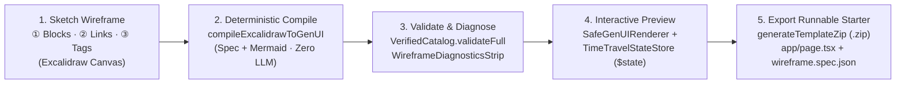

# Product Steering: GenUI Studio — The Excalidraw-to-GenUI Workbench

## 1. Product Identity & One-Sentence Promise

> **Product Promise:** **GenUI Studio is an Excalidraw-to-GenUI Workbench: turn a wireframe into a validated, interactive UI preview—and export a usable React starter.**

- **Primary User:** Frontend engineers, product designers, and coding agents who want to sketch a wireframe, compile it deterministically into a validated `@json-render` `Spec`, inspect actionable validation and prop-healing diagnostics in a live preview, and export a runnable Next.js/React starter project.
- **First-Success User Journey ("The Hard Test"):**
  1. **Sketch:** Open the sample wireframe (`/preview/spatial-mesh-starter?wireframe=sample`) or draw **① Catalog Blocks**, **② Directed Interaction Links (`arrow`)**, and **③ Tags (`customData.catalogComponent`)** in Excalidraw.
  2. **Compile:** Run `compileExcalidrawToGenUI` (`apps/studio-hub/src/lib/excalidraw-compiler.ts`) to deterministically produce a GenUI `Spec` + `.kiro/specs/<slug>/design.md` Mermaid diagram (with zero LLM or network calls inside `compileExcalidrawToGenUI`).
  3. **Validate & Diagnose:** Inspect `<WireframeDiagnosticsStrip />` (`apps/studio-hub/src/components/WireframeDiagnosticsStrip.tsx`) for unknown component tags, clamped out-of-range props, blocked unsafe URIs, and rejected schema fields.
  4. **Preview:** Interact with the live React preview rendered through `<SafeGenUIRenderer>` (supporting hook-using components across SSR and client DOM, `<DiagnosticHealedBadge />`, and `<ElementFaultCard />`) over `TimeTravelStateStore` with live `$state` arrow bindings.
  5. **Export:** Export a runnable Next.js starter `.zip` (`generateTemplateZip(template, { wireframe })`) containing `src/template/wireframe.spec.json`, `app/page.tsx`, `src/template/catalog.ts`, `wireframe/<slug>.excalidraw.json`, and `.kiro/specs/<slug>/design.md`.

---

## 2. Core Architecture: The Workbench & Its Engine

### A. The Product Front Door: Excalidraw-to-GenUI Workbench (`apps/studio-hub`, `:5175`)
- **Hero Onboarding (`MarketplacePage.tsx`):** Foregrounds the 5-step **Sketch → Compile → Validate → Preview → Export** workflow with a 1-click **"Open Sample Wireframe in Workbench"** button (`data-testid="hero-open-sample-wireframe"` → `/preview/spatial-mesh-starter?wireframe=sample`).
- **Deterministic Spatial Compiler (`excalidraw-compiler.ts`):** Maps drawn shapes, bound text, containment frames (`>= 0.75` overlap), and arrows into a DAG-sanitized `Spec`, sorted top-to-bottom / left-to-right by `(minY, minX)` with UTF-16 code-point tie-breaking (`compareCodePoints`).
- **Actionable Diagnostics (`WireframeDiagnosticsStrip.tsx`):** Surfaces resolved block mappings (`shape → specKey → ComponentType`), `$state` arrow bindings, compiler warnings, prop-healing diagnostics, and schema/graph errors.
- **Runnable Starter Export (`wireframe-export.ts` & `packages/templates/src/exporter.ts`):** Embeds the user's live compiled wireframe `Spec` (`src/template/wireframe.spec.json`), Excalidraw scene (`wireframe/<slug>.excalidraw.json`), and `.kiro/specs/<slug>/design.md` Mermaid diagram into a runnable Next.js project archive.

### B. The Verification Engine (`packages/genui-core`, `packages/genui-cli`, `packages/genui-mcp`)
Built on Vercel's `@json-render/core` and `@json-render/react` (`v0.22.0`):
- **Catalog Contract & Prompt Synchronizer (`createVerifiedCatalog`):** Enforces 1:1 parity between `defineCatalog()` Zod schemas, `defineRegistry()` React component mappings, and deterministic `catalog.prompt()` generation with SHA-256 fingerprinting (`catalogHash`).
- **DAG Sanitizer & Stream Compiler (`sanitizeSpecGraph`, `createGuardrailedStreamCompiler`):** 3-color DFS cycle and sibling-aliasing severance, recursion/fan-out caps (`maxDepth`, `maxElements`, `maxValueDepth`, `maxValueNodes`), RFC 6901 prototype-pollution blocking (`__proto__`, `constructor`, `prototype`), and unsafe URI neutralization (`javascript:`, `vbscript:`, `data:text/html`).
- **Hook-Safe Fault Boundary (`SafeGenUIRenderer`):** Renders each catalog component on its own child React fiber (`<SafeElementInvoker>`) inside `<GenUIElementErrorBoundary>` so hook-using components (`useState`, `useMemo`, `useId`) work in both SSR (`renderToString` / `renderToStaticMarkup`) and client hydration (`hydrateRoot` / `createRoot`), while isolating invalid props or runtime throws into `<ElementFaultCard />`.
- **Property-Based Test Suite (`@genui-studio/core/testing`):** Uses `fast-check` (`runCatalogInvariantSuite`, `INV-PBT-01..04`, default `50` runs per property) to empirically test stream chunking, adversarial payloads, state pointer ordering, and catalog determinism.
- **CLI & MCP Tooling (`genui-studio`, `@genui-studio/mcp`):** CI spec validation (`genui-studio validate`) and stdio MCP tools (`list_catalog_components`, `validate_ui_spec`, `fuzz_test_catalog`).

| Capability / Boundary | Upstream `@json-render/core` & `@json-render/react` (`v0.22.0`) | Added by `@genui-studio/core` & GenUI Studio Workbench |
|---|---|---|
| **Visual Wireframe Authoring** | Code/JSON-authored `Spec` trees | Excalidraw Wireframe Architect (`compileExcalidrawToGenUI`), `<WireframeDiagnosticsStrip />`, and runnable starter `.zip` export |
| **Graph & Value Hardening** | `validateSpec`, `autoFixSpec` | 3-color DFS cycle severance (`sanitizeSpecGraph`), depth/node budgets, `__proto__`/`constructor` & `javascript:` blocking, `-0`/`NaN`/`±Infinity` healing |
| **SSR + Client Fault Isolation** | `<Renderer>`, `StateProvider`, `VisibilityProvider`, `ActionProvider` | `<SafeGenUIRenderer>`, fiber-isolated `<SafeElementInvoker>` (SSR + hydration hook-safe), `<ElementFaultCard />`, `<DiagnosticHealedBadge />` |
| **State & Streaming** | `parseSpecStreamLine`, `applySpecStreamPatch`, `StateStore` | `createGuardrailedStreamCompiler` (JSONL/SSE/full-Spec), `createTimeTravelStateStore` (depth-sorted batches, `deepFreezeValue`, `undo`/`redo`) |
| **Verification & Agent Tooling** | `catalog.prompt()` | SHA-256 `catalogHash`, `genui-studio` CLI, `@genui-studio/mcp` stdio server, `fast-check` property-based test runner |

### C. Optional Reference Demos & Stress-Test Fixtures (Secondary to the Workbench)
- **`apps/spatial-ops` (`:5174` / OTLP `:4318`):** Optional advanced reference demo showing 3D WebGL (`@react-three/fiber`) + 2D HUD state synchronization over `TimeTravelStateStore` and local OTLP/HTTP JSON ingestion (`~/.spatial-ops/otlp-snapshot.json` / `SPATIAL_OPS_OTLP_SNAPSHOT`). Remediation actions are local simulations/advisories only.
- **Themed Stress-Test Packs (`packages/templates`):** `spatial-mesh-starter` (default workbench sample), `spatial-ops-3d-pro`, `ninety9-archive`, `afterdark-horror`, `cmos-cloud-bios`, and `neuro-chimera-synth` serve as stress-test fixtures proving catalog isolation and domain versatility.

---

## 3. Threat Model, Supported Deployment Modes & Craft Standards

1. **Supported Deployment Modes:** Local developer workbench (`pnpm dev:hub`), CI/CD spec linting (`genui-studio validate`), local stdio MCP server (`pnpm mcp`), and in-app React/SSR rendering via `@genui-studio/core`. Not a multi-tenant public SaaS backend.
2. **Collector & MCP Safety Boundaries:** `apps/spatial-ops` collector binds to loopback (`127.0.0.1`) by default, refuses non-loopback bind without `--allow-remote` / `SPATIAL_OPS_ALLOW_REMOTE=1`, restricts CORS to loopback origins by default, caps decompressed gzip payloads via `gunzipSync(buf, { maxOutputLength: maxBodyBytes })` (`413`), and enforces optional `SPATIAL_OPS_AUTH_TOKEN` Bearer auth on mutating routes. MCP telemetry/remediation tools explicitly report `LOCAL_SIMULATION` / `LOCAL_OTLP_SNAPSHOT_ADVISORY`.
3. **Zero Raw JSX/HTML & Honest Terminology:** Never use `dangerouslySetInnerHTML`, `innerHTML` assignment, or `eval()`. Describe `fast-check` suites accurately as **property-based tests** and **tested invariants** (never as mathematical or formal proofs).
