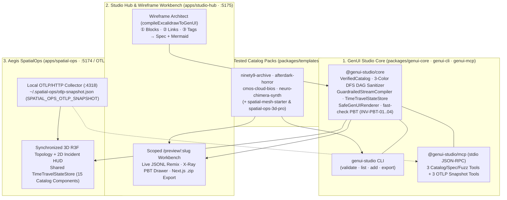

# Product Steering: GenUI Studio

## 1. Executive Summary, Thesis & Architecture Spine

> **One-Sentence Thesis:** **GenUI Studio** is a guardrailed Generative UI compiler, verification engine, and Kiro-orchestrated workbench (`@genui-studio/core`, built on `@json-render` `v0.22.0`) that compiles spatial wireframes and streamed RFC 6902 JSONL patches into DAG-sanitized, property-tested, crash-isolated React and 3D WebGL interfaces across **GenUI Studio Core → Studio Hub & Wireframe Workbench → Aegis SpatialOps → Stress-Tested Catalog Packs**.

**GenUI Studio** is built on Vercel's `@json-render` ecosystem (`@json-render/core` and `@json-render/react` `v0.22.0` are the packages imported by source; `@json-render/shadcn` and `@json-render/react-three-fiber` are declared by `apps/spatial-ops` but not imported) and orchestrated by **Kiro** (Specs, Steering, Hooks, Powers, and the `packages/genui-mcp` MCP server built on `@modelcontextprotocol/sdk`).

Our mission is to eliminate the three failure modes of production Generative UI:
1. **Schema–Component–Prompt Drift:** Keeping React/R3F component implementations, Zod catalog schemas, action handlers, and LLM system prompts (`catalog.prompt()`) strictly synchronized at compile time and runtime.
2. **Streaming Spec Vulnerability:** Guaranteeing that arbitrary, deeply-nested, or adversarial RFC 6902 JSONL/SSE streams emitted by an LLM cannot trigger React hydration crashes, cyclic tree infinite loops, prototype pollution, unsafe URIs, undefined state pointer panics, or full-page white screens of death.
3. **Design-to-Verify Disconnect:** Giving engineers and coding agents a deterministic spatial wireframe compiler (`compileExcalidrawToGenUI`), a CI spec validator (`genui-studio validate`), and an MCP server (`@genui-studio/mcp`) grounded in the exact same catalog contracts.



---

## 2. Four-Stage Architecture Spine (Skeleton Crew Compliance)

### Stage 1 — GenUI Studio Core (`packages/genui-core`, `packages/genui-cli`, `packages/genui-mcp`)
The framework-level verification, streaming, and resilience engine wrapping `@json-render/core` and `@json-render/react`:
- **Catalog Contract & Prompt Synchronizer (`createVerifiedCatalog`):** Enforces 1:1 parity between `defineCatalog()` Zod schemas, `defineRegistry()` React component mappings, and deterministic `catalog.prompt()` generation with FIPS 180-4 SHA-256 schema fingerprinting (`catalogHash`).
- **Guardrailed JSONL Stream Patcher & DAG Sanitizer (`createGuardrailedStreamCompiler`, `sanitizeSpecGraph`):** Builds on `parseSpecStreamLine()`, `applySpecStreamPatch()`, `validateSpec()`, `autoFixSpec()`, and `diffToPatches()` (with its own bounded line buffer instead of `createSpecStreamCompiler()`), adding real-time **3-color DFS DAG cycle detection**, depth/fan-out/value-depth budget enforcement, RFC 6901/6902 prototype-pollution path blocking (`__proto__`, `constructor`, `prototype`), and unsafe URI rejection (`javascript:`, `vbscript:`, `data:text/html`).
- **Bidirectional State Store & Watch Dispatcher (`createTimeTravelStateStore`):** Implements the `@json-render/core` `StateStore` interface on top of `getByPath` and `@json-render/core/store-utils` (`immutableSetByPath`, `flattenToPointers`) with depth-sorted batch pointer updates, deep-frozen snapshots (`maxHistory` default `128`), `undo()`/`redo()`/`jumpToSnapshot()`, and a synchronous cascade-depth circuit breaker.
- **Per-Element Telemetry Error Boundary (`SafeGenUIRenderer`):** Wraps individual catalog components in `<SafeElementInvoker>` + `<GenUIElementErrorBoundary>` so a runtime render exception or schema violation isolates the fault to `<ElementFaultCard />` and surfaces `<DiagnosticHealedBadge />` without collapsing sibling or parent nodes or breaking React hook order.
- **Property-Based Fuzzing Suite (`@genui-studio/core/testing`):** Built on `fast-check`, providing catalog-driven Arbitraries (`zodTypeToArbitrary`, `catalogToElementArbitrary`, `catalogToSpecArbitrary`, `arbitraryAdversarialSpec`, `arbitraryCorruptedJsonlStream`) and `runCatalogInvariantSuite` (`INV-PBT-01`..`04`, default `numRuns = 50`).

#### `@json-render` (`v0.22.0`) vs. `@genui-studio/core`
| Layer / Capability | Upstream `@json-render/core` & `@json-render/react` (`v0.22.0`) | Added by `@genui-studio/core`, CLI, MCP & Studio Hub |
|---|---|---|
| **Catalog & Prompt Foundation** | `defineCatalog`, `defineRegistry`, `catalog.prompt()`, `Spec` & `UIElement` types | `createVerifiedCatalog`, SHA-256 `catalogHash`, 1:1 registry parity check, Zod prop clamping & case/separator enum healing |
| **Graph & Value Safety** | `validateSpec`, `autoFixSpec` | 3-color DFS cycle & sibling-aliasing severance (`sanitizeSpecGraph`), `maxDepth`/`maxElements`/`maxValueDepth`/`maxValueNodes`, `__proto__`/`constructor` & `javascript:`/`vbscript:`/`data:text/html` blocking, `-0`/`NaN`/`±Infinity` normalization |
| **Streaming Compilation** | `parseSpecStreamLine`, `applySpecStreamPatch`, `diffToPatches` | `createGuardrailedStreamCompiler` accepting JSONL, SSE (`data:`/`[DONE]`), or full Spec snapshots across arbitrary byte cuts with bounded line/stream buffers and `finalize()` flush |
| **State Management** | `StateStore` interface, `getByPath`, `immutableSetByPath`, `flattenToPointers` | `createTimeTravelStateStore` with depth-sorted batch updates, `deepFreezeValue`, `maxHistory` ring buffer (`undo`/`redo`/`jumpToSnapshot`), and watch cascade circuit breaker |
| **Fault Isolation & Diagnostics** | `<Renderer>`, `StateProvider`, `VisibilityProvider`, `ActionProvider` | `<SafeGenUIRenderer>`, hook-safe `<SafeElementInvoker>`, per-node `<ElementFaultCard />`, `<DiagnosticHealedBadge />` |
| **Visual Authoring & Tooling** | Code-authored catalogs & specs | Excalidraw Wireframe Architect (`compileExcalidrawToGenUI`), `genui-studio` CLI validator/scaffolder, `@genui-studio/mcp` stdio server, `fast-check` PBT runner |

### Stage 2 — Studio Hub & Wireframe Workbench (`apps/studio-hub`, `:5175`)
**Domain:** Developer Tools / Template Marketplace & Verification Workbench.
- **Purpose:** Storefront (`/`) and scoped verification workbench (`/preview/:slug` + `?fullscreen=true`) for the catalog packs in `packages/templates`, featuring live RFC 6902 JSONL remix streaming, the X-Ray PBT & telemetry drawer, runnable Next.js `.zip` export, and the lazy-loaded **Excalidraw Wireframe Architect** (`WireframeArchitectCanvas.tsx` + `excalidraw-compiler.ts`).
- **3-Primitive Deterministic Wireframe Architect (`compileExcalidrawToGenUI`):**
  1. **① Catalog Blocks:** Drawn Excalidraw shapes (`rectangle`, `diamond`, `ellipse`, `frame`) and bound text labels resolve deterministically against the active `VerifiedCatalog` via exact component names, keyword synonyms, and containment geometry (`computeContainmentRatio >= 0.75`, sorted top-to-bottom / left-to-right by `(minY, minX)` with UTF-16 code-point tie-breaking).
  2. **② Directed Interaction Links (`arrow`):** Drawn arrows with `startBinding` and `endBinding` compile into safe RFC 6901 state pointers (`/wireframeBindings/<slug>`), injecting `{ "$state": "/wireframeBindings/<slug>" }` onto the target element's summary prop, seeding `spec.state.wireframeBindings`, and emitting a dashed `-.->` edge in the generated `.kiro/specs/<slug>/design.md` Mermaid diagram.
  3. **③ Tags & Guardrails:** Explicit `customData.catalogComponent` tags override label heuristics only when the component exists in the catalog; unknown components, `isDeleted` elements, `__proto__`/`constructor` keys, and cycles are stripped before passing through `catalog.validateFull()` / `sanitizeSpecGraph()`. **Scope note:** `compileExcalidrawToGenUI` executes with zero LLM, network, clock, or randomness calls (verified by `apps/studio-hub/src/__tests__/wireframe-proof.test.ts` and `apps/studio-hub/scripts/audit-wireframe-compiler.mjs`).

### Stage 3 — Aegis SpatialOps (`apps/spatial-ops`, `:5174` / OTLP `:4318`)
**Domain:** Autonomous Cloud SRE & 3D Infrastructure Topology Command Center.
- **Purpose:** Unites a **3D WebGL scene** (`@react-three/fiber` `<Canvas>` + `@react-three/drei`, driven by `src/three/SpatialSceneCanvas.tsx`) with **2D incident response runbooks & telemetry panels** (15 catalog components) over a **single shared `TimeTravelStateStore`**, fed by a local OpenTelemetry OTLP/HTTP JSON collector on `:4318` (`POST /v1/{traces,logs,metrics}`).
- **Authoritative OTLP Snapshot Contract:** Both the SpatialOps collector (`apps/spatial-ops/server/otlp-collector.ts`) and the MCP server (`packages/genui-mcp/src/tools/otlp-snapshot-provider.ts`) read and write `~/.spatial-ops/otlp-snapshot.json` by default and honour `SPATIAL_OPS_OTLP_SNAPSHOT`.

### Stage 4 — Stress-Tested Catalog Packs (`packages/templates` & `@genui-studio/core/registry`)
Domain stress tests rendered inside the same `@genui-studio/core` runtime and `ScopedTemplateContainer`:
- **`ninety9-archive`:** 1997 monochrome workstation archive (`34` dossiers, COBOL boot terminal, strict 5-tone monochrome token law).
- **`afterdark-horror`:** Procedural 3D cemetery/crypt exploration (`THREE.InstancedMesh`, AABB+circle collision solver, procedural Web Audio, WCAG flash limits, Swiss editorial convergence).
- **`cmos-cloud-bios`:** 1994 Award BIOS utility + 3D motherboard twin + deterministic IaC compiler (`docker-compose.yml`, `vercel.json`, `main.tf` with FNV-1a checksum).
- **`neuro-chimera-synth` (`CHIMERA // LAB`):** Bio-synthetic Physarum SQL query optimizer, custom recursive-descent SQL parser/planner, Web Audio sonifier, and offline `kiro-crew-app/` bundle.
- **Installable Registry Packs (`@genui-studio/core/registry`):** `spatial-mesh-starter` (free) and `spatial-ops-3d-pro` (token-gated via offline `local-format-demo` or custom `LicenseVerifier`).

---

## 3. 5-Layer Kiro Integration Matrix & Honest Verification Status

| Layer | Location | Role in GenUI Studio | Verification Status |
|---|---|---|---|
| **1. Specs (EARS)** | `.kiro/specs/{core-skeleton,app-spatial-warroom,ninety9-archive,afterdark,cmos-cloud-bios,neuro-chimera-synth}/` | Requirements, architecture designs, `INV-PBT-01..04` correctness theorems, and implementation task checklists | **Verified** against source code |
| **2. Steering** | `.kiro/steering/*.md` (9 files) | Always-on rules (`product.md`, `tech.md`, `structure.md`, `genui-invariants.md`) + `fileMatch` domain laws (`spatial-3d-rules.md`, `ninety9-monochrome-rules.md`, `afterdark-3d-horror.md`, `cmos-bios-rules.md`, `chimera-frankenstein-rules.md`) | **Verified** against source paths & APIs |
| **3. Hooks** | `.kiro/hooks/*.json` + `.kiro/hooks/scripts/*.mjs` | v1 hooks: `catalog-schema-sync.json` (`catalog-audit.mjs`), `spec-invariants-test.json` (`run-pbt-suite.mjs`), `raw-jsx-guard.json`, `standalone-dropin-ingest.json` | **Verified** (`catalog-audit.mjs` & `run-pbt-suite.mjs` exit `0` in CI) |
| **4. Powers & Skills** | `.kiro/powers/json-render-power/` + pack `POWER.md` / `SKILL.md` | 5 Golden Rules of catalog conversion, MCP config, and R3F/React playbooks (`react-to-catalog.md`, `three-and-mcp-patterns.md`) | **Verified** against installed `@json-render` `v0.22.0` types |
| **5. MCP & Kiro Crew** | `packages/genui-mcp`, `.kiro/settings/mcp.json`, `packages/templates/src/neuro-chimera-synth/kiro-crew-app/` | 6 stdio MCP tools (`list_catalog_components`, `validate_ui_spec`, `fuzz_test_catalog`, `query_telemetry_metrics`, `fetch_trace_spans`, `execute_remediation`) + `chimera-lab@1.1.0` Kiro Crew bundle | **MCP Verified** over stdio (`scripts/verify-mcp.mjs`). **Kiro Crew State 1** (offline manifest validation) & **State 2** (`dist/index.mjs` build + `hooks.py` `py_compile`) **Verified**; **State 3** (live Kiro Crew gateway install/runtime) **Unverified** (`kirocrew` gateway not installed) |

### Reproducible Verification Commands (`node >=22.18.0`, `pnpm@9.15.0`)
```bash
pnpm install --frozen-lockfile
node scripts/check-workspace-scripts.mjs
pnpm -r build
pnpm -r typecheck
pnpm -r lint
pnpm -r test
node .kiro/hooks/scripts/catalog-audit.mjs
node .kiro/hooks/scripts/run-pbt-suite.mjs
node scripts/verify-mcp.mjs
node apps/studio-hub/scripts/audit-wireframe-compiler.mjs
```

---

## 4. Non-Negotiable Anti-Slop & Craft Standards
1. **Zero Fake Demos:** Every stream, RFC 6902 JSONL patch, `$state`/`$bindState` binding, `VisibilityCondition` evaluation, `autoFixSpec` pass, and `fast-check` property run MUST execute through the real `@genui-studio/core` and `@json-render/*` pipeline. Never use fake `setTimeout` progress bars that bypass the compiler.
2. **Surgical Developer Telemetry Aesthetic** (platform chrome: Studio Hub and SpatialOps; each template under `packages/templates/src/<slug>` follows its own `[data-template-theme]` steering file instead):
   - Visual inspiration: **Linear, Vercel Geist, Raycast, Grafana**.
   - High-contrast surfaces, crisp `1px` hairline borders, monospace tabular telemetry metrics (`JetBrains Mono` / `Geist Mono`), and semantic status indicators (emerald `#10B981` for verified invariants, amber `#F59E0B` for lossless auto-fix warnings, crimson `#EF4444` for quarantined DAG/schema faults).
   - **Strictly forbidden:** Halloween clip-art, pumpkin icons, cobwebs, "Creepster" fonts, or novelty theme gimmicks.
3. **Zero Raw JSX/HTML Generation:** AI models and stream compilers must NEVER emit or evaluate raw JSX, HTML strings, `dangerouslySetInnerHTML`, or `eval()`. All UI structure is strictly mediated by flat `Spec` maps validated against Zod catalogs.
