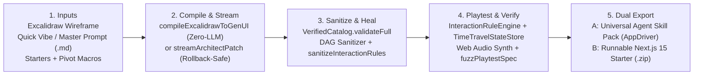

# Product Steering: GenUI Studio — Verified Behavioral Spec & Universal Agent Skill Compiler

## 1. Product Identity & One-Sentence Promise

> **Product Promise:** **GenUI Studio compiles wireframes, rough vibes, or structured Markdown Master Prompts into schema-validated, fuzz-tested behavioral `Spec`s (`@genui-studio/core`)—and exports either executable `AppDriver` Agent Skill Packs for Kiro/Cursor/Claude Code/Codex or runnable Next.js 15 starters—proven across separate standalone applications on the exact same foundation.**

- **Category:** Kiroween 2026 — **Skeleton Crew**
- **Core Moat:** Static layout generators produce visual boxes without proving runtime behavior. GenUI Studio proves that interactions, state machines, and win/lose/complete edge cases work via `InteractionRuleEngine` + `TimeTravelStateStore` + `fast-check` (`fuzzPlaytestSpec`), and hands AI IDEs an executable `AppDriver` contract suite (`contracts/invariants.pbt.test.ts` with passing `reference-driver.ts` and failing `production-driver.ts` stub) plus verbatim `preservedConstraints[]` so production code must pass the behavioral contract.
- **Primary User:** Frontend engineers, product designers, and AI coding agents (Kiro, Cursor, Claude Code, Codex) turning visual wireframes, short vibes, or full Markdown PRDs into verified interactive applications.

---

## 2. Six Non-Negotiable Architectural Guardrails

1. **Zero Fake Offline NLP:** Freeform `Quick Vibe` and `Master Prompt (.md)` generation/reframing MUST use a real streaming BYO-LLM client (`apps/studio-hub/src/lib/llm-architect.ts`) supporting OpenAI-compatible endpoints (Yantra AI `https://api.aitklabs.in/v1`, OpenAI, OpenRouter, local Ollama) and native Gemini with transactional snapshot rollback on abort/error. Offline zero-key mode is strictly honest: curated starters + deterministic structural Pivot Macros (`apps/studio-hub/src/lib/pivot-macros.ts`); freeform submission without an endpoint throws `LlmConfigurationRequiredError`.
2. **Zero-Network Excalidraw Compiler + Separate One-Way Export:** `apps/studio-hub/src/lib/excalidraw-compiler.ts` stays **100% synchronous, zero-network, and zero-LLM** (`node apps/studio-hub/scripts/audit-wireframe-compiler.mjs` must exit `0`). One-way `.excalidraw.json` export lives in `apps/studio-hub/src/lib/spec-to-excalidraw.ts`.
3. **Non-Circular Agent Skill Pack Contracts (`AppDriver`):** Every exported Skill Pack ships `contracts/app-driver.ts`, `contracts/reference-driver.ts` (PASS under `GENUI_DRIVER_TARGET=reference`), and `contracts/production-driver.ts` (throws `NotImplementedError` — FAIL under `GENUI_DRIVER_TARGET=production` until wired to the built app), with fuzzer-discovered `shortestTraces` baked into `contracts/invariants.pbt.test.ts`.
4. **Dual Input Modes with Constraint Preservation:** `vibe` mode acts as a Creative Architect; `master-prompt` mode acts as a Strict Spec Extractor preserving Markdown `sourceSection` tags, capturing non-UI requirements verbatim in `preservedConstraints[]` (merged into `SKILL.md` and `.kiro/specs/<slug>/{requirements,design,tasks}.md`), and running `fuzzPlaytestSpec` to surface reachable traces and `deadRules`.
5. **Single Behavioral Runtime:** Interactive previews dispatch user and timer actions through `InteractionRuleEngine` + `TimeTravelStateStore` rather than ad-hoc untracked React state.
6. **Preserve Existing Baseline:** Keep `product-landing-starter`, `saas-dashboard-starter`, `apps/ninety9-archive`, `apps/cmos-cloud-bios`, all existing routes, `data-testid` hooks, and all baseline tests green.

---

## 3. Core Architecture: The Lean Skeleton & Proven Applications

### A. The Verification & Behavioral Engine (`packages/genui-core`, `packages/templates`, `packages/genui-cli`)
Built on Vercel's `@json-render/core` and `@json-render/react` (`v0.22.0`):
- **Catalog Contract & Prompt Synchronizer (`createVerifiedCatalog`):** Enforces 1:1 parity between `defineCatalog()` Zod schemas, `defineRegistry()` React component mappings, and deterministic `catalog.prompt()` generation with SHA-256 fingerprinting (`catalogHash`).
- **DAG Sanitizer & Stream Compiler (`sanitizeSpecGraph`, `createGuardrailedStreamCompiler`):** 3-color DFS cycle and sibling-aliasing severance, recursion/fan-out caps (`maxDepth`, `maxElements`, `maxValueDepth`, `maxValueNodes`), RFC 6901 prototype-pollution blocking (`__proto__`, `constructor`, `prototype`), and unsafe URI neutralization (`javascript:`, `vbscript:`, `data:text/html`).
- **Declarative Interaction Engine & Web Audio Synth (`packages/genui-core/src/interaction/`):** Zod v4 schemas (`InteractionRuleSchema`, `CreativeBriefSchema`, `PreservedConstraintSchema`) + `sanitizeInteractionRules()` (caps: `64` rules, `16` guards, `16` effects, depth `6`), pure bounded `evaluateInteractionGuard()`, procedural `createWebAudioSynth()`, and `createInteractionRuleEngine()` wrapping `TimeTravelStateStore` with a 32-transition circuit breaker and rewindable `scrubToHistoryIndex()` restoring both state and `once: true` eligibility.
- **Property-Based Test & Playtest Fuzzer (`@genui-studio/core/testing`):** `runCatalogInvariantSuite` (`INV-PBT-01..04`) plus `extractActionVocabulary` & `fuzzPlaytestSpec` returning `shortestTraces` (`win`/`lose`/`complete`) and `deadRules` (with `sourceSection`).
- **Hook-Safe Fault Boundary (`SafeGenUIRenderer`):** Renders each catalog component on its own child React fiber (`<SafeElementInvoker>`) inside `<GenUIElementErrorBoundary>` across SSR (`renderToString` / `renderToStaticMarkup`) and client hydration (`hydrateRoot` / `createRoot`), isolating faults into `<ElementFaultCard />`.
- **Universal Skill Pack Exporter, Starter Exporter & CLI (`@genui-studio/templates`, `genui-studio`):** Exports portable Agent Skill & Contract Packs (`buildSkillPack`, `buildSkillPackFiles`, `generateSkillPackZip`), runnable Next.js 15 `.zip` starters (`generateTemplateZip`), and CLI gates (`genui-studio validate`, `genui-studio fuzz`, `genui-studio export-skill`, `genui-studio export`, `genui-studio add`, `genui-studio list`).

### B. Playable Workbench, BYO-LLM Architect & Offline Tools (`apps/studio-hub`, `:5175`)
- **5-Second Playable Workbench (`/play`, `PlayableWorkbenchPage.tsx`, `playable-starter.ts`):** Flagship **Signal Relay Vault** interactive starter running exclusively through `InteractionSurface` (`packages/genui-core/src/interaction/dom-bridge.tsx`) + `InteractionRuleEngine` + `TimeTravelStateStore` across **Playable Preview**, **Live Flow Map** (`FlowMapView.tsx` pulsing active rules & edges), and read-only **Excalidraw Source** (`ExcalidrawSourceView.tsx`), with `PlaytestTimelineBar.tsx`, `RuleInspectorDrawer.tsx`, `VibeReframeBar.tsx`, and dual-mode `PlayableExportDialog.tsx` / `TemplateExportDialog.tsx`.
- **Deterministic Wireframe Compiler (`excalidraw-compiler.ts`):** Compiles Landing and SaaS Dashboard wireframes into DAG-sanitized `Spec`s with `(minY, minX)` + UTF-16 code-point sorting (`compareCodePoints`) and `<WireframeDiagnosticsStrip />`.
- **Streaming BYO-LLM Architect & Dev Proxy (`llm-architect.ts`, `vite.config.ts`):** Real `ReadableStream` SSE/JSONL client for Yantra AI (`https://api.aitklabs.in/v1`), OpenAI, OpenRouter, Gemini, and local Ollama, backed by `/api/architect/stream` and `/api/architect/status` reading `GENUI_LLM_API_KEY` server-side from `.env.local`.
- **Offline Pivot Macros & One-Way Excalidraw (`pivot-macros.ts`, `spec-to-excalidraw.ts`):** Deterministic zero-key RFC 6902 structural macros and pure Excalidraw v2 export.

### C. Standalone Skeleton Crew Applications & Starter Templates
1. **`apps/ninety9-archive` (`:5176` — Standalone App #1):** 1997 paper-white monochrome archive (`34` dossiers across `12` sectors, `6` routes, playable 1-bit arcade, strict 5-tone token law) running directly on `@genui-studio/core`.
2. **`apps/cmos-cloud-bios` (`:5177` — Standalone App #2):** 1994 Award CMOS BIOS utility + 3D WebGL motherboard twin (`@react-three/fiber`) + deterministic cloud IaC compiler (`docker-compose.yml`, `vercel.json`, `main.tf`) + FSK modem audio, running directly on `@genui-studio/core`.
3. **All 4 MIT Applications as Previewable & Exportable Starter Templates (`packages/templates`):** `afterdark-horror`, `ninety9-archive`, `cmos-cloud-bios`, and `neuro-chimera-synth` (*CHIMERA // LAB*).

---

## 4. Threat Model, Supported Deployment Modes & Craft Standards

1. **Supported Deployment Modes:** Static SPA deployment or local developer workbench (`apps/studio-hub` with optional server-side `.env.local` LLM dev proxy), standalone Vite apps (`apps/ninety9-archive`, `apps/cmos-cloud-bios`), exported Next.js 15 starters, exported Agent Skill & Contract Packs, CI spec/fuzz validation (`genui-studio validate`, `genui-studio fuzz`), and in-app React/SSR rendering via `@genui-studio/core`.
2. **Runtime Safety Boundaries:** `@genui-studio/core` defends untrusted `Spec` trees, JSONL/SSE streams, and `InteractionRule[]` definitions against cyclic graphs, infinite rule loops (32-step circuit breaker), depth/element/value/rule blowups, prototype pollution (`__proto__`/`constructor`/`prototype`), `javascript:`/`vbscript:`/`data:text/html` URIs, out-of-range props, and per-component render exceptions. Catalog components themselves must be trusted application code.
3. **Zero Raw JSX/HTML & Honest Terminology:** Never use `dangerouslySetInnerHTML`, `innerHTML` assignment, or `eval()`. Describe `fast-check` suites accurately as **property-based tests** and **tested invariants** (never as mathematical proofs). Never leak `GENUI_LLM_API_KEY` or `.env*` files into client bundles or `.zip` exports.
