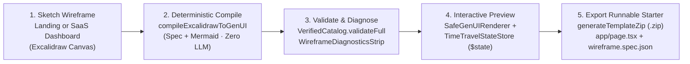

# Product Steering: GenUI Studio — Wireframe-to-Application Skeleton

## 1. Product Identity & One-Sentence Promise

> **Product Promise:** **GenUI Studio is a lean, guardrailed Wireframe-to-Application skeleton (`@genui-studio/core` + `apps/studio-hub`): draw or load a wireframe, compile it deterministically into a validated UI `Spec`, inspect diagnostics live, and export a runnable Next.js starter—proven across standalone applications built on the exact same foundation.**

- **Category:** Kiroween 2026 — **Skeleton Crew**
- **Primary User:** Frontend engineers, product designers, and coding agents who want a reusable, guardrailed Generative UI foundation that turns visual wireframes or structured specs into working React/Next.js applications without fragile prompt-generated JSX or unvalidated JSON streams.
- **First-Success User Journey ("The Hard Test"):**
  1. **Sketch / Select Archetype:** Open the **Product Landing** sample (`/preview/product-landing-starter?wireframe=sample`) or switch with one click to the **SaaS Dashboard** wireframe (`data-testid="wireframe-load-dashboard-btn"`), or draw **① Catalog Blocks**, **② Directed Interaction Links (`arrow`)**, and **③ Tags (`customData.catalogComponent`)** in Excalidraw.
  2. **Compile:** Run `compileExcalidrawToGenUI` (`apps/studio-hub/src/lib/excalidraw-compiler.ts`) to deterministically produce a GenUI `Spec` + `.kiro/specs/<slug>/design.md` Mermaid diagram (zero LLM or network calls inside `compileExcalidrawToGenUI`).
  3. **Validate & Diagnose:** Inspect `<WireframeDiagnosticsStrip />` (`apps/studio-hub/src/components/WireframeDiagnosticsStrip.tsx`) for unknown component tags, clamped out-of-range props, blocked unsafe URIs, and rejected schema fields.
  4. **Preview:** Interact with the live React preview rendered through `<SafeGenUIRenderer>` (supporting hook-using components across SSR and client DOM, `<DiagnosticHealedBadge />`, and `<ElementFaultCard />`) over `TimeTravelStateStore` with live `$state` arrow bindings.
  5. **Export:** Export a runnable Next.js starter `.zip` (`generateTemplateZip(template, { wireframe })`) containing `src/template/wireframe.spec.json`, `app/page.tsx`, `src/template/catalog.ts`, `wireframe/<slug>.excalidraw.json`, and `.kiro/specs/<slug>/design.md`.

---

## 2. Core Architecture: The Lean Skeleton & Proven Applications

### A. The Verification Engine (`packages/genui-core`, `packages/templates`, `packages/genui-cli`)
Built on Vercel's `@json-render/core` and `@json-render/react` (`v0.22.0`):
- **Catalog Contract & Prompt Synchronizer (`createVerifiedCatalog`):** Enforces 1:1 parity between `defineCatalog()` Zod schemas, `defineRegistry()` React component mappings, and deterministic `catalog.prompt()` generation with SHA-256 fingerprinting (`catalogHash`).
- **DAG Sanitizer & Stream Compiler (`sanitizeSpecGraph`, `createGuardrailedStreamCompiler`):** 3-color DFS cycle and sibling-aliasing severance, recursion/fan-out caps (`maxDepth`, `maxElements`, `maxValueDepth`, `maxValueNodes`), RFC 6901 prototype-pollution blocking (`__proto__`, `constructor`, `prototype`), and unsafe URI neutralization (`javascript:`, `vbscript:`, `data:text/html`).
- **Hook-Safe Fault Boundary (`SafeGenUIRenderer`):** Renders each catalog component on its own child React fiber (`<SafeElementInvoker>`) inside `<GenUIElementErrorBoundary>` so hook-using components (`useState`, `useMemo`, `useId`) work in both SSR (`renderToString` / `renderToStaticMarkup`) and client hydration (`hydrateRoot` / `createRoot`), while isolating invalid props or runtime throws into `<ElementFaultCard />`.
- **Property-Based Test Suite (`@genui-studio/core/testing`):** Uses `fast-check` (`runCatalogInvariantSuite`, `INV-PBT-01..04`, default `50` runs per property) to empirically test stream chunking, adversarial payloads, state pointer ordering, and catalog determinism.
- **Scoped Theme Engine & Starter Exporter (`@genui-studio/templates`, `genui-studio` CLI):** Isolates any application's CSS tokens inside `[data-template-theme="<slug>"]`, merges templates with `base-nextjs-shell` into runnable Next.js 15 `.zip` starters, and validates specs in CI (`genui-studio validate`).

### B. The Front-Door Workbench (`apps/studio-hub`, `:5175`)
- **Hero Onboarding (`MarketplacePage.tsx`):** Foregrounds the 5-step **Sketch → Compile → Validate → Preview → Export** workflow with a 1-click **"Open Sample Wireframe in Workbench"** CTA (`/preview/product-landing-starter?wireframe=sample`) and showcases all 4 MIT applications built with Kiro + GenUI.
- **Deterministic Spatial Compiler (`excalidraw-compiler.ts`):** Maps drawn shapes, bound text, containment frames (`>= 0.75` overlap), and arrows into a DAG-sanitized `Spec`, sorted top-to-bottom / left-to-right by `(minY, minX)` with UTF-16 code-point tie-breaking (`compareCodePoints`).
- **Two Wireframe Archetypes on One Catalog:** Switch between **Landing Sample** and **SaaS Dashboard** wireframes in one click to compile, diagnose, preview, and export two visibly distinct apps on the exact same `SiteShell / HeroSection / MetricStrip / FeatureGrid` catalog.

### C. Standalone Skeleton Crew Applications & Starter Templates
To prove the skeleton supports radically different domains without modifying core runtime code:
1. **`apps/ninety9-archive` (`:5176` — Standalone App #1):** 1997 paper-white monochrome archive (`34` dossiers across `12` sectors, `6` multi-page routes, playable 1-bit monochrome arcade, strict 5-tone token law) running directly on `@genui-studio/core`.
2. **`apps/cmos-cloud-bios` (`:5177` — Standalone App #2):** 1994 Award CMOS BIOS utility + 3D WebGL motherboard twin (`@react-three/fiber`) + deterministic cloud IaC compiler (`docker-compose.yml`, `vercel.json`, `main.tf`) + FSK modem audio, running directly on `@genui-studio/core`.
3. **All 4 MIT Applications as Previewable & Exportable Starter Templates (`packages/templates`):**
   - `afterdark-horror` — 3D WebGL cemetery exploration + procedural Web Audio + daylight editorial reveal.
   - `ninety9-archive` — 1997 monochrome archive & workstation arcade.
   - `cmos-cloud-bios` — 1994 Award CMOS BIOS + 3D PCB cloud IaC compiler.
   - `neuro-chimera-synth` (*CHIMERA // LAB*) — Physarum bio-SQL network simulator + recursive-descent SQL parser/EXPLAIN cost planner + local optimizer agents + Web Audio FM sonification.

---

## 3. Threat Model, Supported Deployment Modes & Craft Standards

1. **Supported Deployment Modes:** Static SPA deployment or local developer workbench (`apps/studio-hub`), standalone Vite apps (`apps/ninety9-archive`, `apps/cmos-cloud-bios`), exported Next.js 15 starters, CI spec validation (`genui-studio validate`), and in-app React/SSR rendering via `@genui-studio/core`. Zero external API keys or backend servers required.
2. **Runtime Safety Boundaries:** `@genui-studio/core` defends untrusted `Spec` trees and JSONL/SSE patches against cyclic graphs, depth/element/value blowups, prototype pollution (`__proto__`/`constructor`/`prototype`), `javascript:`/`vbscript:`/`data:text/html` URIs, out-of-range props, and per-component render exceptions. Catalog components themselves must be trusted application code.
3. **Zero Raw JSX/HTML & Honest Terminology:** Never use `dangerouslySetInnerHTML`, `innerHTML` assignment, or `eval()`. Describe `fast-check` suites accurately as **property-based tests** and **tested invariants** (never as mathematical proofs).
