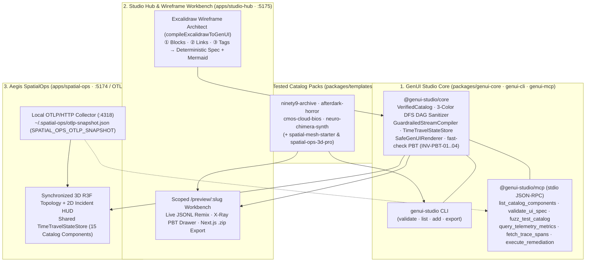

# GenUI Studio (`GenUI-kit`)

<div align="center">

[](./LICENSE)
[](./.kiro/specs/core-skeleton/correctness.md)
[](https://github.com/vercel-labs/json-render)
[](./packages/genui-mcp)
[](./.kiro)
[](./tsconfig.base.json)
[](./package.json)

**GenUI Studio is a guardrailed Generative UI compiler, verification engine, and Kiro-orchestrated workbench (`@genui-studio/core`, built on `@json-render` `v0.22.0`) that compiles spatial wireframes and streamed RFC 6902 JSONL patches into DAG-sanitized, property-tested, crash-isolated React and 3D WebGL interfaces across Studio Hub, Aegis SpatialOps, and stress-tested catalog packs.**

[**Quickstart & Reproducible Commands**](#-quickstart--reproducible-verification-commands) • [**1. GenUI Studio Core**](#-1-genui-studio-core-genui-studiocore--cli--mcp) • [**2. Studio Hub & Wireframe Workbench**](#-2-studio-hub--wireframe-workbench-appsstudio-hub--5175) • [**3. Aegis SpatialOps**](#-3-aegis-spatialops-appsspatial-ops--5174--otlp-4318) • [**4. Stress-Tested Catalog Packs**](#-4-stress-tested-catalog-packs-genui-studiotemplates) • [**5-Layer Kiro Matrix**](#-5-layer-kiro-integration-matrix) • [**Verified vs. Unverified Status**](#-verified-vs-unverified-status)

</div>

---

## 🎯 Architecture Spine: Core → Workbench → SpatialOps → Catalog Packs

GenUI Studio is organized along a single four-stage spine:

**GenUI Studio Core → Studio Hub & Wireframe Workbench → Aegis SpatialOps → Stress-Tested Catalog Packs**

1. **GenUI Studio Core (`packages/genui-core`, `packages/genui-cli`, `packages/genui-mcp`):** Wraps [`@json-render/core`](https://github.com/vercel-labs/json-render) and `@json-render/react` (`v0.22.0`) with a 3-color DFS DAG cycle sanitizer, RFC 6901 prototype-pollution & unsafe URI blocker, numeric/enum prop healing (`<DiagnosticHealedBadge />`), hook-safe per-element React error boundaries (`<SafeGenUIRenderer>`), an immutable `TimeTravelStateStore`, a CI spec validator (`genui-studio validate`), `fast-check` PBT suites (`INV-PBT-01..04`), and a stdio MCP server (`@genui-studio/mcp`).
2. **Studio Hub & Wireframe Workbench (`apps/studio-hub`, `:5175`):** Developer authoring and verification workbench featuring the lazy-loaded **Excalidraw Wireframe Architect** (`compileExcalidrawToGenUI`: compiles **① Catalog Blocks**, **② Directed Interaction Links**, and **③ Tags & Guardrails** into a validated GenUI `Spec` + `.kiro` Mermaid diagram with zero LLM/network calls inside `compileExcalidrawToGenUI`), scoped `/preview/:slug` inspection, live JSONL remix streaming, X-Ray PBT/telemetry diagnostics, and runnable Next.js `.zip` export.
3. **Aegis SpatialOps (`apps/spatial-ops`, `:5174` / OTLP `:4318`):** SRE observability command center ingesting local OpenTelemetry OTLP/HTTP JSON (`POST /v1/{traces,logs,metrics}`) into a synchronized **3D WebGL microservice topology** (`@react-three/fiber` + `@react-three/drei`) and **2D incident runbook HUD** (`15` catalog components) driven by the same `TimeTravelStateStore` and sharing `~/.spatial-ops/otlp-snapshot.json` (`SPATIAL_OPS_OTLP_SNAPSHOT`) with `@genui-studio/mcp`.
4. **Stress-Tested Catalog Packs (`packages/templates` & `@genui-studio/core/registry`):** Four domain stress tests (`ninety9-archive`, `afterdark-horror`, `cmos-cloud-bios`, `neuro-chimera-synth`) rendered inside `@genui-studio/core` and `apps/studio-hub`, plus two CLI-installable spatial packs (`spatial-mesh-starter`, `spatial-ops-3d-pro`).



---

## 📊 `@json-render` (`v0.22.0`) vs. `@genui-studio/core`

`@json-render/core` and `@json-render/react` (`v0.22.0`) are the upstream packages imported by source (`@json-render/shadcn` and `@json-render/react-three-fiber` are declared in `apps/spatial-ops/package.json` but not imported; `apps/spatial-ops` renders its 3D WebGL scene directly with `@react-three/fiber` and `@react-three/drei`). `@genui-studio/core`, `genui-studio` CLI, `@genui-studio/mcp`, and `apps/studio-hub` add the surrounding visual compiler, runtime defense-in-depth, and verification pipeline:

| Capability / Boundary | Upstream `@json-render/core` & `@json-render/react` (`v0.22.0`) | Added by `@genui-studio/core` & GenUI Studio |
| :--- | :--- | :--- |
| **Visual Wireframe Authoring** | JSON / code-authored `Spec` trees | **Excalidraw Wireframe Architect** (`compileExcalidrawToGenUI` → deterministic `Spec` + `.kiro` Mermaid diagram; zero LLM/network calls inside `compileExcalidrawToGenUI`) |
| **Catalog & Prompt Synchronizer** | `defineCatalog()`, `defineRegistry()`, `catalog.prompt()` | **`createVerifiedCatalog()`** with FIPS 180-4 SHA-256 `catalogHash`, 1:1 schema-to-registry parity check, and deterministic key sorting |
| **Cyclic Graph & Recursion Caps** | `validateSpec()`, `autoFixSpec()` | **3-Color DFS DAG Sanitizer (`sanitizeSpecGraph`)** severing back-edges (`A -> B -> A`) and sibling aliasing, enforcing `maxDepth`, `maxElements`, `maxValueDepth`, and `maxValueNodes` |
| **Prototype Pollution & URI Guard** | Relies on caller hygiene | **RFC 6901 Pointer & String Guard** (`isDangerousKey`, `isSafeJsonPointer`, `isSafeUrl`) blocking `__proto__`, `constructor`, `prototype`, `javascript:`, `vbscript:`, and `data:text/html` |
| **Prop Healing & Float Normalization** | Strict Zod validation | **Semantic Case/Separator Enum Healing, Numeric Clamping, `-0 -> 0` / `NaN` / `±Infinity` Healing & `<DiagnosticHealedBadge />`** |
| **Hook-Safe Fault Isolation** | `<Renderer>`, `StateProvider`, `VisibilityProvider`, `ActionProvider` | **`<SafeGenUIRenderer>` (`<SafeElementInvoker>` + `<GenUIElementErrorBoundary>`)** isolating component throws to `<ElementFaultCard />` while keeping React hook order invariant |
| **Chunk-Invariant Streaming** | `parseSpecStreamLine()`, `applySpecStreamPatch()`, `diffToPatches()` | **`createGuardrailedStreamCompiler()`** with bounded buffers (`maxBufferBytes`, `maxLineLength`, `maxTotalStreamBytes`, `maxPatches`), accepting JSONL, SSE (`data:`/`[DONE]`), or full Spec snapshots across arbitrary byte boundaries |
| **Immutable Time-Travel State** | `StateStore` interface, `getByPath`, `immutableSetByPath`, `flattenToPointers` | **`createTimeTravelStateStore()`** with depth-sorted batch pointer mutations (`/a` before `/a/b`), `deepFreezeValue`, bounded ring buffer (`maxHistory` default `128`), `undo()`/`redo()`/`jumpToSnapshot()`, and watch cascade circuit breaker |
| **CI CLI, MCP & PBT Fuzzing** | Core schema/spec utilities | **`genui-studio` CLI**, **`@genui-studio/mcp`** (`@modelcontextprotocol/sdk` stdio server), and **`@genui-studio/core/testing`** (`fast-check` Arbitraries + `runCatalogInvariantSuite`) |

---

## ⚡ Quickstart & Reproducible Verification Commands

**Prerequisites:** `Node.js >= 22.18.0` and `pnpm@9.15.0`. All packages and both applications run locally with **zero API keys**.

```bash
# 1. Install workspace dependencies
pnpm install --frozen-lockfile

# 2. Verify every workspace package defines build, typecheck, lint, and test
node scripts/check-workspace-scripts.mjs

# 3. Run the full workspace build, typecheck, ESLint invariant check, and test suite
pnpm -r build
pnpm -r typecheck
pnpm -r lint
pnpm -r test

# 4. Run Kiro executable hooks (1:1 catalog/registry audit + fast-check PBT suite)
node .kiro/hooks/scripts/catalog-audit.mjs
node .kiro/hooks/scripts/run-pbt-suite.mjs

# 5. Run the real stdio MCP client verification & Wireframe Architect static bundle audit
node scripts/verify-mcp.mjs
node apps/studio-hub/scripts/audit-wireframe-compiler.mjs
```

### Launch the Applications Locally
```bash
# Start both applications in parallel:
#   -> Studio Hub & Wireframe Workbench: http://localhost:5175
#   -> Aegis SpatialOps (WebGL + HUD + OTLP :4318): http://localhost:5174
pnpm dev

# Or launch individually:
pnpm dev:hub
pnpm dev:spatial
```

---

## 🔧 1. GenUI Studio Core (`@genui-studio/core` + CLI + MCP)

### Core Runtime (`packages/genui-core`)
- **3-Color DFS DAG Sanitizer (`dag-sanitizer.ts`):** Traverses elements with White/Grey/Black DFS states to sever back-edge cycles (`A -> B -> A`) and duplicate sibling references, enforces `maxDepth`, `maxElements`, `maxValueDepth`, and `maxValueNodes`, prunes dangling child keys, and strips `__proto__`/`constructor`/`prototype` plus `javascript:`/`vbscript:`/`data:text/html` URIs.
- **Chunk-Invariant Stream Compiler (`stream-compiler.ts`):** Consumes RFC 6902 JSONL patches, SSE `data:`/`[DONE]` streams, or full `{ root, elements, state? }` snapshots across arbitrary byte cuts and flushes trailing lines on `finalize()`.
- **Deep-Frozen `TimeTravelStateStore` (`time-travel-store.ts`):** Depth-sorts batch JSON Pointer mutations (`/a` before `/a/b`), preserves `===` structural sharing on untouched branches, recursively freezes snapshots, and maintains bounded `undo()`/`redo()`/`jumpToSnapshot()` history (`maxHistory` default `128`).
- **Hook-Safe Telemetry Boundary (`safe-renderer.tsx`):** Wraps catalog components in `<SafeElementInvoker>` + `<GenUIElementErrorBoundary>` and renders `<DiagnosticHealedBadge />` whenever enum/numeric healing intervened.

### CLI Validator & Pack Scaffolder (`packages/genui-cli` — `genui-studio`)
```bash
# Validate a JSON / JSONL / SSE UI stream in CI
pnpm genui-studio validate ./path/to/spec.jsonl --strict --json

# List, scaffold, or export template packs (validateLicenseToken defaults to offline "local-format-demo")
pnpm genui-studio list
pnpm genui-studio add spatial-mesh-starter
pnpm genui-studio export spatial-mesh-starter
```

### Model Context Protocol Server (`packages/genui-mcp` — `@genui-studio/mcp`)
Configured in [`.kiro/settings/mcp.json`](./.kiro/settings/mcp.json) over stdio JSON-RPC (`pnpm mcp` / `node ./packages/genui-mcp/dist/cli.js`) and verified end-to-end by [`scripts/verify-mcp.mjs`](./scripts/verify-mcp.mjs):
- **Catalog & Spec Verification Tools:** `list_catalog_components`, `validate_ui_spec`, `fuzz_test_catalog`.
- **OTLP Telemetry & Remediation Tools:** `query_telemetry_metrics`, `fetch_trace_spans`, `execute_remediation`.
  - Read the snapshot that the SpatialOps OTLP collector writes atomically to `~/.spatial-ops/otlp-snapshot.json`. Both the collector and the MCP server honour the same `SPATIAL_OPS_OTLP_SNAPSHOT` override. Until the collector has written a snapshot, the tools return empty results (no synthetic data). Start the MCP server with `--demo` (or `SPATIAL_OPS_DEMO=1`) to use the in-memory `DefaultMcpTelemetryProvider` simulation instead.

---

## 🎨 2. Studio Hub & Wireframe Workbench (`apps/studio-hub` · `:5175`)

`apps/studio-hub` is the marketplace storefront (`/`) and scoped verification workbench (`/preview/:slug` and `/preview/:slug?fullscreen=true`) powered by `@genui-studio/core`.

### 3-Primitive Deterministic Wireframe Architect (`WireframeArchitectCanvas.tsx` & `excalidraw-compiler.ts`)
Clicking **Wireframe** in the Studio HUD lazy-loads `@excalidraw/excalidraw` inside `/preview/:slug` and compiles drawn scenes through `compileExcalidrawToGenUI` using **three primitives**:

| Primitive | Excalidraw Input | Deterministic Compilation (`compileExcalidrawToGenUI`) |
| :--- | :--- | :--- |
| **① Catalog Blocks** | Drawn shapes (`rectangle`, `diamond`, `ellipse`, `frame`) + bound/contained text labels | Resolves each shape to a component in the active `VerifiedCatalog` via exact name match, keyword synonyms (`scoreComponentMatch`), and containment ratio (`>= 0.75`). Sorts root and child arrays top-to-bottom then left-to-right by `(minY, minX)` with locale-independent UTF-16 code-point tie-breaking (`compareCodePoints`). |
| **② Directed Interaction Links** | `arrow` elements with `startBinding.elementId`, `endBinding.elementId`, and text label | Synthesizes a safe RFC 6901 JSON Pointer `/wireframeBindings/<slug>`, injects `{ "$state": "/wireframeBindings/<slug>" }` onto the target block's summary prop, seeds `spec.state.wireframeBindings`, and emits a dashed `src -.->\|"/wireframeBindings/<slug>"\| dst` edge in the generated `.kiro/specs/<slug>/design.md` Mermaid diagram. |
| **③ Tags & Guardrails** | `customData.catalogComponent` / `defaultProps` stencil metadata & untrusted canvas attributes | Honours `customData.catalogComponent` only when the component exists in the active catalog; unknown components fall back to safe label resolution. Drops `isDeleted` elements, strips `__proto__`/`constructor`/`prototype` keys, caps canvas size at `MAX_CANVAS_ELEMENTS = 250` and tree depth at `MAX_TREE_DEPTH = 12`, and validates the output via `catalog.validateFull()` / `sanitizeSpecGraph()`. |

> **Scope of the Zero-LLM / Zero-Network Guarantee:** Strictly scoped to `compileExcalidrawToGenUI`, compilation is a synchronous, pure in-memory transformation with **zero LLM, network, clock, or randomness calls**. Reproducible proof:
> - **Input fixture:** [`apps/studio-hub/src/__tests__/fixtures/wireframe-proof.excalidraw`](./apps/studio-hub/src/__tests__/fixtures/wireframe-proof.excalidraw)
> - **Golden `Spec` & Mermaid snapshots:** [`wireframe-proof.spec.json`](./apps/studio-hub/src/__tests__/__snapshots__/wireframe-proof.spec.json) and [`wireframe-proof.mmd`](./apps/studio-hub/src/__tests__/__snapshots__/wireframe-proof.mmd)
> - **Determinism & runtime I/O tripwire suite:** [`apps/studio-hub/src/__tests__/wireframe-proof.test.ts`](./apps/studio-hub/src/__tests__/wireframe-proof.test.ts) (50 repeated runs, deep clones, Danish `da` collation override, and network/clock/randomness tripwires)
> - **Static Rollup bundle audit:** `node apps/studio-hub/scripts/audit-wireframe-compiler.mjs` (bundles `compileExcalidrawToGenUI` + `createVerifiedCatalog` into 1 chunk of 23 modules and verifies 0 forbidden network/model/timer/random tokens)

---

## 📡 3. Aegis SpatialOps (`apps/spatial-ops` · `:5174` / OTLP `:4318`)

`apps/spatial-ops` pairs a **local OpenTelemetry OTLP/HTTP JSON collector (`:4318`)** with a synchronized **3D WebGL service-mesh topology** (`@react-three/fiber` + `@react-three/drei`) and **2D SRE incident HUD** over a single shared `TimeTravelStateStore`:

```bash
# Terminal 1: Start SpatialOps Web UI (:5174) + local OTLP Collector (:4318)
pnpm dev:spatial

# Terminal 2: Emit sample OTLP traces, logs, and metrics (--faulty triggers a SEV-0 cascade)
pnpm --filter @genui-studio/spatial-ops demo:emit-otlp -- --faulty
```

- **15 Spatial & SRE Catalog Components:** `AegisWarRoomShell`, `ClusterTopologyCanvas`, `ServiceMeshNode3D`, `TrafficFlowEdge3D`, `BlastRadiusSphere3D`, `RegionZoneBoundary3D`, `IncidentHeroBanner`, `ServiceDiagnosticPanel`, `LatencyHistogramCard`, `ErrorLogTailer`, `BlastRadiusDependencyTree`, `RunbookActionDesk`, `ClusterMetricsGrid`, `SreAuditTrailBanner`, and `TraceWaterfallViewer`.
- **Shared 3D/2D State & OTLP Snapshot:** Executing a 2D runbook action (`tripCircuitBreaker`, `triggerRegionalFailover`, `scaleServiceReplicas`, `rollbackDeployment`) or clicking a 3D node updates the shared `TimeTravelStateStore` without remounting the WebGL canvas. The collector atomically writes `~/.spatial-ops/otlp-snapshot.json` (overridable via `SPATIAL_OPS_OTLP_SNAPSHOT`) for `@genui-studio/mcp`.

---

## 🧩 4. Stress-Tested Catalog Packs (`@genui-studio/templates`)

Every template pack renders inside `@genui-studio/core` and `apps/studio-hub` (`/preview/:slug`) inside a scoped `[data-template-theme="<slug>"]` container, governed by its own Kiro EARS spec, `fileMatch` steering law, `POWER.md`/`SKILL.md`, and `fast-check` property suite:

1. **`ninety9-archive` (*NINETY9: The Monochrome Archive of the 1990s*):** 1997 paper-white workstation cataloging `34` historical dossiers across `12` sectors behind a COBOL CRT boot terminal (`CobolBootTerminal.tsx`), governed by [`.kiro/specs/ninety9-archive/`](./.kiro/specs/ninety9-archive/) and the 5-tone monochrome law in [`.kiro/steering/ninety9-monochrome-rules.md`](./.kiro/steering/ninety9-monochrome-rules.md).
2. **`afterdark-horror` (*AFTERDARK 2.0: Interactive 3D Exploration*):** Full-window WebGL exploration across `5` procedural cemetery/crypt zones (`THREE.InstancedMesh`), AABB+circle sliding collision solver (`resolvePlayerMovement`), procedural Web Audio synthesis, WCAG 2.3.1 flash-rate limits, and Zone E circuit-breaker restoration into a Swiss editorial layout, governed by [`.kiro/specs/afterdark/`](./.kiro/specs/afterdark/) and [`.kiro/steering/afterdark-3d-horror.md`](./.kiro/steering/afterdark-3d-horror.md).
3. **`cmos-cloud-bios` (*BIOS // NECROMANCER: 1994 CMOS Cloud Compiler*):** Keyboard-driven 1994 Award Modular BIOS setup utility (`#0000AA` VGA chrome) + synchronized 3D motherboard digital twin + deterministic IaC compiler (`docker-compose.yml`, `vercel.json`, `main.tf` stamped with an FNV-1a checksum), governed by [`.kiro/specs/cmos-cloud-bios/`](./.kiro/specs/cmos-cloud-bios/) and [`.kiro/steering/cmos-bios-rules.md`](./.kiro/steering/cmos-bios-rules.md).
4. **`neuro-chimera-synth` (*CHIMERA // LAB: Bio-Synthetic SQL Optimizer & Kiro Crew App*):** Couples a multi-agent *Physarum polycephalum* slime-mold conductance solver (`lib/chimera/bio-solver.ts`) to a recursive-descent SQL parser/cost planner (`sql-parser.ts`, `query-planner.ts`), Web Audio sonifier (`sonifier.ts`), and an offline Kiro Crew application bundle (`kiro-crew-app/`), governed by [`.kiro/specs/neuro-chimera-synth/`](./.kiro/specs/neuro-chimera-synth/) and [`.kiro/steering/chimera-frankenstein-rules.md`](./.kiro/steering/chimera-frankenstein-rules.md).
5. **CLI Registry Packs (`@genui-studio/core/registry`):** `spatial-mesh-starter` (free) and `spatial-ops-3d-pro` (token-gated via offline `local-format-demo` or custom `LicenseVerifier`).

---

## 🤖 5-Layer Kiro Integration Matrix

| Kiro Layer | Artifacts in Repository | What It Enforces / Provides | Verification Command / Evidence |
| :--- | :--- | :--- | :--- |
| **1. Specs (EARS)** | [`.kiro/specs/core-skeleton/`](./.kiro/specs/core-skeleton/), [`app-spatial-warroom/`](./.kiro/specs/app-spatial-warroom/), [`ninety9-archive/`](./.kiro/specs/ninety9-archive/), [`afterdark/`](./.kiro/specs/afterdark/), [`cmos-cloud-bios/`](./.kiro/specs/cmos-cloud-bios/), [`neuro-chimera-synth/`](./.kiro/specs/neuro-chimera-synth/) | EARS requirements (`WHEN/WHILE/IF ... SHALL`), architecture design docs, `INV-PBT-01..04` correctness theorems, and implementation task tracking | `pnpm -r test` (`22` test files, `151` passing tests) |
| **2. Steering** | [`.kiro/steering/`](./.kiro/steering/) (`product.md`, `tech.md`, `structure.md`, `genui-invariants.md`, `spatial-3d-rules.md`, `ninety9-monochrome-rules.md`, `afterdark-3d-horror.md`, `cmos-bios-rules.md`, `chimera-frankenstein-rules.md`) | Global monorepo/invariant rules (`inclusion: always`) + domain-specific 3D, monochrome, BIOS, and bio-solver laws (`inclusion: fileMatch`) | `pnpm -r lint` (shared [`eslint.config.mjs`](./eslint.config.mjs) enforces Invariants 1 & 7 statically) |
| **3. Hooks** | [`.kiro/hooks/`](./.kiro/hooks/) (`catalog-schema-sync.json`, `spec-invariants-test.json`, `raw-jsx-guard.json`, `standalone-dropin-ingest.json`) + `.kiro/hooks/scripts/*.mjs` | Event-driven catalog-to-registry parity audit, `fast-check` PBT invariant runner, raw JSX/HTML guard, and standalone drop-in ingestion | `node .kiro/hooks/scripts/catalog-audit.mjs` & `node .kiro/hooks/scripts/run-pbt-suite.mjs` |
| **4. Powers & Skills** | [`.kiro/powers/json-render-power/`](./.kiro/powers/json-render-power/) (`POWER.md`, `mcp.json`, `steering/*.md`) + per-pack `POWER.md` & `SKILL.md` | 5 Golden Rules for converting React/Three.js components into guardrailed catalogs + reusable agent playbooks | Verified against `@json-render` `v0.22.0` types |
| **5. MCP Server & Kiro Crew** | [`packages/genui-mcp/`](./packages/genui-mcp/), [`.kiro/settings/mcp.json`](./.kiro/settings/mcp.json), [`packages/templates/src/neuro-chimera-synth/kiro-crew-app/`](./packages/templates/src/neuro-chimera-synth/kiro-crew-app/) | 6 stdio JSON-RPC MCP tools (3 catalog/spec/fuzz + 3 OTLP snapshot tools) + `chimera-lab@1.1.0` Kiro Crew bundle (`app.json`, 3 agents, skill, UI bundle, Python hooks) | `node scripts/verify-mcp.mjs` (stdio MCP client) & `chimera-lab.pbt.test.ts` |

---

## 🔬 Property-Based Testing & Real Bugs Caught

Core runtime invariants are defined in [`.kiro/specs/core-skeleton/correctness.md`](./.kiro/specs/core-skeleton/correctness.md) and verified via `fast-check` (`@genui-studio/core/testing`):

| Invariant ID | Verified Property |
| :--- | :--- |
| **`INV-PBT-01`** | **Stream Chunking Invariance:** Arbitrary chunk cuts across valid RFC 6902 JSONL / SSE streams (with or without trailing newlines) converge to the identical final `Spec`. |
| **`INV-PBT-02`** | **Adversarial Payload Resilience & DAG Idempotence:** Fuzzed `__proto__`, `NaN`/`±Infinity`/`-0`, self-loops (`A -> A`), mutual cycles (`A -> B -> A`), oversized lines, and `javascript:` URIs never throw unhandled exceptions, never pollute `Object.prototype`, and sanitize idempotently. |
| **`INV-PBT-03`** | **State Pointer & Batch Permutation Determinism:** Out-of-order parent/child pointer updates (`/a` and `/a/b`) converge regardless of object key order, freeze snapshots, preserve `===` structural sharing, and invert cleanly via `undo()`/`redo()`. |
| **`INV-PBT-04`** | **Catalog-to-Prompt Determinism:** Reordering component declarations or Zod property keys produces the exact same FIPS 180-4 SHA-256 `catalogHash` and prompt output. |

### Real Bugs Caught by Property Testing & Verification Audits
| Bug / Audit | Minimal Counterexample | Root Cause | Fix |
| :--- | :--- | :--- | :--- |
| **`BUG-PBT-01`** | `fullStream.replace(/\n$/, "")` | Streams ending without a trailing `\n` dropped the final element. | `GuardrailedStreamCompiler.finalize()` flushes residual line buffers before DAG sanitization. |
| **`BUG-PBT-02`** | `{"count": -0}` and `NaN` | `-0` and `NaN` broke canonical serialization equality checks. | `deepCloneAndSanitizeValue` normalizes `-0 -> 0`, heals `NaN`/`±Infinity`, and records diagnostics. |
| **`BUG-PBT-03`** | `children: ["el-1", "el-1"]` | Duplicate sibling keys / diamond aliasing caused React key collisions and DFS loops. | `sanitizeSpecGraph` enforces strict tree ownership via `mountedNodes` + DFS recursion stack. |
| **`BUG-PBT-04`** | `store.update({ "/a/b": 99, "/a": { b: 1 } })` | Batch updates depended on key insertion order. | `TimeTravelStateStore.update()` sorts JSON Pointers by depth (shallowest first). |
| **`BUG-WF-LOCALE`** | Two wireframe blocks at equal `(minY, minX)` with IDs `"aa-note"` and `"zz-note"` under Danish (`da`) collation | `compareVisualNodes` used `localeCompare`, causing `"aa"` to sort after `"z"` in `da` vs. before `"z"` in `en-US`. | Replaced `localeCompare` with UTF-16 code-point comparison (`compareCodePoints`) in `excalidraw-compiler.ts`. |

---

## ✅ Verified vs. Unverified Status

To keep engineering claims strictly reproducible, below is the exact separation between what is verified in this repository and what remains unverified without external host infrastructure:

| Area | Status | What Was Verified / Why Unverified |
| :--- | :--- | :--- |
| **Workspace Build, Typecheck, Lint & Tests** | **Verified** | `pnpm -r build`, `pnpm -r typecheck`, `pnpm -r lint`, and `pnpm -r test` exit `0` across all 6 workspace packages (`22` test files, `151` tests). Enforced in [`.github/workflows/ci.yml`](./.github/workflows/ci.yml). |
| **External Tarball Consumer Installation** | **Verified** | `@genui-studio/core`, `@genui-studio/templates`, `genui-studio`, and `@genui-studio/mcp` packed via `pnpm pack`, installed into an isolated project outside the workspace, and verified for ESM runtime imports, `@genui-studio/core/testing` + `fast-check`, NodeNext TypeScript declarations (`--skipLibCheck false`), and CLI `bin` execution. |
| **Wireframe Architect Deterministic Compilation (`compileExcalidrawToGenUI`)** | **Verified** | Reproducible Excalidraw fixture → golden `Spec` + Mermaid snapshots, 50-run determinism, Danish locale collation invariance, runtime network/clock/randomness tripwires (`wireframe-proof.test.ts`), and static Rollup bundle scan (`audit-wireframe-compiler.mjs`). |
| **OTLP Collector (`:4318`) ↔ MCP Snapshot Contract** | **Verified** | `apps/spatial-ops` collector and `packages/genui-mcp` share `~/.spatial-ops/otlp-snapshot.json` and honour `SPATIAL_OPS_OTLP_SNAPSHOT`; verified end-to-end with `emit-otlp-sample.mjs --faulty` and stdio MCP client calls (`scripts/verify-mcp.mjs`). |
| **Kiro Crew Bundle — State 1 (Offline Packaging & Manifest Validation)** | **Verified** | `validateCrewBundle` validates all 13 files of `chimera-lab@1.1.0` (`app.json`, 3 agents, `SKILL.md` without BOM, 3 paused crons, hook specs) and rejects malformed manifests with field paths (`chimera-lab.pbt.test.ts`). |
| **Kiro Crew Bundle — State 2 (ESM Bundle & Python Hook Compilation)** | **Verified** | `cd ui && npm install && npm run build` compiles `dist/index.mjs` (`3,980` bytes; externalizes `react`, `@kirocrew/app-sdk`, `@kirocrew/app-sdk/ui`); `python -m py_compile backend/hooks.py backend/__init__.py` exits `0` and offline `on_startup`/`on_shutdown` checks pass. |
| **Kiro Crew Bundle — State 3 (Live Gateway Installation & Runtime)** | **Unverified** | `kirocrew app install` / `enable`, mounting the dashboard inside a running Kiro Crew host, live gateway hook execution, and cron scheduling inside the gateway are **unverified** because the `kirocrew` CLI and gateway are not installed in this environment. |
| **External Cloud Control-Plane & Hosted License Billing** | **Unverified / Local Simulation by Design** | SpatialOps `execute_remediation` and runbook actions mutate local `TimeTravelStateStore` / OTLP state only (no external Kubernetes/cloud API calls); `validateLicenseToken` defaults to offline `"local-format-demo"` unless a custom `LicenseVerifier` is supplied. |

---

## 📂 Monorepo Structure

```text
GenUI-kit/
├── LICENSE                                  # MIT License
├── package.json                             # Root scripts & engines (node >=22.18.0, pnpm@9.15.0)
├── pnpm-workspace.yaml                      # packages/* & apps/*
├── tsconfig.base.json                       # Shared strict TypeScript configuration
├── eslint.config.mjs                        # Shared ESLint flat config enforcing GenUI invariants
├── .github/workflows/ci.yml                 # GitHub Actions CI pipeline
├── .kiro/                                   # Specs, Steering, Hooks, Powers & MCP settings
├── scripts/                                 # check-workspace-scripts.mjs, sync-templates.ts, verify-mcp.mjs
├── packages/
│   ├── genui-core/                          # @genui-studio/core — Sanitizer, Stream Compiler, TimeTravelStateStore, SafeGenUIRenderer, Testing
│   ├── genui-cli/                           # genui-studio — Spec validator CLI & template pack scaffolder
│   ├── genui-mcp/                           # @genui-studio/mcp — Stdio MCP server (verification + OTLP snapshot tools)
│   └── templates/                           # @genui-studio/templates — Scoped renderer & 4 stress-tested catalog packs
└── apps/
    ├── studio-hub/                          # Studio Hub & Wireframe Workbench (:5175)
    └── spatial-ops/                         # Aegis SpatialOps (:5174 / OTLP :4318)
```

---

## 🏆 Documentation & License

- **Submission Notes & Evidence Walkthrough:** [**`SUBMISSION.md`**](./SUBMISSION.md)
- **License:** [**`MIT`**](./LICENSE)
