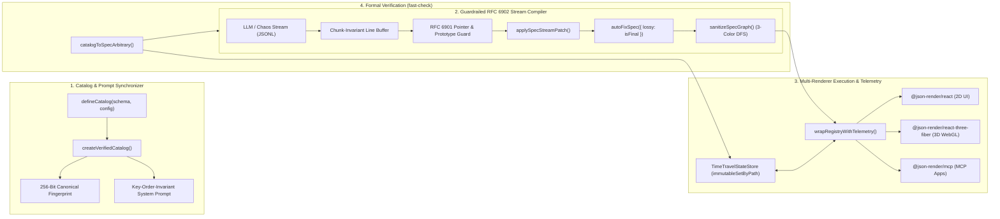

# GenUI Studio (`GenUI-kit`)

[](./LICENSE)
[](https://github.com/vercel-labs/json-render)
[](./.kiro/specs/core-skeleton/correctness.md)
[](./.kiro)
[](./tsconfig.base.json)

**GenUI Studio** is a commercial-grade, open-source **Generative UI Skeleton Framework & Formal Verification Workbench** powered by Vercel's `@json-render` ecosystem (`@json-render/core`, `@json-render/react`, `@json-render/shadcn`, `@json-render/react-three-fiber`, `@json-render/mcp`) and orchestrated via **Kiro Spec-Driven Development**.

---

## Why GenUI Studio Exists

Modern AI agents need to stream rich, interactive user interfaces—telemetry dashboards, multi-step forms, incident remediation playbooks, and 3D spatial topologies—rather than walls of static Markdown. Allowing LLMs to emit raw JSX or HTML is slow, unsafe (XSS), and fragile.

While guardrailed JSON-to-UI (`@json-render`) constrains output via Zod component catalogs, production engineering teams still face two critical failure modes:
1. **Schema–Component–Prompt Drift:** Keeping React/Three.js component implementations, Zod catalog schemas, action handlers, and AI system prompts (`catalog.prompt()`) strictly synchronized.
2. **Adversarial & Hallucinated Stream Topologies:** Guaranteeing that arbitrary, chunk-fragmented RFC 6902 JSONL patch streams emitted by an LLM cannot trigger React hydration crashes, cyclic graph infinite loops (`RangeError: Maximum call stack size exceeded`), prototype pollution, non-finite float (`NaN`/`Infinity`/`-0`) corruption, or full-screen whiteouts.

**GenUI Studio** solves both problems at the framework level through a formally verified skeleton core (`@genui-studio/core`) backed by automated `fast-check` property-based fuzzing.

---

## System Architecture



---

## Monorepo Architecture (Skeleton Crew Structure)

```text
GenUI-kit/
├── LICENSE                                  # MIT License
├── package.json                             # Workspace scripts & root configuration
├── pnpm-workspace.yaml                      # Monorepo package topology
├── tsconfig.base.json                       # Shared strict TypeScript compiler configuration
├── .kiro/                                   # Kiro Spec-Driven Development & Agentic Toolkit
│   ├── steering/                            # Permanent architectural & invariant rules
│   │   ├── product.md                       # Vision, anti-slop rules & telemetry aesthetic
│   │   ├── tech.md                          # Grounded @json-render v0.22.0 API reference
│   │   ├── structure.md                     # Monorepo dependency DAG boundaries
│   │   └── genui-invariants.md              # 7 formal runtime, schema & memory invariants
│   ├── specs/
│   │   └── core-skeleton/                   # Formal specifications for @genui-studio/core
│   │       ├── requirements.md              # 20 EARS-syntax requirements (WHEN/WHILE/IF -> SHALL)
│   │       ├── design.md                    # Subsystem blueprints & 3-color DFS algorithms
│   │       ├── correctness.md               # Formal mathematical theorems & PBT bug log
│   │       └── tasks.md                     # Phased engineering execution plan
│   ├── hooks/                               # Event-driven IDE verification hooks & scripts
│   │   ├── catalog-schema-sync.json         # Triggers catalog-audit.mjs on save
│   │   ├── spec-invariants-test.json        # Triggers run-pbt-suite.mjs on save
│   │   ├── raw-jsx-guard.json               # Audits against raw HTML/JSX injection
│   │   └── scripts/
│   │       ├── catalog-audit.mjs            # Executable catalog & boundary parity auditor
│   │       └── run-pbt-suite.mjs            # Executable fast-check PBT verification runner
│   └── powers/
│       └── json-render-power/               # Modular Kiro Power for @json-render engineering
│           ├── POWER.md                     # Onboarding manual & 5 Golden Rules
│           ├── mcp.json                     # Model Context Protocol server configuration
│           └── steering/
│               ├── react-to-catalog.md      # React component -> Guardrailed Catalog playbook
│               └── three-and-mcp-patterns.md# 3D R3F & MCP App integration patterns
├── packages/
│   └── genui-core/                          # @genui-studio/core — Reusable Skeleton Engine
│       └── src/
│           ├── catalog/verified-catalog.ts  # Canonical hashing, prompt sync & prop healing
│           ├── stream/dag-sanitizer.ts      # 3-color DFS cycle severance & XSS/proto sanitizer
│           ├── stream/stream-compiler.ts    # Chunk-invariant RFC 6902 JSONL stream compiler
│           ├── state/time-travel-store.ts   # Structural-sharing StateStore & watch breaker
│           ├── boundary/safe-renderer.tsx   # Per-node ErrorBoundary & DiagnosticHealedBadge
│           ├── telemetry/telemetry-tracker.ts # Real-time throughput, latency & compliance metrics
│           ├── testing/index.ts             # Zod-to-fast-check Arbitraries & invariant runner
│           └── __tests__/invariants.fuzz.test.ts # Automated fast-check property test suite
└── apps/
    ├── finops-command/                      # Application #1: FinOps Command Center (2D B2B SaaS Dashboard)
    │   ├── catalog/                         # 14-Component FinOps Verified Catalog & React Registry
    │   ├── components/                      # Spec & Telemetry X-Ray Drawer & Chaos Injector
    │   ├── data/                            # 240-Account SaaS Ledger Seed & Mutation Engine
    │   └── streams/                         # Dual-Mode RFC 6902 JSONL Stream Engine & Playbooks
    └── spatial-ops/                         # Application #2: Aegis 3D Spatial Incident War-Room (3D + 2D)
        ├── catalog/                         # 14-Component Hybrid 3D (R3F) + 2D (HUD) Verified Catalog
        ├── three/                           # Zero-allocation WebGL canvas, OrbitControls & geometry cache
        ├── components/                      # Spec & Telemetry X-Ray Drawer & SRE incident HUD
        ├── data/                            # 16-Node Microservice Topology & SRE Mutation Engine
        └── streams/                         # RFC 6902 JSONL Incident Scenarios & Spatial Chaos Engine
```

---

## Formal Mathematical Verification (`fast-check` PBT)

Every build and file save in `packages/genui-core` is verified against 4 formal mathematical theorems defined in [`.kiro/specs/core-skeleton/correctness.md`](./.kiro/specs/core-skeleton/correctness.md):

| Theorem ID | Formal Property Verified |
| :--- | :--- |
| **`INV-PBT-01`** | **Stream Chunking Invariance:** For any valid `Spec` generated from a registered `VerifiedCatalog`, splitting its serialized RFC 6902 JSONL stream across arbitrary random byte/character chunk boundaries, `\r\n` vs `\n` delimiters, or streams without trailing newlines always converges to the exact same final `Spec`. |
| **`INV-PBT-02`** | **Adversarial Payload Resilience & Idempotence:** For any fuzzed stream or `Spec` containing `__proto__`/`constructor`/`prototype`, `NaN`/`±Infinity`/`-0`, self-loops (`A -> A`), mutual cycles (`A -> B -> A`), slot cycles, diamond node aliasing, or `javascript:` URIs, the engine never throws an unhandled exception, never pollutes `Object.prototype`, always emits a cycle-free DAG, and is strictly idempotent (`sanitize(sanitize(S)) === sanitize(S)`). |
| **`INV-PBT-03`** | **State Pointer Idempotency, Determinism & Isolation:** Out-of-order and overlapping parent/child batch state mutations (`/a` and `/a/b`) converge deterministically regardless of key order, preserve `===` structural sharing on untouched branches, remain isolated across session stores, and invert cleanly via `undo()`/`redo()`. |
| **`INV-PBT-04`** | **Catalog-to-Prompt Determinism:** Permuting the declaration order of component schemas, Zod object `.shape` properties, actions, or `customRules` produces the exact same 256-bit `catalogHash` and byte-for-byte identical LLM system prompt. |

### Edge-Case Bugs Discovered & Fixed by `fast-check` Shrinking

| Bug ID | Shrunk Counterexample | Fix Implemented in `@genui-studio/core` |
| :--- | :--- | :--- |
| **`BUG-PBT-01`** | EOF stream chunk lacking a trailing `\n` on the final JSONL line | `GuardrailedStreamCompiler.finalize()` explicitly flushes any residual un-newlined buffer before final DAG sanitization. |
| **`BUG-PBT-02`** | `{"op":"replace","path":".../count","value":-0}` and `NaN` | `deepCloneAndSanitizeValue` normalizes `-0 -> 0` and heals `NaN`/`±Infinity` while incrementing `healedPropsCount`. |
| **`BUG-PBT-03`** | Duplicate sibling keys `children: ["el-1", "el-1"]` & diamond aliasing | `sanitizeSpecGraph` tracks a global `mountedNodes` set alongside the 3-color DFS stack to guarantee single-mount tree topology. |
| **`BUG-PBT-04`** | `store.update({ "/a/b": 99, "/a": { b: 1 } })` key-order sensitivity | `TimeTravelStateStore.update()` sorts JSON Pointers by path depth (shallowest first) and then lexicographically before applying `immutableSetByPath`. |
| **`BUG-PBT-05`** | Synchronous leaf throw inside `react-dom/server` (`renderToStaticMarkup`) | `wrapRegistryWithTelemetry()` combines a synchronous `try / catch` around registry component invocation with `<GenUIElementErrorBoundary>`. |

---

## Quick Start & Verification Commands

```bash
# 1. Install workspace dependencies
pnpm install

# 2. Run the fast-check Property-Based Testing (PBT) suite across all apps
pnpm test

# 3. Run the Kiro Catalog Audit & Auto-PBT hooks directly
node .kiro/hooks/scripts/catalog-audit.mjs
node .kiro/hooks/scripts/run-pbt-suite.mjs

# 4. Launch Application #1: FinOps Command Center (2D B2B SaaS Dashboard)
pnpm dev:finops
# Open http://localhost:5173

# 5. Launch Application #2: Aegis 3D Spatial Incident War-Room (Three.js WebGL + 2D HUD)
pnpm dev:spatial
# Open http://localhost:5174
```

---

## License

Released under the [MIT License](./LICENSE).
