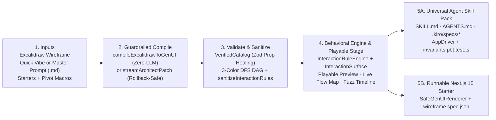

# GenUI Studio

[](./LICENSE)
[](./package.json)
[](./tsconfig.base.json)

A TypeScript monorepo for **Verified Behavioral Specs** and **Universal Agent Skill Packs** built on [`@json-render`](https://github.com/vercel-labs/json-render) `v0.22.0`. Compile Excalidraw wireframes or stream RFC 6902 JSONL specs, run declarative `Trigger -> Guard -> Effect` interaction state machines through `TimeTravelStateStore` and `fast-check`, preview with per-element React error isolation, and export either runnable Next.js 15 starters or executable `AppDriver` contract packs for **Kiro, Cursor, Claude Code, and Codex**.

## Why Verified Behavioral Specs

Static layout tools generate boxes and copy. **GenUI Studio** verifies that interactions, state transitions, and win/lose/complete edge cases actually execute without loops or unsafe mutations—then hands AI coding agents an executable contract suite (`contracts/invariants.pbt.test.ts`) their production app has to pass:

- **`contracts/reference-driver.ts`** drives the exported `contracts/wireframe.spec.json` through `createInteractionRuleEngine()` and **passes** (`GENUI_DRIVER_TARGET=reference`).
- **`contracts/production-driver.ts`** ships as a typed stub throwing `NotImplementedError` and **fails** by default (`GENUI_DRIVER_TARGET=production`) until the AI IDE agent builds the real application and wires the driver to it.
- Verified `shortestTraces` discovered by `fuzzPlaytestSpec()` are baked directly into `contracts/invariants.pbt.test.ts` so the agent must prove its production implementation reaches every verified outcome and preserves every non-UI constraint extracted from a Master Prompt.

## Quick Start

Requires Node.js `>= 22.18.0` and `pnpm@9.15.0`. Core compilation, rule execution, playtest fuzzing, Skill Pack export, starter blueprints, and Pivot Macros require **zero external API keys or backend services**.

```bash
git clone https://github.com/NOBA235/GenUI-kit.git
cd GenUI-kit
pnpm install --frozen-lockfile
pnpm -r build

# Start the Studio Hub Workbench (http://localhost:5175)
pnpm dev:hub
```

To run the standalone reference applications independently:

```bash
pnpm dev:ninety9   # http://localhost:5176 — 1997 Monochrome Archive (6 routes)
pnpm dev:cmos      # http://localhost:5177 — 1994 Award BIOS + 3D PCB IaC Compiler
```

### Optional BYO-LLM Setup (Yantra AI, OpenAI, OpenRouter, Gemini, or Local Ollama)

Freeform `Quick Vibe` and `Master Prompt (.md)` streaming in [`apps/studio-hub/src/lib/llm-architect.ts`](./apps/studio-hub/src/lib/llm-architect.ts) uses a real chunked `ReadableStream` SSE/JSONL client—there is no fake offline NLP parser (`LlmConfigurationRequiredError` is thrown when no endpoint is configured). To enable the safe server-side Vite dev proxy (`POST /api/architect/stream`) without exposing API keys in client bundles, copy [`.env.example`](./.env.example) to `.env.local` (gitignored) and restart `pnpm dev:hub` — `VibeReframeBar` automatically detects `/api/architect/status` and enables the proxy:

```bash
# Example: Yantra AI (OpenAI-compatible router at https://api.aitklabs.in/v1)
GENUI_LLM_API_KEY=yk_live_your_key_here
GENUI_LLM_BASE_URL=https://api.aitklabs.in/v1
GENUI_LLM_MODEL=auto:fast
```

Supported providers include **Yantra AI** (`https://api.aitklabs.in/v1`, models `auto:fast`, `auto:cheap`, `auto:reasoning`, or `provider/model`), **OpenAI**, **OpenRouter**, **Google Gemini** (`streamGenerateContent?alt=sse`), and **local Ollama** (`http://localhost:11434/v1`, no cloud key required).

## How It Works



1. **5-Second Playable Workbench (`/play`, [`PlayableWorkbenchPage.tsx`](./apps/studio-hub/src/pages/PlayableWorkbenchPage.tsx)):** Ships with the **Signal Relay Vault** playable starter ([`playable-starter.ts`](./apps/studio-hub/src/lib/playable-starter.ts)) where every click, drag-and-drop, keyboard shortcut, and timer tick dispatches through `InteractionSurface` ([`dom-bridge.tsx`](./packages/genui-core/src/interaction/dom-bridge.tsx)) into `InteractionRuleEngine` and `TimeTravelStateStore` (zero ad-hoc component domain state). Switch cleanly across **Playable Preview**, **Live Flow Map** ([`FlowMapView.tsx`](./apps/studio-hub/src/components/FlowMapView.tsx), pulsing active rules & edges live), and read-only **Excalidraw Source** ([`ExcalidrawSourceView.tsx`](./apps/studio-hub/src/components/ExcalidrawSourceView.tsx)), with **Play | Edit | Fuzz** history scrubbing & winning-trace replay ([`PlaytestTimelineBar.tsx`](./apps/studio-hub/src/components/PlaytestTimelineBar.tsx)) and slide-over rule/audit inspection ([`RuleInspectorDrawer.tsx`](./apps/studio-hub/src/components/RuleInspectorDrawer.tsx)).
2. **Deterministic Wireframe Compilation ([`apps/studio-hub/src/lib/excalidraw-compiler.ts`](./apps/studio-hub/src/lib/excalidraw-compiler.ts)):** Pure synchronous compilation maps Excalidraw shapes to active catalog components by explicit tag, label, or keyword, sorts children deterministically by `(minY, minX)` with UTF-16 code-point tie-breaking, and turns labelled arrows into RFC 6901 `$state` pointer bindings (`/wireframeBindings/<label>`). Makes zero network or LLM calls (audited by [`audit-wireframe-compiler.mjs`](./apps/studio-hub/scripts/audit-wireframe-compiler.mjs)). Pure one-way `.excalidraw.json` export lives separately in [`spec-to-excalidraw.ts`](./apps/studio-hub/src/lib/spec-to-excalidraw.ts).
3. **Dual-Mode Streaming BYO-LLM & Honest Offline Pivot Macros ([`VibeReframeBar.tsx`](./apps/studio-hub/src/components/VibeReframeBar.tsx), [`llm-architect.ts`](./apps/studio-hub/src/lib/llm-architect.ts), [`pivot-macros.ts`](./apps/studio-hub/src/lib/pivot-macros.ts)):**
   - **Quick Vibe (`vibe`):** Streams `BRIEF:` + RFC 6902 JSONL patches for `elements`, `state`, and `/experience/rules` with full snapshot rollback on abort or HTTP/stream error.
   - **Master Prompt (`master-prompt`):** Auto-detected on pasted text `> 300` chars or Markdown headings (with `.md` file upload); extracts UI flows with `sourceSection` tags, preserves non-UI backend/DB/auth/stack requirements verbatim via `CONSTRAINTS: [...]` (`preservedConstraints[]`), and runs `fuzzPlaytestSpec()` immediately to surface reachable traces and `deadRules`.
   - **Offline Pivot Macros:** Four deterministic zero-key RFC 6902 macros (`+ Add Countdown Timer`, `+ Add Win Goal`, `+ Add Drag & Drop`, `Simplify Unused Nodes`).
4. **Graph Sanitization, Interaction Engine & Fuzzer ([`packages/genui-core`](./packages/genui-core)):** Enforces a 3-color DFS DAG invariant, blocks prototype-pollution keys (`__proto__`, `constructor`, `prototype`) and unsafe URIs (`javascript:`, `vbscript:`, `data:text/html`), clamps out-of-range numeric props, executes declarative `InteractionRule[]` inside `createInteractionRuleEngine()` with a 32-transition circuit breaker and rewindable `TimeTravelStateStore` history (`scrubToHistoryIndex()`), generates procedural Web Audio cues (`createWebAudioSynth()`), and playtest-fuzzes rules with `fast-check` (`fuzzPlaytestSpec()`).
5. **Fault-Isolated Rendering (`<SafeGenUIRenderer>`):** Mounts each catalog component on its own React fiber inside `<GenUIElementErrorBoundary>` so invalid or throwing blocks degrade to `<ElementFaultCard />` while sibling components remain interactive across SSR (`renderToString` / `renderToStaticMarkup`) and client hydration (`hydrateRoot`).
6. **Dual Export Modes ([`PlayableExportDialog.tsx`](./apps/studio-hub/src/components/PlayableExportDialog.tsx), [`TemplateExportDialog.tsx`](./apps/studio-hub/src/components/TemplateExportDialog.tsx), [`packages/templates`](./packages/templates)):**
   - **Mode A — Universal Agent Skill & Contract Pack ([`skill-pack-exporter.ts`](./packages/templates/src/skill-pack-exporter.ts)):** Exports `SKILL.md`, `AGENTS.md`, `.kiro/specs/<slug>/{requirements,design,tasks}.md`, `.kiro/steering/visual-intent.md`, `.cursor/rules/genui-spec.mdc`, `contracts/{app-driver.ts,reference-driver.ts,production-driver.ts,wireframe.spec.json,catalog.ts,invariants.pbt.test.ts}`, and optional `wireframe/<slug>.excalidraw.json`.
   - **Mode B — Runnable Next.js 15 Starter ([`exporter.ts`](./packages/templates/src/exporter.ts), [`base-shell.ts`](./packages/templates/src/base-shell.ts)):** Packages a self-contained Next.js 15 `.zip` starter bundling `app/page.tsx` wired to `InteractionSurface` + `createInteractionRuleEngine()`, `src/template/wireframe.spec.json`, `src/template/catalog.ts`, `wireframe/<slug>.excalidraw.json`, and Kiro design docs.

## Packages & Applications

| Workspace | Package | Dev Command | Description |
| :--- | :--- | :--- | :--- |
| [`packages/genui-core`](./packages/genui-core) | `@genui-studio/core` | — | Verified Zod catalogs (`createVerifiedCatalog`), 3-color DFS DAG sanitizer, guardrailed JSONL stream compiler, `TimeTravelStateStore`, declarative `InteractionRuleEngine`, `InteractionSurface` DOM bridge, procedural Web Audio synth, `<SafeGenUIRenderer>`, and `fast-check` catalog & playtest fuzzer (`@genui-studio/core/testing`). |
| [`packages/templates`](./packages/templates) | `@genui-studio/templates` | — | Universal Agent Skill & Contract Pack exporter (`buildSkillPack`, `buildSkillPackFiles`, `generateSkillPackZip`), dual-mode template registry, `@scope` CSS isolation, Next.js 15 `.zip` exporter, and 6 MIT starters/apps. |
| [`packages/genui-cli`](./packages/genui-cli) | `genui-studio` | — | CLI for validating specs (`validate`), playtest-fuzzing behavioral rules (`fuzz`), exporting Universal Agent Skill Packs (`export-skill`), scaffolding templates (`add`), listing packs (`list`), and exporting Next.js starters (`export`). |
| [`apps/studio-hub`](./apps/studio-hub) | `@genui-studio/studio-hub` | `pnpm dev:hub` (`:5175`) | `/play` **Signal Relay Vault** playable workbench (`Playable Preview` · `Live Flow Map` · `Excalidraw Source`, `Play/Edit/Fuzz` timeline scrubber, `RuleInspectorDrawer`, dual-mode `VibeReframeBar`, dual Mode A/B export), Excalidraw Wireframe Architect, `<WireframeDiagnosticsStrip />`, X-Ray PBT inspector, and Vite `/api/architect/stream` dev proxy. |
| [`apps/ninety9-archive`](./apps/ninety9-archive) | `@genui-studio/app-ninety9-archive` | `pnpm dev:ninety9` (`:5176`) | Standalone 6-route 1997 monochrome workstation archive (34 dossiers, 5-tone monochrome token set, playable 1-bit arcade) running on `@genui-studio/core`. |
| [`apps/cmos-cloud-bios`](./apps/cmos-cloud-bios) | `@genui-studio/app-cmos-cloud-bios` | `pnpm dev:cmos` (`:5177`) | Standalone keyboard-first 1994 Award CMOS BIOS with 3D WebGL PCB twin (`@react-three/fiber`), FSK modem audio, and deterministic Terraform / Docker Compose / Vercel IaC output. |

## Programmatic Usage

```tsx
import { z } from "zod";
import { defineRegistry, JSONUIProvider } from "@json-render/react";
import { schema } from "@json-render/react/schema";
import {
  createGuardrailedStreamCompiler,
  createInteractionRuleEngine,
  createVerifiedCatalog,
  SafeGenUIRenderer,
  wrapRegistryWithTelemetry,
  type InteractionRule,
} from "@genui-studio/core";
import { fuzzPlaytestSpec } from "@genui-studio/core/testing";

const catalog = createVerifiedCatalog(schema, {
  components: {
    MetricCard: {
      description: "Bounded KPI card",
      props: z.object({
        label: z.string().min(1).max(64),
        uptimePercent: z.number().min(0).max(100),
      }),
      slots: [],
    },
  },
  actions: {},
});

const { registry } = defineRegistry(catalog.catalog, {
  components: {
    MetricCard: ({ props }) => (
      <section>
        <h2>{props.label}</h2>
        <p>{props.uptimePercent}%</p>
      </section>
    ),
  },
});

const compiler = createGuardrailedStreamCompiler({ catalog });
compiler.push(
  '{"op":"add","path":"/root","value":"kpi-1"}\n' +
    '{"op":"add","path":"/elements/kpi-1","value":{"type":"MetricCard","props":{"label":"API","uptimePercent":140},"children":[]}}\n',
);
const { spec, healedDiagnostics } = compiler.finalize(); // uptimePercent clamped 140 -> 100

const rules: InteractionRule[] = [
  {
    id: "boost-score",
    label: "Boost Score",
    trigger: { type: "onClick", elementKey: "kpi-1" },
    effects: [{ type: "inc", path: "/score", by: 1, max: 2 }],
  },
  {
    id: "win-at-two",
    label: "Reach Target",
    once: true,
    trigger: { type: "onStateMatch" },
    guards: [{ op: "gte", path: "/score", value: 2 }],
    effects: [{ type: "setOutcome", outcome: "win", reason: "Target reached" }],
  },
];

// Verify winnability and extract minimal traces before rendering or exporting
const fuzz = fuzzPlaytestSpec({ initialState: { score: 0 }, rules, numRuns: 100, seed: 42 });
const engine = createInteractionRuleEngine({ initialState: { score: 0 }, rules });
const safeRegistry = wrapRegistryWithTelemetry(catalog, registry, { showHealedBadges: true });

export function Example() {
  return (
    <JSONUIProvider registry={safeRegistry} store={engine.store}>
      <SafeGenUIRenderer
        spec={spec}
        registry={safeRegistry}
        catalog={catalog}
        healedDiagnostics={healedDiagnostics}
      />
    </JSONUIProvider>
  );
}
```

## CLI

```bash
# List registered starter packs and templates
npx genui-studio list

# Validate a Spec JSON or JSONL stream against DAG & safety invariants
npx genui-studio validate ./path/to/spec.json

# Playtest-fuzz a behavioral spec and assert required outcomes are reachable (exits 1 if unreachable)
npx genui-studio fuzz ./contracts/wireframe.spec.json --runs=100 --seed=42 --require-outcome=win

# Export a Universal Agent Skill & Contract Pack (.zip) for Kiro, Cursor, Claude Code, and Codex
npx genui-studio export-skill saas-dashboard-starter --out ./skill-pack.zip
npx genui-studio export-skill ./contracts/wireframe.spec.json --out ./app-skill-pack.zip

# Scaffold a template into the current project or export a standalone Next.js 15 starter archive
npx genui-studio add product-landing-starter
npx genui-studio export saas-dashboard-starter --out ./starter.zip
```

### Running the Exported Skill Pack Contract Loop

Inside any unpacked `<slug>-skill-pack/`:

```bash
# 1. Confirm the reference behavioral model passes (exits 0)
GENUI_DRIVER_TARGET=reference npx vitest run contracts/invariants.pbt.test.ts

# 2. Confirm the production contract fails with NotImplementedError until the app is wired
npx vitest run contracts/invariants.pbt.test.ts
```

## Included Reference Applications

All templates in [`packages/templates`](./packages/templates) are MIT-licensed and can be previewed in Studio Hub or exported via CLI / `.zip`:

- `product-landing-starter` / `saas-dashboard-starter` — Minimal starter catalogs wired directly to the Excalidraw Wireframe Architect presets.
- `afterdark-horror` — Five 3D WebGL cemetery and crypt scenes (`THREE.InstancedMesh`), procedural Web Audio synthesis, and dark-to-light theme restoration.
- `ninety9-archive` — Paper-white 1997 monochrome archive with 6 routes, 34 indexed dossiers, and a playable 1-bit arcade (also packaged as [`apps/ninety9-archive`](./apps/ninety9-archive)).
- `cmos-cloud-bios` — Keyboard-driven 1994 Award BIOS, 3D PCB thermal monitor, and deterministic `docker-compose.yml` / `vercel.json` / `main.tf` compiler (also packaged as [`apps/cmos-cloud-bios`](./apps/cmos-cloud-bios)).
- `neuro-chimera-synth` — Physarum bio-SQL network simulator, recursive-descent SQL parser with EXPLAIN cost planner, three deterministic local optimizer agents, and Web Audio FM synthesis.

## Development & Verification

```bash
# Workspace integrity, build, typecheck, lint, and tests across all 6 packages
node scripts/check-workspace-scripts.mjs
pnpm -r build
pnpm -r typecheck
pnpm -r lint
pnpm -r test

# Static catalog/boundary audit, fast-check core fuzz suite, and zero-LLM compiler bundle audit
node .kiro/hooks/scripts/catalog-audit.mjs
node .kiro/hooks/scripts/run-pbt-suite.mjs
node apps/studio-hub/scripts/audit-wireframe-compiler.mjs
```

Key verified test suites:

- **Declarative interaction engine & playtest fuzzer:** [`packages/genui-core/src/__tests__/interaction-engine.pbt.test.ts`](./packages/genui-core/src/__tests__/interaction-engine.pbt.test.ts) verifies triggers/guards/effects, the 32-step circuit breaker, prototype-pollution and URI sanitization, `scrubToHistoryIndex()` rewind & `once` re-arming, `shortestTraces` + `deadRules` detection, procedural Web Audio synthesis, and `fast-check` random-event safety.
- **Universal Agent Skill Pack & dual-driver contract gate:** [`packages/templates/src/__tests__/skill-pack-exporter.test.ts`](./packages/templates/src/__tests__/skill-pack-exporter.test.ts) unpacks a real generated Skill Pack `.zip` and executes `contracts/invariants.pbt.test.ts` via Vitest twice—passing under `GENUI_DRIVER_TARGET=reference` and failing with `NotImplementedError` under `GENUI_DRIVER_TARGET=production`—plus verbatim `preservedConstraints[]` survival across `SKILL.md` and `.kiro/specs/<slug>/*`.
- **CLI behavioral commands:** [`packages/genui-cli/src/__tests__/cli.test.ts`](./packages/genui-cli/src/__tests__/cli.test.ts) tests `genui-studio fuzz` (exit `0` on reachable outcomes, non-zero on unreachable outcomes) and `genui-studio export-skill`.
- **Streaming BYO-LLM architect, Master Prompt mode & Pivot Macros:** [`apps/studio-hub/src/__tests__/llm-architect.test.ts`](./apps/studio-hub/src/__tests__/llm-architect.test.ts) exercises split-chunk OpenAI/Yantra & Gemini `ReadableStream` SSE decoding, hostile payload healing/blocking, mid-stream abort & HTTP-500 transactional rollback, multi-section Markdown Master Prompt extraction wired into `buildSkillPackFiles()`, `LlmConfigurationRequiredError` zero-key honesty, all 4 offline Pivot Macros, and deterministic Excalidraw round-tripping.
- **Playable workbench DOM E2E & Flow Map pulses:** [`apps/studio-hub/src/__tests__/playable-workbench.e2e.test.tsx`](./apps/studio-hub/src/__tests__/playable-workbench.e2e.test.tsx) and [`apps/studio-hub/src/__tests__/playable-starter.test.ts`](./apps/studio-hub/src/__tests__/playable-starter.test.ts) mount the `/play` Signal Relay Vault in `jsdom`, fire real DOM click and drag-and-drop events until `outcome === "win"`, scrub backward and replay through `TimeTravelStateStore`, run **Verify Winnability** and **Auto-Replay Winning Trace**, assert pulsed `FlowMapView` edges, and exercise both Mode A (Skill Pack) and Mode B (Next.js Starter) exports.
- **End-to-end workbench journey & zero-LLM compiler proof:** [`apps/studio-hub/src/__tests__/workbench-journey.e2e.test.tsx`](./apps/studio-hub/src/__tests__/workbench-journey.e2e.test.tsx), [`apps/studio-hub/src/__tests__/wireframe-proof.test.ts`](./apps/studio-hub/src/__tests__/wireframe-proof.test.ts), and [`packages/genui-core/src/__tests__/safe-renderer-dom.test.tsx`](./packages/genui-core/src/__tests__/safe-renderer-dom.test.tsx). CI runs all checks in [`.github/workflows/ci.yml`](./.github/workflows/ci.yml).

## Security & Verification Boundaries

- **Enforced:** DAG cycle & multi-parent severance, depth/element/value budgets, rule/guard/effect/transition budgets (max `64` rules, `16` guards, `16` effects, depth `6`, `32` transitions/step), prototype-pollution key rejection, unsafe URI neutralization (`javascript:`, `vbscript:`, `data:text/html`), zero raw HTML injection (`eslint.config.mjs`), per-node error boundaries, server-side dev proxy isolation for `GENUI_LLM_API_KEY`, and secret-file exclusion during `.zip` export (`.env*`, `.git`, `node_modules`).
- **Honest scope limits:**
  - `fast-check` suites are empirical property-based tests (not exhaustive formal verification); randomized fuzzing proves reachability of discovered traces and tests bounded invariants rather than proving universal absence of bugs across infinite state spaces.
  - Arbitrary untrusted React component source code inside a custom component registry is not sandboxed; catalog component implementations must be trusted application code.
  - Live external LLM provider calls (Yantra AI, OpenAI, OpenRouter, Gemini, Ollama) are verified in CI via deterministic chunked `ReadableStream` test doubles; live remote calls depend on user-supplied credentials or a running local Ollama instance.

## Deployment & Documentation

- **Static deployment:** Preconfigured for Vercel ([`vercel.json`](./vercel.json)) and Netlify ([`netlify.toml`](./netlify.toml)) with SPA rewrites, plus standalone app configs at [`apps/ninety9-archive/vercel.json`](./apps/ninety9-archive/vercel.json) and [`apps/cmos-cloud-bios/vercel.json`](./apps/cmos-cloud-bios/vercel.json).
- **Kiro specs, steering & hooks:** [`.kiro/`](./.kiro) and detailed project architecture walkthrough in [`SUBMISSION.md`](./SUBMISSION.md).
- **License:** [MIT](./LICENSE).
