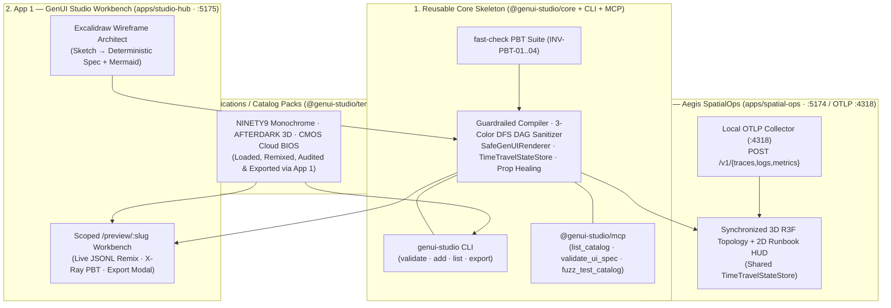

# GenUI Studio (`GenUI-kit`)

<div align="center">

[](./LICENSE)
[](./.kiro/specs/core-skeleton/correctness.md)
[](https://github.com/vercel-labs/json-render)
[](./packages/genui-mcp)
[](./.kiro)
[](./tsconfig.base.json)
[](./package.json)

**A guardrailed Generative UI compiler skeleton (`@genui-studio/core`, built on `@json-render` `v0.22.0`) for visually sketching, runtime-hardening, property-testing, and isolating crash-proof React & 3D interfaces—powering two distinct applications and installable example apps.**

[**Quickstart**](#-zero-setup-quickstart) • [**Workbench (`apps/studio-hub`)**](#-app-1-genui-workbench--wireframe-architect-appsstudio-hub) • [**SpatialOps (`apps/spatial-ops`)**](#-app-2-aegis-spatialops-telemetry-workbench-appsspatial-ops) • [**Featured Apps**](#-featured-applications-built-with-genui-studio-genui-studiotemplates) • [**Kiro & PBT**](#-property-based-testing--real-bugs-caught)

</div>

---

## 🎯 What GenUI Studio Is (In 20 Seconds)

**One core skeleton (`@genui-studio/core` + CLI + MCP + `.kiro/`) powering two radically different applications:**

1. **Core Skeleton (`packages/genui-core`, `packages/genui-cli`, `packages/genui-mcp`):** Hardens [`@json-render`](https://github.com/vercel-labs/json-render) (`v0.22.0`) with a 3-color DFS DAG cycle sanitizer, RFC 6901 prototype-pollution & XSS URI blocker, numeric/enum prop healing (`<DiagnosticHealedBadge />`), hook-safe per-element React error boundaries (`<SafeGenUIRenderer>`), an immutable `TimeTravelStateStore`, a CI spec validator (`genui-studio validate`), `fast-check` PBT suites, and an MCP server.
2. **App 1 — GenUI Studio Workbench (`apps/studio-hub`, `:5175`):** Developer authoring & verification workbench featuring the lazy-loaded **Excalidraw Wireframe Architect** (sketch boxes, containment frames & state arrows → deterministic Zod-backed `Spec` + `.kiro` Mermaid diagram with no LLM call required), scoped `/preview/:slug` inspection, live JSONL remix streaming, X-Ray PBT/telemetry diagnostics, and runnable project export.
3. **App 2 — Aegis SpatialOps (`apps/spatial-ops`, `:5174` / OTLP `:4318`):** Production-style SRE observability command center ingesting local OpenTelemetry OTLP/HTTP JSON (`POST /v1/{traces,logs,metrics}`) into a synchronized **3D WebGL microservice topology (`15` spatial/HUD components)** + **2D incident runbook HUD** driven by the exact same `TimeTravelStateStore`.

> [!NOTE]
> **Local Showcase Environment & Transparency:** Run both applications locally with zero API keys (`pnpm dev` starts Studio Workbench on `http://localhost:5175` and SpatialOps on `http://localhost:5174` + OTLP `:4318`). Telemetry defaults to real local OTLP ingestion (`--demo` activates the synthetic mesh simulator); offline CLI license checks default to `"local-format-demo"` unless wired to a custom `LicenseVerifier`.

---

## 📑 Table of Contents

- [Why GenUI Studio Exists (The Real-World Problem)](#-why-genui-studio-exists-the-real-world-problem)
- [How GenUI Studio Extends `@json-render` v0.22.0](#-how-genui-studio-extends-json-render-v0220)
- [Skeleton Architecture](#-skeleton-architecture)
- [Zero-Setup Quickstart](#-zero-setup-quickstart)
- [App 1: GenUI Workbench & Wireframe Architect (`apps/studio-hub`)](#-app-1-genui-workbench--wireframe-architect-appsstudio-hub)
- [App 2: Aegis SpatialOps Telemetry Workbench (`apps/spatial-ops`)](#-app-2-aegis-spatialops-telemetry-workbench-appsspatial-ops)
- [Featured Applications Built With GenUI Studio (`@genui-studio/templates`)](#-featured-applications-built-with-genui-studio-genui-studiotemplates)
- [Core Skeleton Engine (`@genui-studio/core`)](#-core-skeleton-engine-genui-studiocore)
- [Spec Validator CLI (`genui-studio`) & MCP Server (`@genui-studio/mcp`)](#-spec-validator-cli-genui-studio--mcp-server-genui-studiomcp)
- [Property-Based Testing & Real Bugs Caught](#-property-based-testing--real-bugs-caught)
- [Kiro Spec-Driven Agentic Ecosystem](#-kiro-spec-driven-agentic-ecosystem)
- [Monorepo Structure](#-monorepo-structure)
- [Documentation & License](#-documentation--license)

---

## 💡 Why GenUI Studio Exists (The Real-World Problem)

Teams shipping AI-generated dashboards, workflows, and agent tools run into three immediate production failure modes:

1. **Streamed Payloads Crash React at Runtime:** Fragmented LLM JSONL/SSE streams can introduce cyclic child graphs (`A -> B -> A`), `__proto__` keys, unsafe `javascript:` URIs, `NaN`/`Infinity` values, or out-of-range props that crash the entire React tree.
2. **Schema–Component–Prompt Drift:** Zod component contracts, React/Three.js implementations, and LLM system prompts (`catalog.prompt()`) drift apart silently during fast iteration.
3. **No Shared Design-to-Verify-to-Agent Workflow:** Designers sketch layouts manually while engineers and coding agents lack a shared deterministic compiler, CI spec linter, and MCP verification server grounded in the same catalog.

**GenUI Studio** solves all three as an open-source skeleton layered cleanly **on top of [`@json-render`](https://github.com/vercel-labs/json-render) (`v0.22.0`)**—keeping `@json-render`'s catalog, spec model, and React/R3F renderers while hardening every boundary around them.

---

## 📊 How GenUI Studio Extends `@json-render` (`v0.22.0`)

`@json-render/core`, `@json-render/react`, and `@json-render/react-three-fiber` (`v0.22.0`) provide the upstream catalog, patch compiler primitives, and renderers. GenUI Studio adds the surrounding visual compiler, runtime defense-in-depth, and automated verification pipeline:

| Capability / Failure Mode | Raw JSX / HTML Streaming | Base `@json-render` (`v0.22.0`) | **GenUI Studio (`GenUI-kit`) Skeleton** |
| :--- | :--- | :--- | :--- |
| **Visual Wireframe Authoring** | Hand-coded prompts / JSX | JSON / code Spec authoring | **Excalidraw Wireframe Architect** (`excalidraw-compiler.ts` → deterministic `Spec` + `.kiro` Mermaid, no LLM call) |
| **Cyclic Graph & Recursion Caps** | ❌ Infinite loop crash | ⚠️ Unbounded unless externally validated | ✅ **3-Color DFS DAG Sanitizer** + `maxDepth`/`maxElements`/`maxValueDepth`/`maxValueNodes` |
| **Prototype Pollution & XSS** | ❌ Critical XSS surface | ⚠️ Relies on caller input hygiene | ✅ **RFC 6901 Pointer Guard** (drops `__proto__`, `constructor`, `prototype`; blocks `javascript:`/`vbscript:`/`data:text/html`) |
| **LLM Prop & Enum Drift** | ❌ Runtime throw / broken UI | ❌ Strict validation rejection | ✅ **Semantic Case/Separator Enum Healing, Clamping & `<DiagnosticHealedBadge />`** |
| **Hook-Safe Fault Isolation** | ❌ Whole tree crashes | ⚠️ Component throw unmounts parent | ✅ **`<SafeElementInvoker>` + `<GenUIElementErrorBoundary>`** (preserves hook order across patch transitions) |
| **Non-Finite Floats** | ❌ `NaN`/`Infinity` breaks JSON | ⚠️ Passes through raw JS numbers | ✅ **Sanitized & Normalized** (`-0 -> 0`, `NaN`/`±Infinity -> 0` + recorded healing diagnostic) |
| **Chunk-Invariant Streaming** | ❌ Partial tag syntax errors | ⚠️ Manual SSE / stream framing | ✅ **Bounded Buffer** supporting `JSONL`, **SSE `data:`/`[DONE]`**, and **whole-Spec `{ root, elements }`** |
| **Immutable Time-Travel State** | ❌ Ad-hoc state mutations | ⚠️ Standard `createStateStore()` | ✅ **Deep-Frozen `TimeTravelStateStore`** (depth-sorted batches, `===` structural sharing, `undo()`/`redo()`) |
| **Catalog Digest, CI & Agents** | ❌ None | ✅ `catalog.prompt()` foundation | ✅ **FIPS 180-4 SHA-256 Prompt Hash**, **`genui-studio validate` CLI**, **`@genui-studio/mcp`**, & **4 `fast-check` PBT Suites** |

---

## 🏛️ Skeleton Architecture



---

## ⚡ Zero-Setup Quickstart

All packages and both showcase applications run locally with **zero API keys** and **zero external accounts**.

```bash
# 1. Clone and install workspace dependencies
git clone https://github.com/NOBA235/GenUI-kit.git
cd GenUI-kit
pnpm install

# 2. Build packages and both apps
pnpm build

# 3. Start both Skeleton Crew apps in parallel
#    -> App 1 (GenUI Workbench): http://localhost:5175
#    -> App 2 (SpatialOps 3D/2D + OTLP :4318): http://localhost:5174
pnpm dev

# Or launch each app individually:
pnpm dev:hub
pnpm dev:spatial
```

### Run Verification & Tooling Checks
```bash
# Workspace test suites & typechecking
pnpm test
pnpm typecheck

# Standalone Kiro verification hook scripts
node .kiro/hooks/scripts/catalog-audit.mjs
node .kiro/hooks/scripts/run-pbt-suite.mjs

# Validate a JSON / JSONL / SSE UI stream from CLI or stdin
pnpm genui-studio validate path/to/spec.jsonl --strict --json

# Start the stdio MCP Server
pnpm mcp
```

---

## 🎨 App 1: GenUI Workbench & Wireframe Architect (`apps/studio-hub`)

`apps/studio-hub` serves as the **visual authoring, inspection, and verification workbench** powered by `@genui-studio/core`:

- **Excalidraw Wireframe Architect ([`WireframeArchitectCanvas.tsx`](./apps/studio-hub/src/components/WireframeArchitectCanvas.tsx) & [`excalidraw-compiler.ts`](./apps/studio-hub/src/lib/excalidraw-compiler.ts)):**
  - Lazy-loads `@excalidraw/excalidraw` on demand inside `/preview/:slug`.
  - Deterministically compiles drawn rectangles, containment frames, text labels, and arrow bindings directly into a Zod-validated `@genui-studio/core` `Spec` tree + `.kiro/specs/<slug>/design.md` Mermaid diagram (**zero LLM API call required**).
  - Binds arrow labels into reactive state paths (`$state` / `$bindState` pointers guarded by `isSafeJsonPointer` and `isDangerousKey`).
- **Scoped Multi-Viewport Preview & HUD ([`StudioHud.tsx`](./apps/studio-hub/src/components/StudioHud.tsx), [`PreviewPage.tsx`](./apps/studio-hub/src/pages/PreviewPage.tsx)):**
  - Switch between `Desktop`, `Tablet`, `Mobile`, and clean `?fullscreen=true` viewports inside CSS-isolated containers (`ScopedTemplateContainer`).
  - Stream **GenUI Live Remix** JSONL patches, step through `TimeTravelStateStore` undo/reset history, inspect live patch/healing telemetry in the **X-Ray Drawer**, and export runnable packages via the **Template Export Dialog** (CLI / `.zip` / MCP snippet).

---

## 📡 App 2: Aegis SpatialOps Telemetry Workbench (`apps/spatial-ops`)

`apps/spatial-ops` proves that `@genui-studio/core` isn't limited to static pages or 2D forms—it drives a real-time **2D + 3D telemetry workbench** on a single shared `TimeTravelStateStore`:

```text
Web UI:         http://localhost:5174
OTLP Collector: http://localhost:4318/v1/{traces,logs,metrics}
```

### Send Real OpenTelemetry Data in 10 Seconds
Point any Node.js, Next.js, Go, or Python service using OTLP/HTTP JSON at SpatialOps, or use the built-in sample emitter:

```bash
export OTEL_EXPORTER_OTLP_ENDPOINT="http://localhost:4318"
export OTEL_EXPORTER_OTLP_PROTOCOL="http/json"

# Emit a faulty multi-service trace + error log + host utilization metric:
pnpm --filter @genui-studio/spatial-ops demo:emit-otlp -- --faulty

# Or boot SpatialOps with the opt-in in-memory mesh simulator:
pnpm --filter @genui-studio/spatial-ops dev:demo
```

- **15 Spatial & SRE Catalog Components:** `AegisWarRoomShell`, `ClusterTopologyCanvas` (R3F WebGL + `OrbitControls`), `ServiceMeshNode3D`, `TrafficFlowEdge3D`, `BlastRadiusSphere3D`, `RegionZoneBoundary3D`, `IncidentHeroBanner`, `ServiceDiagnosticPanel`, `LatencyHistogramCard`, `ErrorLogTailer`, `BlastRadiusDependencyTree`, `RunbookActionDesk`, `ClusterMetricsGrid`, `SreAuditTrailBanner`, and `TraceWaterfallViewer`.
- **Dual-Surface State Coherence:** Adjusting a circuit breaker or failover action in the 2D HUD updates the 3D WebGL nodes, traffic flow velocities, and blast-radius spheres over `@genui-studio/core`'s `TimeTravelStateStore` without remounting the canvas.

---

## 🧩 Featured Applications Built With GenUI Studio (`@genui-studio/templates`)

To prove that `@genui-studio/core` generalizes beyond standard SaaS dashboards and observability consoles, **three radically different showcase applications** are registered in [`packages/templates`](./packages/templates/src/registry-entries.generated.ts). Each is an **example application built on the same catalog-driven runtime**—not a separate project—and can be opened, wireframed, remixed live, and audited inside **App 1 (`apps/studio-hub`)**:

| Showcase Slug | Title | Domain & Paradigm Tested |
| :--- | :--- | :--- |
| **`ninety9-archive`** | **NINETY9 — The Monochrome Archive of the 1990s** | Editorial workstation archive (`34` artifacts, `12` sectors, `1990–1999` timeline, toggleable CRT scanlines, Zod-verified live monochrome remixes) |
| **`afterdark-horror`** | **AFTERDARK 2.0 — Interactive 3D Exploration** | Five interconnected 3D WebGL cemetery/crypt zones, procedural Web Audio soundscape, interactive investigation converging to a Swiss editorial layout |
| **`cmos-cloud-bios`** | **BIOS // NECROMANCER — 1994 CMOS Cloud Compiler** | Keyboard-driven 1994 Award BIOS utility + 3D motherboard twin compiling `docker-compose.yml`, `vercel.json`, and `main.tf` configurations |

*(In addition, `@genui-studio/core/registry` provides `spatial-mesh-starter` and `spatial-ops-3d-pro` template packs for the 3D spatial components.)*

---

## 🔧 Core Skeleton Engine (`@genui-studio/core`)

- **3-Color DFS DAG Sanitizer (`dag-sanitizer.ts`):** Traverses elements with White/Grey/Black DFS states to sever back-edge cycles (`A -> B -> A`) and sibling aliasing, enforces depth and element/value recursion budgets (`maxDepth`, `maxElements`, `maxValueDepth`, `maxValueNodes`), removes dangling child keys, and blocks dangerous prototype keys (`__proto__`, `constructor`, `prototype`) plus unsafe URI schemes (`javascript:`, `vbscript:`, `data:text/html`).
- **Chunk-Invariant Stream Compiler (`stream-compiler.ts`):** Consumes RFC 6902 JSONL patches, SSE `data:`/`[DONE]` streams, or full `{ root, elements, state? }` snapshots across arbitrary byte boundaries, enforcing `maxBufferBytes`, `maxLineLength`, `maxTotalStreamBytes`, and `maxPatches`, then flushing trailing lines on `finalize()`.
- **Deep-Frozen `TimeTravelStateStore` (`time-travel-store.ts`):** Depth-sorts batch JSON Pointer mutations (`/a` before `/a/b`), preserves reference equality (`===`) on untouched subtrees, recursively freezes snapshots (`deepFreezeValue`), and maintains bounded `undo()`/`redo()` history.
- **Hook-Safe Telemetry Boundary (`safe-renderer.tsx`):** Wraps individual components in `<SafeElementInvoker>` + `<GenUIElementErrorBoundary>` so React hook invocation order remains stable across malformed patches, and displays `<DiagnosticHealedBadge />` whenever enum/numeric healing intervened.

---

## 🛠️ Spec Validator CLI (`genui-studio`) & MCP Server (`@genui-studio/mcp`)

### 1. CLI Spec Linter & Pack Scaffolding (`packages/genui-cli`)
```bash
# Validate an LLM stream or spec file in CI (exits non-zero on cycles, XSS URIs, __proto__, or rejected lines)
npx genui-studio validate ./specs/dashboard.jsonl --allowed=WorkspaceShell,KpiMetricCard --strict --json

# Pipe an SSE stream through stdin
cat stream.sse | npx genui-studio validate - --max-depth=12

# Inspect and scaffold spatial template packs (validateLicenseToken defaults to offline "local-format-demo")
npx genui-studio list
npx genui-studio add spatial-mesh-starter
npx genui-studio export spatial-mesh-starter
```

### 2. Model Context Protocol Server (`packages/genui-mcp`)
Configured out-of-the-box in [`.kiro/settings/mcp.json`](./.kiro/settings/mcp.json) over JSON-RPC stdio (`pnpm mcp` / `node ./packages/genui-mcp/dist/cli.js`):

- **Catalog & Spec Verification Tools:**
  - `list_catalog_components` — Returns Zod-derived JSON Schemas and fallback props for target components.
  - `validate_ui_spec` — Validates proposed `Spec` objects, JSONL patch streams, or SSE streams with optional `autoFix`.
  - `fuzz_test_catalog` — Executes randomized `fast-check` property verification runs from the agent loop.
- **OTLP Telemetry & Remediation Tools:**
  - `query_telemetry_metrics`, `fetch_trace_spans`, `execute_remediation`
  - Reads local snapshots written by the SpatialOps OTLP collector at `~/.spatial-ops/otlp-snapshot.json` (configurable via `SPATIAL_OPS_OTLP_SNAPSHOT`), falling back to `DefaultMcpTelemetryProvider` when started with `--demo` or before live traces arrive.

---

## 🔬 Property-Based Testing & Real Bugs Caught

Core runtime invariants are defined in [`.kiro/specs/core-skeleton/correctness.md`](./.kiro/specs/core-skeleton/correctness.md) and verified continuously via `fast-check` (`@genui-studio/core/testing`) plus React DOM (`jsdom`) tests:

| Invariant ID | Verified Property |
| :--- | :--- |
| **`INV-PBT-01`** | **Stream Chunking Invariance:** Arbitrary chunk cuts across valid RFC 6902 JSONL / SSE streams (with or without trailing newlines) converge to the identical final `Spec`. |
| **`INV-PBT-02`** | **Adversarial Payload Resilience & DAG Idempotence:** Fuzzed `__proto__`, `NaN`/`±Infinity`/`-0`, self-loops (`A -> A`), mutual cycles (`A -> B -> A`), oversized lines, and `javascript:` URIs never throw unhandled exceptions, never pollute `Object.prototype`, and sanitize idempotently. |
| **`INV-PBT-03`** | **State Pointer & Batch Permutation Determinism:** Out-of-order parent/child pointer updates (`/a` and `/a/b`) converge regardless of object key order, freeze snapshots, preserve `===` structural sharing, and invert cleanly via `undo()`/`redo()`. |
| **`INV-PBT-04`** | **Catalog-to-Prompt Determinism:** Reordering component declarations or Zod property keys produces the exact same FIPS 180-4 SHA-256 `catalogHash` and prompt output. |

### Real Bugs Discovered by `fast-check` Shrinking
| Bug ID | Shrunk Minimal Counterexample | Root Cause | Resolution |
| :--- | :--- | :--- | :--- |
| **`BUG-PBT-01`** | `fullStream.replace(/\n$/, "")` | Streams ending without a trailing `\n` dropped the final element. | `GuardrailedStreamCompiler.finalize()` flushes residual line buffers before DAG sanitization. |
| **`BUG-PBT-02`** | `{"count": -0}` and `NaN` | `-0` and `NaN` broke canonical serialization equality checks. | `deepCloneAndSanitizeValue` normalizes `-0 -> 0`, heals `NaN`/`±Infinity`, and records diagnostics. |
| **`BUG-PBT-03`** | `children: ["el-1", "el-1"]` | Duplicate sibling keys / diamond aliasing caused React key collisions and DFS loops. | `sanitizeSpecGraph` enforces strict tree ownership via `mountedNodes` + DFS recursion stack. |
| **`BUG-PBT-04`** | `store.update({ "/a/b": 99, "/a": { b: 1 } })` | Batch updates depended on key insertion order. | `TimeTravelStateStore.update()` sorts JSON Pointers by depth (shallowest first). |
| **`BUG-INT-01`** | Clamped out-of-bounds prop during streaming | Subsequent patch ticks cleared healing provenance. | Preserved `HealedDiagnosticsByElement` at `<DiagnosticHealedBadge />`. |

---

## 🤖 Kiro Spec-Driven Agentic Ecosystem

GenUI Studio is orchestrated end-to-end with Kiro customizations under [`.kiro/`](./.kiro):

- **Steering Rules (`.kiro/steering/`):** Permanent constraints (`product.md`, `tech.md`, `structure.md`, `genui-invariants.md`, `spatial-3d-rules.md`) keeping agents synchronized on `@json-render` `v0.22.0` APIs, Skeleton Crew boundaries, and zero-allocation Three.js practices.
- **EARS Formal Specs (`.kiro/specs/`):** Requirements, architecture designs, task lists, and `fast-check` correctness theorems (`core-skeleton/` and `app-spatial-warroom/`).
- **Executable Agent Hooks (`.kiro/hooks/`):**
  - `catalog-schema-sync.json` → runs `.kiro/hooks/scripts/catalog-audit.mjs` to catch Zod/component/prompt drift.
  - `spec-invariants-test.json` → runs `.kiro/hooks/scripts/run-pbt-suite.mjs` on core saves.
  - `raw-jsx-guard.json` → prevents unauthorized raw JSX/HTML generation outside catalogs.
- **Reusable Kiro Power (`.kiro/powers/json-render-power/`):** Packages `POWER.md`, MCP server config, and transformation playbooks for portable agent reuse.

---

## 📂 Monorepo Structure

```text
GenUI-kit/
├── LICENSE                                  # MIT License
├── package.json                             # Root scripts (dev, dev:hub, dev:spatial, mcp, genui-studio, test, build)
├── pnpm-workspace.yaml                      # packages/* & apps/*
├── tsconfig.base.json                       # Shared strict TypeScript configuration
├── SUBMISSION.md                            # Kiroween submission notes & demo breakdown
├── README.md                                # Project overview, quickstart & architecture
├── .kiro/                                   # Specs, Steering, Executable Hooks, Power & MCP settings
├── packages/
│   ├── genui-core/                          # @genui-studio/core — Sanitizer, Stream Compiler, TimeTravelStateStore, SafeGenUIRenderer, Testing
│   ├── genui-cli/                           # genui-studio — Spec validator CLI & template pack scaffolder
│   ├── genui-mcp/                           # @genui-studio/mcp — Stdio MCP server (verification + OTLP snapshot tools)
│   └── templates/                           # @genui-studio/templates — Scoped renderer & Featured Applications registry
└── apps/
    ├── studio-hub/                          # App 1: GenUI Studio Workbench (:5175) — Wireframe Architect, Live Remix, X-Ray PBT & Export
    └── spatial-ops/                         # App 2: Aegis SpatialOps (:5174 / OTLP :4318) — 3D WebGL + 2D Incident Workbench
```

---

## 🏆 Documentation & License

- **Submission Notes & Walkthrough:** [**`SUBMISSION.md`**](./SUBMISSION.md)
- **License:** [**`MIT`**](./LICENSE)
