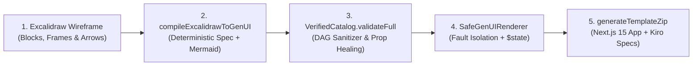

# GenUI Studio

[](./LICENSE)
[](./package.json)
[](./tsconfig.base.json)

A TypeScript monorepo for deterministic, schema-validated Generative UI built on [`@json-render`](https://github.com/vercel-labs/json-render) `v0.22.0`. Draw wireframes in Excalidraw or stream RFC 6902 JSONL specs, validate and heal props against Zod catalogs, preview with per-element React error isolation, and export runnable Next.js 15 starters.

## Quick Start

Requires Node.js `>= 22.18.0` and `pnpm@9.15.0`. No external API keys or backend services are required.

```bash
git clone https://github.com/NOBA235/GenUI-kit.git
cd GenUI-kit
pnpm install --frozen-lockfile
pnpm -r build

# Start the Wireframe-to-Application Workbench (http://localhost:5175)
pnpm dev:hub
```

To run the standalone reference applications independently:

```bash
pnpm dev:ninety9   # http://localhost:5176 — 1997 Monochrome Archive (6 routes)
pnpm dev:cmos      # http://localhost:5177 — 1994 Award BIOS + 3D PCB IaC Compiler
```

## How It Works



1. **Wireframe Compilation (`apps/studio-hub/src/lib/excalidraw-compiler.ts`):** Pure synchronous compilation maps Excalidraw shapes to active catalog components by explicit tag, label, or keyword, sorts children deterministically by `(minY, minX)` with UTF-16 code-point tie-breaking, and turns labelled arrows into RFC 6901 `$state` pointer bindings (`/wireframeBindings/<label>`). Makes zero network or LLM calls.
2. **Graph Sanitization & Prop Healing (`packages/genui-core`):** Enforces a 3-color DFS DAG invariant (severing cycles and multi-parent aliasing), blocks prototype-pollution keys (`__proto__`, `constructor`, `prototype`) and unsafe URIs (`javascript:`, `vbscript:`, `data:text/html`), clamps out-of-range numeric props, and normalizes enums.
3. **Fault-Isolated Rendering (`<SafeGenUIRenderer>`):** Mounts each catalog component on its own React fiber inside `<GenUIElementErrorBoundary>` so invalid or throwing blocks degrade to `<ElementFaultCard />` while sibling components remain interactive across SSR (`renderToString` / `renderToStaticMarkup`) and client hydration (`hydrateRoot`).
4. **Runnable Export (`packages/templates/src/exporter.ts`):** Packages the compiled wireframe into a self-contained Next.js 15 `.zip` archive containing `app/page.tsx`, `src/template/wireframe.spec.json`, `src/template/catalog.ts`, `wireframe/<slug>.excalidraw.json`, `SKILL.md`, and `.kiro/specs/<slug>/design.md`.

## Packages & Applications

| Workspace | Package | Dev Command | Description |
| :--- | :--- | :--- | :--- |
| [`packages/genui-core`](./packages/genui-core) | `@genui-studio/core` | — | Verified Zod catalogs (`createVerifiedCatalog`), 3-color DFS DAG sanitizer (`sanitizeSpecGraph`), bounded JSONL stream compiler, `TimeTravelStateStore`, `<SafeGenUIRenderer>`, and `fast-check` PBT harness (`@genui-studio/core/testing`). |
| [`packages/templates`](./packages/templates) | `@genui-studio/templates` | — | Dual-mode template registry (`Mode A · Native` & `Mode B · Standalone`), `@scope` CSS isolation, Next.js 15 `.zip` exporter, Shadcn registry serializer, and starter packs. |
| [`packages/genui-cli`](./packages/genui-cli) | `genui-studio` | — | CLI for inspecting catalogs, validating JSON/JSONL specs, adding templates, and exporting Next.js starters. |
| [`apps/studio-hub`](./apps/studio-hub) | `@genui-studio/studio-hub` | `pnpm dev:hub` (`:5175`) | Storefront, Excalidraw Wireframe Architect (with Product Landing and SaaS Dashboard presets), `<WireframeDiagnosticsStrip />`, Live Remix bar, X-Ray PBT inspector, and `.zip` exporter. |
| [`apps/ninety9-archive`](./apps/ninety9-archive) | `@genui-studio/app-ninety9-archive` | `pnpm dev:ninety9` (`:5176`) | Standalone 6-route 1997 monochrome workstation archive (34 dossiers, 5-tone monochrome token set, playable 1-bit arcade) running on `@genui-studio/core`. |
| [`apps/cmos-cloud-bios`](./apps/cmos-cloud-bios) | `@genui-studio/app-cmos-cloud-bios` | `pnpm dev:cmos` (`:5177`) | Standalone keyboard-first 1994 Award CMOS BIOS with 3D WebGL PCB twin (`@react-three/fiber`), FSK modem audio, and deterministic Terraform / Docker Compose / Vercel IaC output. |

## Programmatic Usage

```tsx
import { z } from "zod";
import { defineRegistry, JSONUIProvider } from "@json-render/react";
import { schema } from "@json-render/react/schema";
import {
  createGuardrailedStreamCompiler,
  createTimeTravelStateStore,
  createVerifiedCatalog,
  SafeGenUIRenderer,
  wrapRegistryWithTelemetry,
} from "@genui-studio/core";

const catalog = createVerifiedCatalog(schema, {
  components: {
    MetricCard: {
      description: "Bounded KPI card",
      props: z.object({
        label: z.string().min(1).max(64),
        uptimePercent: z.number().min(0).max(100),
      }),
      slots: [],
    },
  },
  actions: {},
});

const { registry } = defineRegistry(catalog.catalog, {
  components: {
    MetricCard: ({ props }) => (
      <section>
        <h2>{props.label}</h2>
        <p>{props.uptimePercent}%</p>
      </section>
    ),
  },
});

const compiler = createGuardrailedStreamCompiler({ catalog });
compiler.push(
  '{"op":"add","path":"/root","value":"kpi-1"}\n' +
    '{"op":"add","path":"/elements/kpi-1","value":{"type":"MetricCard","props":{"label":"API","uptimePercent":140},"children":[]}}\n',
);
const { spec, healedDiagnostics } = compiler.finalize(); // uptimePercent clamped 140 -> 100

const store = createTimeTravelStateStore(spec.state ?? {});
const safeRegistry = wrapRegistryWithTelemetry(catalog, registry, {
  showHealedBadges: true,
});

export function Example() {
  return (
    <JSONUIProvider registry={safeRegistry} store={store}>
      <SafeGenUIRenderer
        spec={spec}
        registry={safeRegistry}
        catalog={catalog}
        healedDiagnostics={healedDiagnostics}
      />
    </JSONUIProvider>
  );
}
```

## CLI

```bash
# List registered starter packs and templates
npx genui-studio list

# Validate a Spec JSON or JSONL stream against a catalog
npx genui-studio validate ./path/to/spec.json

# Scaffold a template into the current project
npx genui-studio add product-landing-starter

# Export a standalone Next.js 15 project archive
npx genui-studio export saas-dashboard-starter --out ./starter.zip
```

## Included Reference Applications

All templates in [`packages/templates`](./packages/templates) are MIT-licensed and can be previewed in Studio Hub or exported via CLI / `.zip`:

- `product-landing-starter` / `saas-dashboard-starter` — Minimal starter catalogs wired directly to the Excalidraw Wireframe Architect presets.
- `afterdark-horror` — Five 3D WebGL cemetery and crypt scenes (`THREE.InstancedMesh`), procedural Web Audio synthesis, and dark-to-light theme restoration.
- `ninety9-archive` — Paper-white 1997 monochrome archive with 6 routes, 34 indexed dossiers, and a playable 1-bit arcade (also packaged as [`apps/ninety9-archive`](./apps/ninety9-archive)).
- `cmos-cloud-bios` — Keyboard-driven 1994 Award BIOS, 3D PCB thermal monitor, and deterministic `docker-compose.yml` / `vercel.json` / `main.tf` compiler (also packaged as [`apps/cmos-cloud-bios`](./apps/cmos-cloud-bios)).
- `neuro-chimera-synth` — Physarum bio-SQL network simulator, recursive-descent SQL parser with EXPLAIN cost planner, three deterministic local optimizer agents, and Web Audio FM synthesis.

## Development & Verification

```bash
# Workspace integrity, build, typecheck, lint, and tests (6 packages, 18 test files, 120 tests)
node scripts/check-workspace-scripts.mjs
pnpm -r build
pnpm -r typecheck
pnpm -r lint
pnpm -r test

# Static catalog/boundary audit, fast-check core fuzz suite, and zero-LLM compiler bundle audit
node .kiro/hooks/scripts/catalog-audit.mjs
node .kiro/hooks/scripts/run-pbt-suite.mjs
node apps/studio-hub/scripts/audit-wireframe-compiler.mjs
```

Key test coverage:

- **End-to-end workbench journey:** [`apps/studio-hub/src/__tests__/workbench-journey.e2e.test.tsx`](./apps/studio-hub/src/__tests__/workbench-journey.e2e.test.tsx) compiles both Landing and SaaS Dashboard wireframes, verifies diagnostics and hostile-input quarantine, renders hook components with live `$state` updates, unpacks the exported `.zip`, and renders the exported `app/page.tsx`.
- **Compiler determinism & zero-network guarantee:** [`apps/studio-hub/src/__tests__/wireframe-proof.test.ts`](./apps/studio-hub/src/__tests__/wireframe-proof.test.ts) verifies 50-run determinism, locale-independent sorting (`da` collation), and runtime I/O tripwires.
- **SSR & hydration parity:** [`packages/genui-core/src/__tests__/safe-renderer-dom.test.tsx`](./packages/genui-core/src/__tests__/safe-renderer-dom.test.tsx) tests `renderToString`, `renderToStaticMarkup`, `hydrateRoot`, and `createRoot` with hook and `React.memo` components.
- **Property-based invariants (`fast-check`):** Suites across `packages/genui-core`, `packages/templates`, `apps/studio-hub`, `apps/ninety9-archive`, and `apps/cmos-cloud-bios`. CI runs all checks in [`.github/workflows/ci.yml`](./.github/workflows/ci.yml).

## Security Boundaries

- **Enforced:** DAG cycle & multi-parent severance, depth/element/value budgets (`maxDepth`, `maxElements`, `maxValueDepth`, `maxValueNodes`), prototype-pollution key rejection, unsafe URI neutralization (`javascript:`, `vbscript:`, `data:text/html`), zero raw HTML injection (`eslint.config.mjs`), per-node error boundaries, and secret-file exclusion during `.zip` export (`.env*`, `.git`, `node_modules`).
- **Out of scope:** Arbitrary untrusted React component source code inside a custom component registry is not sandboxed; catalog component implementations must be trusted application code.

## Deployment & Documentation

- **Static deployment:** Preconfigured for Vercel ([`vercel.json`](./vercel.json)) and Netlify ([`netlify.toml`](./netlify.toml)) with SPA rewrites, plus standalone app configs at [`apps/ninety9-archive/vercel.json`](./apps/ninety9-archive/vercel.json) and [`apps/cmos-cloud-bios/vercel.json`](./apps/cmos-cloud-bios/vercel.json).
- **Kiro specs, steering & hooks:** [`.kiro/`](./.kiro) and detailed project architecture walkthrough in [`SUBMISSION.md`](./SUBMISSION.md).
- **License:** [MIT](./LICENSE).
