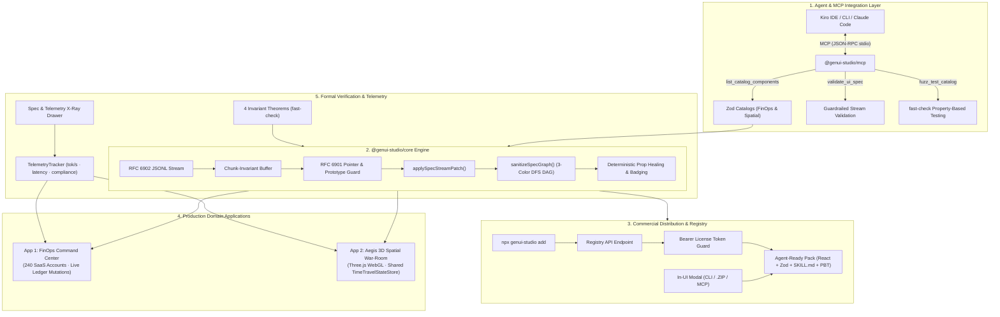

# GenUI Studio (`GenUI-kit`)

<div align="center">

[](./LICENSE)
[-10B981.svg)](./packages/genui-core/src/__tests__)
[](https://github.com/vercel-labs/json-render)
[](./.kiro/specs/core-skeleton/correctness.md)
[](./packages/genui-mcp)
[](./.kiro)
[](./tsconfig.base.json)
[](./package.json)

**The Formally Verified Generative UI Skeleton Framework, Creator Template Registry & Model Context Protocol (MCP) Server.**  
*Powering deterministic, crash-proof 2D/3D streaming interfaces for AI agents, orchestrated with Kiro Spec-Driven Development.*

[**Explore App 1 (FinOps)**](http://localhost:5173) • [**Explore App 2 (3D War-Room)**](http://localhost:5174) • [**Kiroween Submission**](./SUBMISSION.md) • [**Kiro Power Manual**](./.kiro/powers/json-render-power/POWER.md)

</div>

---

> [!IMPORTANT]
> **Kiroween 2026 Hackathon Submission:** For the full judging submission, deep-dive into Kiro's agentic ecosystem (Specs, Steering Docs, Agent Hooks, Powers, MCP, and PBT), the 5 shrunk edge-case bug post-mortems, and the second-by-second **2-Minute 45-Second Demo Video Script**, read [**`SUBMISSION.md`**](./SUBMISSION.md).

---

## 📑 Table of Contents

- [Why GenUI Studio Exists](#-why-genui-studio-exists)
- [Framework Comparison Matrix](#-framework-comparison-matrix)
- [System Architecture](#-system-architecture)
- [Monorepo Structure](#-monorepo-structure)
- [Zero-Setup Quickstart](#-zero-setup-quickstart)
- [Core Skeleton Engine (`@genui-studio/core`)](#-core-skeleton-engine-genui-studiocore)
- [Dual Production Domain Applications](#-dual-production-domain-applications)
  - [App 1: FinOps & RevOps Command Center (2D)](#app-1-finops--revops-command-center-2d)
  - [App 2: Aegis 3D Spatial Incident War-Room (3D + 2D)](#app-2-aegis-3d-spatial-incident-war-room-3d--2d)
- [Model Context Protocol (MCP) Server (`@genui-studio/mcp`)](#-model-context-protocol-mcp-server-genui-studiomcp)
- [Commercial Distribution & Agent Skill Registry (`npx genui-studio add`)](#-commercial-distribution--agent-skill-registry-npx-genui-studio-add)
- [Mathematical Correctness & Property-Based Testing](#-mathematical-correctness--property-based-testing)
- [Kiro Spec-Driven Agentic Ecosystem](#-kiro-spec-driven-agentic-ecosystem)
- [License](#-license)

---

## 💡 Why GenUI Studio Exists

Modern AI coding agents and LLM applications are evolving past plain-text chat. Today's agents must stream complex, interactive user interfaces—financial operations dashboards, multi-step checkout flows, incident remediation playbooks, and 3D spatial infrastructure maps.

However, having LLMs emit raw JSX or HTML introduces three catastrophic failure modes:
1. **Catastrophic Whiteouts & React Hydration Crashes:** Fragmented LLM patch streams can inject cyclic element graphs (`RangeError: Maximum call stack size exceeded`), prototype pollution (`__proto__`), or non-finite numbers (`NaN`/`Infinity`), immediately taking down the user's browser tab.
2. **Schema–Component–Prompt Drift:** In traditional setups, React/Three.js components, Zod schemas, action handlers, and AI system prompts (`catalog.prompt()`) quickly drift apart, resulting in hallucinations and broken components.
3. **Agent Integration & Tooling Disconnect:** AI coding agents lack standardized protocols to inspect available catalogs, validate proposed UI specs before streaming, and run property-based fuzz tests.

**GenUI Studio** solves all three problems at the framework level through a formally verified skeleton core (`@genui-studio/core`), an integrated MCP Server (`@genui-studio/mcp`), a token-gated template pack registry (`genui-studio` CLI), and two full-scale production applications.

---

## 📊 Framework Comparison Matrix

| Capability / Failure Mode | Raw JSX / HTML Streaming | Unchecked `@json-render` | **GenUI Studio (`GenUI-kit`)** |
| :--- | :--- | :--- | :--- |
| **Cyclic Graph Safety** | ❌ Infinite loop whiteout | ❌ Stack overflow | ✅ **3-Color DFS DAG Sanitizer** (severs cycles, zero crash) |
| **Prototype Pollution** | ❌ Critical XSS vulnerability | ❌ Vulnerable to `__proto__` | ✅ **RFC 6901 Escaper** (drops `__proto__`, `constructor`) |
| **Out-of-Bounds Props** | ❌ Throws runtime error | ❌ Throws Zod error | ✅ **Deterministic Healing & `<DiagnosticHealedBadge />`** |
| **Non-Finite Floats** | ❌ `NaN`/`Infinity` breaks JSON | ❌ Corrupts downstream state | ✅ **Clamped & Normalized** (`-0 -> 0`, `NaN -> null`) |
| **Stream Chunk Invariance** | ❌ Syntax errors on partial tags | ⚠️ Drops trailing line buffer | ✅ **Chunk-Invariant Line Buffer** (`INV-PBT-01` verified) |
| **State Mutations & Undo** | ❌ Ad-hoc manual re-renders | ⚠️ Unordered key conflicts | ✅ **Structural-Sharing `TimeTravelStateStore`** (undo/redo) |
| **Agent Tooling Standard** | ❌ None | ⚠️ Manual prompts | ✅ **Model Context Protocol (MCP)** (`stdio` JSON-RPC) |
| **Commercial Distribution** | ❌ None | ❌ None | ✅ **Token-Gated CLI (`npx genui-studio add`) & In-UI `.ZIP`** |
| **Formal Verification** | ❌ None | ⚠️ Example unit tests | ✅ **4 Mathematical Theorems via `fast-check` PBT** |

---

## 🏛️ System Architecture



---

## 📂 Monorepo Structure

```text
GenUI-kit/
├── LICENSE                                  # MIT License
├── package.json                             # Root monorepo scripts (dev, mcp, genui-studio, test)
├── pnpm-workspace.yaml                      # Monorepo topology: packages/* & apps/*
├── tsconfig.base.json                       # Shared strict TypeScript compiler configuration
├── SUBMISSION.md                            # Kiroween 2026 Devpost submission & 2m45s video script
├── README.md                                # Master architectural documentation & guide
├── .kiro/                                   # Kiro Spec-Driven Architecture & Customizations
│   ├── settings/
│   │   └── mcp.json                         # Configured MCP Server for Kiro IDE & CLI
│   ├── steering/                            # Permanent architectural rules
│   │   ├── product.md                       # Vision, anti-slop guidelines & telemetry design
│   │   ├── tech.md                          # Grounded @json-render v0.22.0 API reference
│   │   ├── structure.md                     # Monorepo dependency boundaries
│   │   ├── genui-invariants.md              # 7 formal runtime, schema & memory invariants
│   │   └── spatial-3d-rules.md              # React Three Fiber zero-allocation memory rules
│   ├── specs/                               # Formal Specs in EARS syntax
│   │   ├── core-skeleton/                   # Core engine requirements, design, tasks & PBT theorems
│   │   ├── app-finops-command/              # App 1 specification & mutation requirements
│   │   └── app-spatial-warroom/             # App 2 3D WebGL topology & dual-viewport specification
│   ├── hooks/                               # Event-driven agent verification hooks
│   │   ├── catalog-schema-sync.json         # Audits catalog-registry parity on save
│   │   ├── spec-invariants-test.json        # Runs fast-check PBT suite on save
│   │   ├── raw-jsx-guard.json               # Blocks unauthorized JSX/HTML injection
│   │   └── scripts/                         # Executable hook scripts (Node.js)
│   └── powers/
│       └── json-render-power/               # Reusable Kiro Power for generative UI
│           ├── POWER.md                     # Power manual & 5 Golden Rules
│           ├── mcp.json                     # Power MCP configuration
│           └── steering/                    # React-to-catalog & 3D Three.js transformation playbooks
├── packages/
│   ├── genui-core/                          # @genui-studio/core — Core Reusable Skeleton Engine
│   │   └── src/
│   │       ├── catalog/verified-catalog.ts  # Canonical SHA-256 fingerprinting & prop healing
│   │       ├── stream/dag-sanitizer.ts      # 3-color DFS cycle severance & prototype protector
│   │       ├── stream/stream-compiler.ts    # Chunk-invariant RFC 6902 JSONL compiler
│   │       ├── state/time-travel-store.ts   # Structural-sharing StateStore with undo/redo
│   │       ├── boundary/safe-renderer.tsx   # Per-node error boundary & <DiagnosticHealedBadge />
│   │       ├── telemetry/telemetry-tracker.ts # Real-time tok/s, latency & compliance tracking
│   │       ├── registry/                    # Commercial Template Packs, API endpoints & Exporter
│   │       └── testing/index.ts             # fast-check arbitraries & runCatalogInvariantSuite()
│   ├── genui-cli/                           # genui-studio — Token-gated CLI Installer & Registry Client
│   │   └── src/
│   │       ├── cli.ts                       # npx genui-studio add <pack> command runner
│   │       └── installer.ts                 # Pack unpacker, license verification & skill injector
│   └── genui-mcp/                           # @genui-studio/mcp — Model Context Protocol Server
│       └── src/
│           ├── server.ts                    # McpServer with list, validate, and fuzz tools
│           ├── cli.ts                       # Executable JSON-RPC stdio transport runner
│           ├── schema-describer.ts          # Zod-to-JSON Schema contract extractor
│           └── tools/                       # list_catalog_components, validate_ui_spec, fuzz_test_catalog
└── apps/
    ├── finops-command/                      # Application #1: FinOps & RevOps Command Center (2D)
    │   ├── src/catalog/                     # 14 Zod Components & React registry
    │   ├── src/components/                  # X-Ray Drawer, live telemetry & chaos injector
    │   ├── src/data/                        # 240-account SaaS ledger with live mutation engine
    │   └── src/streams/                     # RFC 6902 JSONL streaming playbooks & judge presets
    └── spatial-ops/                         # Application #2: Aegis 3D Spatial Incident War-Room (3D + 2D)
        ├── src/catalog/                     # 14 Hybrid 3D (R3F) + 2D (HUD) Zod Components
        ├── src/three/                       # WebGL canvas, OrbitControls, emissive nodes, packet edges
        ├── src/components/                  # Spatial X-Ray drawer, live cluster telemetry
        ├── src/data/                        # 16-microservice topology & SRE mutation engine
        └── src/streams/                     # SRE incident stream scenarios & failover playbooks
```

---

## ⚡ Zero-Setup Quickstart

The entire monorepo runs with **zero API keys** and **zero external configuration**. All LLM scenarios are bundled with recorded streaming playbooks and live mutation engines.

```bash
# 1. Clone the repository
git clone https://github.com/NOBA235/GenUI-kit.git
cd GenUI-kit

# 2. Install dependencies across all packages and apps (~10 seconds)
pnpm install

# 3. Build all packages and applications
pnpm build

# 4. Launch BOTH applications in parallel (App 1 on :5173, App 2 on :5174)
pnpm dev

# 5. Run the full test suite (40/40 tests passing across all packages)
pnpm test
```

### Application URLs & Switcher
- **App 1 (FinOps Command Center):** [`http://localhost:5173`](http://localhost:5173)
- **App 2 (Aegis 3D Spatial War-Room):** [`http://localhost:5174`](http://localhost:5174)

> [!TIP]
> Each application features an **App Switcher** in the header navigation bar, allowing one-click toggling between the FinOps Command Center and the 3D Spatial War-Room.

---

## 🧩 Core Skeleton Engine (`@genui-studio/core`)

The core engine provides the foundational runtime primitives that make generative UI production-safe:

### 1. 3-Color DFS DAG Sanitizer (`dag-sanitizer.ts`)
Standard tree renderers crash with infinite recursion when an LLM emits cyclic element graphs (e.g. `nodeA -> nodeB -> nodeA`). Our sanitizer runs a strict 3-color (White/Grey/Black) Depth-First Search over the element graph:
- **Cycle Severance:** When a back-edge to an in-flight Grey node is detected, the cyclic child pointer is severed, preventing infinite recursion while preserving the rest of the tree.
- **Prototype Pollution Prevention:** Rejects any keys matching `__proto__`, `prototype`, or `constructor`.
- **Dangling Pointer Removal:** Removes any child keys referencing elements not present in the spec elements map.

### 2. Chunk-Invariant Stream Compiler (`stream-compiler.ts`)
Network packet boundaries can slice an RFC 6902 JSONL line across arbitrary byte cuts. The compiler maintains a chunk-invariant line buffer:
- Accumulates fragments until a complete newline `\n` is encountered.
- Flushes residual buffers upon stream EOF via `finalize()`.
- Validates patches before applying them, guaranteeing deterministic state convergence.

### 3. Bidirectional TimeTravelStateStore (`time-travel-store.ts`)
A fast, immutable state container utilizing RFC 6901 JSON Pointers (`/ledger/accounts/0/status`):
- **Structural Sharing:** Preserves reference equality (`===`) on unmodified branches for sub-millisecond React render performance.
- **Batch Mutation Ordering:** Automatically sorts batch update keys by pointer depth (shallowest first), ensuring parent containers are instantiated before children.
- **Deterministic Undo/Redo:** Built-in history stack supporting unbounded time-travel without memory leaks.

### 4. Telemetry Error Boundary (`safe-renderer.tsx`)
Wraps every rendered node in a per-component boundary:
- Prevents component-level runtime failures from unmounting sibling trees.
- Displays `<DiagnosticHealedBadge />` with tooltip provenance whenever an out-of-bounds prop was automatically clamped or healed to catalog specifications.

---

## 📱 Dual Production Domain Applications

### App 1: FinOps & RevOps Command Center (2D)
A high-density B2B SaaS revenue operations dashboard managing **240 seeded customer subscription accounts**:

```text
http://localhost:5173
```

- **14 Zod Components:**
  1. `WorkspaceShell`: Top-level FinOps shell organizing metrics and active playbooks.
  2. `SectionGrid`: Responsive multi-column CSS grid container for grouping cards.
  3. `KpiMetricCard`: Executive KPI card with Net MRR, Unsettled Balance, and Churn metrics.
  4. `MrrChurnChart`: 12-month SaaS MRR Waterfall & Churn SVG chart.
  5. `CohortRetentionMatrix`: Regional and plan-tier Net Dollar Retention heatmap.
  6. `AnomalyAlertCard`: Severity-badged alerts for sudden churn spikes or failed webhooks.
  7. `CustomerLedgerTable`: Paginated, filterable table of 240 seeded customer accounts.
  8. `WebhookStreamTicker`: Live ticker monitoring simulated Stripe webhook events.
  9. `IssueRefundCard`: Live mutation card to issue partial/full refunds on disputed balances.
  10. `ExtendTrialCard`: Live mutation card to grant 7/14/30 day trial extensions.
  11. `RetryWebhookCard`: Live mutation card to replay failed Stripe event deliveries.
  12. `RetentionDiscountCard`: Live mutation card applying bounded retention discounts (5%–50%).
  13. `RevenueWaterfallCard`: Breakdown of expansion, contraction, and churned MRR.
  14. `AuditTrailBanner`: Cryptographic audit trail logging every user mutation.
- **Interactive Live Mutations:** Mutating financial state via cards immediately recalculates Net MRR, Unsettled Balances, and Churn rates in the header with 1-click **Time-Travel Undo/Redo**.
- **Adversarial Chaos Injection:** Click **"⚡ Inject Corrupted AI Packet"** to fire prototype pollution attacks, 999% discount props, and cyclic elements directly into the active stream. Watch the guardrails clamp, heal, and badge in real time with **zero crash**.

---

### App 2: Aegis 3D Spatial Incident War-Room (3D + 2D)
An autonomous SRE incident command center combining a **3D WebGL microservice mesh** with a **2D tactical HUD** over a shared `TimeTravelStateStore`:

```text
http://localhost:5174
```

- **14 Spatial Components:**
  1. `AegisWarRoomShell`: SRE war-room container orchestrating 3D canvas and HUD.
  2. `ClusterTopologyCanvas`: React Three Fiber WebGL canvas with OrbitControls and Bloom.
  3. `ServiceMeshNode3D`: 3D emissive microservice node with health-driven shaders.
  4. `TrafficFlowEdge3D`: Animated Bezier curves with flowing traffic packet particles.
  5. `BlastRadiusSphere3D`: Volumetric semi-transparent sphere visualizing outage impact.
  6. `RegionZoneBoundary3D`: Spatial wireframe grid delimiting AWS/GCP cloud regions.
  7. `IncidentHeroBanner`: SEV-1 incident header with MTTR clock and active commander.
  8. `ServiceDiagnosticPanel`: Deep-dive inspector for the currently selected 3D node.
  9. `LatencyHistogramCard`: Real-time p50/p95/p99 latency distribution graph.
  10. `ErrorLogTailer`: Streaming log terminal with search and severity filtering.
  11. `BlastRadiusDependencyTree`: Upstream and downstream dependency topology list.
  12. `RunbookActionDesk`: Interactive SRE controls (Circuit Breakers, Failover, Pod Scaling).
  13. `ClusterMetricsGrid`: Cluster-wide CPU, memory, and network saturation dials.
  14. `SreAuditTrailBanner`: Immutable audit log recording all SRE failover actions.
- **Dual-Viewport State Coherence:** Adjusting an SRE runbook slider or triggering a regional failover in the 2D HUD updates the 3D WebGL scene's emissive node colors, traffic packet velocities, and volumetric blast radius spheres at **60 frames per second** without remounting the Three.js canvas.

---

## 🛠️ Model Context Protocol (MCP) Server (`@genui-studio/mcp`)

GenUI Studio exposes a production **Model Context Protocol (MCP)** server over stdio JSON-RPC. Configured out-of-the-box in [`.kiro/settings/mcp.json`](./.kiro/settings/mcp.json), any MCP-compatible agent (Kiro IDE, Kiro CLI, Claude Desktop, Cursor) can interact directly with our component catalogs:

```bash
# Start standalone stdio MCP server
pnpm mcp
```

### Available MCP Tools

#### 1. `list_catalog_components`
Inspects available components and their Zod schemas across both applications.
```json
// Input:
{
  "app": "finops",
  "componentName": "RetentionDiscountCard"
}

// Output:
{
  "components": [
    {
      "name": "RetentionDiscountCard",
      "description": "Retention discount card applying 5%–50% discount",
      "props": {
        "discountPercent": { "type": "number", "minimum": 5, "maximum": 50 }
      },
      "fallbackProps": { "discountPercent": 15 }
    }
  ]
}
```

#### 2. `validate_ui_spec`
Validates a proposed Spec DAG or raw RFC 6902 JSONL stream against the target catalog, detects cycles, and provides auto-fix suggestions.
```json
// Input:
{
  "app": "finops",
  "spec": { "root": "shell-1", "elements": { ... } },
  "autoFix": true
}

// Output:
{
  "valid": true,
  "issues": [],
  "fixedSpec": { ... }
}
```

#### 3. `fuzz_test_catalog`
Triggers an automated `fast-check` property test run against a component schema or the entire catalog invariant suite.
```json
// Input:
{
  "app": "spatial",
  "componentName": "ClusterTopologyCanvas",
  "numRuns": 50
}

// Output:
{
  "passed": true,
  "numRuns": 50,
  "durationMs": 42
}
```

### Kiro IDE / Claude Desktop MCP Configuration

Add this block to your `.kiro/settings/mcp.json` or `claude_desktop_config.json`:

```json
{
  "mcpServers": {
    "genui-studio": {
      "command": "node",
      "args": ["./packages/genui-mcp/dist/cli.js"],
      "env": { "NODE_ENV": "production" },
      "autoApprove": [
        "list_catalog_components",
        "validate_ui_spec",
        "fuzz_test_catalog"
      ]
    }
  }
}
```

---

## 📦 Commercial Distribution & Agent Skill Registry (`npx genui-studio add`)

GenUI Studio is also a **creator distribution and monetization platform for agent-ready 2D/3D templates, generative UI blocks, and AI Agent Skills**.

### 1. The "Agent-Ready Template Pack" Standard
Every pack in `packages/genui-core/src/registry/` is a self-contained commercial distribution bundle combining:
- **Production React / Three.js Components:** Zero-drift code with fallback props and telemetry instrumentation.
- **Strict Zod Catalog & Canonical Hash (`catalog.ts`):** Cryptographically deterministic schema ensuring the LLM cannot hallucinate props.
- **AI Agent Skill & Kiro Power (`SKILL.md` + `.kiro/powers/`):** Full context injection for Claude Code, Cursor, and Kiro IDE detailing props, camera math, and design system tokens.
- **`fast-check` Property Test Suite (`*.fuzz.test.ts`):** 100-iteration adversarial test verifying zero whiteout crashes.

### 2. Available Template Packs

| Pack ID | Tier | Price | Category | Components | Description |
| :--- | :--- | :--- | :--- | :--- | :--- |
| **`finops-command-pro`** | **Pro** | **$49** | FinOps / RevOps | 14 Components | Full B2B SaaS ledger, 4 live financial mutations, time-travel store, Stripe webhook recovery. |
| **`spatial-ops-3d-pro`** | **Pro** | **$79** | Spatial 3D WebGL | 14 Spatial / HUD | Three.js microservice mesh, dual-viewport state sync, circuit breaker & failover controls. |
| **`saas-kpi-starter`** | **Free** | **$0** | SaaS Dashboards | 6 Components | Metric cards, MRR churn charts, retention heatmap, and audit trail banner. |
| **`spatial-mesh-starter`** | **Free** | **$0** | Spatial 3D | 5 Spatial Nodes | Interactive WebGL cluster canvas, 3D nodes, and latency histogram cards. |

### 3. Token-Gated CLI Installer (`npx genui-studio add`)

Developers and AI coding agents install packs directly into their repositories:

```bash
# Install a free starter pack (no license required)
npx genui-studio add saas-kpi-starter

# Install a Pro commercial template pack (token-gated)
npx genui-studio add finops-command-pro --license=kiroween-2026-judge-pass

# Install a 3D WebGL Pro pack into a target directory
npx genui-studio add spatial-ops-3d-pro --license=kiroween-2026-judge-pass --outDir=./src/components/spatial

# Inspect available packs in the registry
npx genui-studio list
```

### 4. In-UI Template Exporter Modal
Both showcase applications feature an interactive **"Export Template 📦"** button in their navigation header:
- **Tab 1 (CLI Install):** Pre-configured `npx genui-studio add` command with live license token input.
- **Tab 2 (Download `.ZIP`):** Generates and downloads a complete, runnable Next.js / React project zip containing all components, catalogs, tests, and `.kiro` configuration.
- **Tab 3 (MCP Connect):** One-click JSON snippet to configure the template pack catalog in Kiro IDE (`.kiro/settings/mcp.json`) or Claude Desktop.

---

## 🔬 Mathematical Correctness & Property-Based Testing

Every build is verified against **4 formal mathematical theorems** defined in [`.kiro/specs/core-skeleton/correctness.md`](./.kiro/specs/core-skeleton/correctness.md) using `fast-check`:

| Theorem ID | Formal Mathematical Property |
| :--- | :--- |
| **`INV-PBT-01`** | **Stream Chunking Invariance:** For any valid `Spec`, splitting its serialized RFC 6902 JSONL stream across arbitrary random byte chunk cuts or omitting trailing newlines converges to the exact same final `Spec`. |
| **`INV-PBT-02`** | **Adversarial Payload Resilience & DAG Idempotence:** For any fuzzed payload containing `__proto__`, `NaN`/`±Infinity`/`-0`, self-loops (`A -> A`), mutual cycles (`A -> B -> A`), or `javascript:` URIs, the engine never throws an unhandled exception, never pollutes `Object.prototype`, and guarantees idempotent sanitization (`sanitize(sanitize(S)) === sanitize(S)`). |
| **`INV-PBT-03`** | **State Pointer Idempotency & Batch Permutation Determinism:** Applying out-of-order parent/child state mutations (`/a` and `/a/b`) produces identical state models regardless of mutation key order, preserves `===` structural sharing on untouched branches, and inverts cleanly via `undo()`/`redo()`. |
| **`INV-PBT-04`** | **Catalog-to-Prompt Determinism:** Permuting the declaration order of components, Zod shape properties, actions, or custom rules produces the exact same 256-bit `catalogHash` and byte-for-byte identical AI system prompt. |

### Real Bugs Discovered by `fast-check` Shrinking

| Bug ID | Shrunk Minimal Counterexample | Root Cause | Architectural Resolution |
| :--- | :--- | :--- | :--- |
| **`BUG-PBT-01`** | `fullStream.replace(/\n$/, "")` | When an LLM stream terminates without a trailing newline, the final element was silently dropped. | `GuardrailedStreamCompiler.finalize()` explicitly flushes residual line buffers before final DAG sanitization. |
| **`BUG-PBT-02`** | `{"count": -0}` and `NaN` | Negative zero `-0` and `NaN` values failed strict canonical serialization equality checks. | `deepCloneAndSanitizeValue` normalizes `-0 -> 0`, heals `NaN`/`±Infinity`, and logs a telemetry healing event. |
| **`BUG-PBT-03`** | `children: ["el-1", "el-1"]` & diamond aliasing | Sibling key duplication and shared node references caused duplicate React key warnings and infinite DFS traversal loops. | `sanitizeSpecGraph` maintains a global `mountedNodes` set alongside the DFS recursion stack to enforce a strict tree DAG. |
| **`BUG-PBT-04`** | `store.update({ "/a/b": 99, "/a": { b: 1 } })` | Out-of-order parent and child mutations in a single batch resulted in different final state models depending on object key order. | `TimeTravelStateStore.update()` sorts JSON Pointers by depth (shallowest first) before applying mutations. |
| **`BUG-INT-01`** | Streamed out-of-bounds prop clamping | When the stream compiler clamped an out-of-bounds prop (e.g., 999% discount to 50%), the diagnostic was lost on subsequent patch ticks. | Piped `HealedDiagnosticsByElement` directly to the `<DiagnosticHealedBadge />` component at the render boundary. |

---

## 🤖 Kiro Spec-Driven Agentic Ecosystem

GenUI Studio was built from the ground up using **Kiro's complete Agentic Architecture**:

```text
.kiro/
├── settings/
│   └── mcp.json                         # Configured MCP Server for Kiro IDE & CLI
├── steering/                            # Permanent architectural rules preventing agent amnesia
│   ├── product.md                       # Vision, anti-slop guidelines & telemetry design
│   ├── tech.md                          # Grounded @json-render v0.22.0 API reference
│   ├── structure.md                     # Monorepo dependency boundaries
│   ├── genui-invariants.md              # 7 formal runtime, schema & memory invariants
│   └── spatial-3d-rules.md              # React Three Fiber zero-allocation memory rules
├── specs/                               # Formal Specs in EARS syntax
│   ├── core-skeleton/                   # Requirements, design, tasks & PBT theorems
│   ├── app-finops-command/              # App 1 specification & mutation requirements
│   └── app-spatial-warroom/             # App 2 3D WebGL topology & dual-viewport specification
├── hooks/                               # Event-driven agent verification hooks
│   ├── catalog-schema-sync.json         # Audits catalog-registry parity on save
│   ├── spec-invariants-test.json        # Runs fast-check PBT suite on save
│   ├── raw-jsx-guard.json               # Blocks unauthorized JSX/HTML injection
│   └── scripts/                         # Executable hook scripts (Node.js)
└── powers/
    └── json-render-power/               # Reusable Kiro Power for generative UI
        ├── POWER.md                     # Power manual & 5 Golden Rules
        ├── mcp.json                     # Power MCP configuration
        └── steering/                    # React-to-catalog & 3D Three.js transformation playbooks
```

### Event-Driven Agent Hooks (`.kiro/hooks/`)
Three automated hooks run on file save to keep agents strictly aligned:
1. **`catalog-schema-sync`:** Audits Zod schemas against React component prop types to guarantee zero drift.
2. **`spec-invariants-test`:** Triggers the 4-theorem `fast-check` suite whenever core files are edited.
3. **`raw-jsx-guard`:** Automatically blocks any attempt by an agent to inject unvalidated JSX/HTML outside catalog definitions.

---

## 🏆 Submission & Demo Video

- **Devpost Submission:** [**`SUBMISSION.md`**](./SUBMISSION.md)
- **2-Minute 45-Second Video Script:** Included in [`SUBMISSION.md#second-by-second-demo-video-script-245`](./SUBMISSION.md#️-second-by-second-demo-video-script-245)
- **License:** [MIT](./LICENSE)
