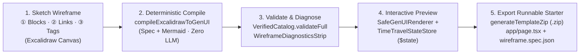

# GenUI Studio (`GenUI-kit`) — The Excalidraw-to-GenUI Workbench

<div align="center">

[](./LICENSE)
[](./apps/studio-hub/src/__tests__/workbench-journey.e2e.test.tsx)
[](https://github.com/vercel-labs/json-render)
[](./packages/genui-mcp)
[](./.kiro)
[](./tsconfig.base.json)
[](./package.json)

**Turn a wireframe into a validated, interactive UI preview—and export a usable React starter.**

[**60-Second First Success**](#-60-second-first-success-quickstart) • [**5-Step Workbench Flow**](#-the-5-step-workbench-flow-sketch--compile--validate--preview--export) • [**Guardrailed Engine (`@genui-studio/core`)**](#-the-engine-behind-the-workbench-genui-studiocore-vs-json-render-v0220) • [**Kiro Case Study**](#-kiro-in-practice-one-complete-feature-trace) • [**Threat Model**](#-threat-model--supported-deployment-modes) • [**Status Table**](#-verified-vs-simulated-vs-unverified-status)

</div>

---

## 🎯 What GenUI Studio Is (And Who It Is For)

**One Product Promise:** **GenUI Studio** is an **Excalidraw-to-GenUI Workbench** (`apps/studio-hub`) powered by a guardrailed UI compiler and runtime (`@genui-studio/core`, built on [`@json-render`](https://github.com/vercel-labs/json-render) `v0.22.0`).

**Who it is for:** Frontend engineers, product designers, and coding agents who want to sketch a layout on an Excalidraw canvas, compile it deterministically into a schema-validated UI specification, see actionable validation and prop-healing diagnostics in a live preview, and export a runnable Next.js/React starter project—without fighting brittle prompt-generated JSX or unvalidated JSON streams.



---

## ⚡ 60-Second "First Success" Quickstart

**Prerequisites:** `Node.js >= 22.18.0` and `pnpm@9.15.0`. Zero API keys or external accounts required.

```bash
# 1. Install and build workspace packages
git clone https://github.com/NOBA235/GenUI-kit.git
cd GenUI-kit
pnpm install --frozen-lockfile
pnpm -r build

# 2. Launch the Excalidraw-to-GenUI Workbench on http://localhost:5175
pnpm dev:hub
```

### Try the 5-Step Journey in Your Browser (or Run It Headlessly)
1. **Open the Sample Wireframe:** Visit `http://localhost:5175` and click **"Open Sample Wireframe in Workbench"** (or open `http://localhost:5175/preview/spatial-mesh-starter?wireframe=sample` directly).
2. **Compile:** The sample Excalidraw sketch compiles immediately into a GenUI `Spec` + Mermaid architecture graph (`compileExcalidrawToGenUI`).
3. **Inspect Actionable Diagnostics:** Check the **Compile & Validation Diagnostics Strip** below the toolbar—it flags an unknown `"PricingTable"` tag (resolved by label to `FeatureGrid`) and an out-of-range `MetricStrip.uptimePercent` (`healed 140 → 100`).
4. **Preview:** Interact with the live rendered UI right beside the canvas, switch between `Desktop` / `Tablet` / `Mobile` viewports, and inspect the `<DiagnosticHealedBadge />`.
5. **Export a Runnable React Starter:** Click **Export** → **Download Next.js Starter (.zip)** to get a self-contained Next.js project embedding your compiled `src/template/wireframe.spec.json`, `app/page.tsx`, `wireframe/<slug>.excalidraw.json`, and `.kiro/specs/<slug>/design.md`.

```bash
# Run the automated end-to-end test of this exact 5-step journey (including unpacking & rendering the exported starter):
pnpm --filter @genui-studio/studio-hub test -- src/__tests__/workbench-journey.e2e.test.tsx
```

---

## 🛠️ The 5-Step Workbench Flow (`Sketch → Compile → Validate → Preview → Export`)

### Step 1 & Step 2 — Sketch & Compile Deterministically ([`excalidraw-compiler.ts`](./apps/studio-hub/src/lib/excalidraw-compiler.ts))
The Wireframe Architect ([`WireframeArchitectCanvas.tsx`](./apps/studio-hub/src/components/WireframeArchitectCanvas.tsx)) lazy-loads `@excalidraw/excalidraw` and compiles scenes through `compileExcalidrawToGenUI` using **three primitives**:

| Primitive | What You Draw in Excalidraw | What `compileExcalidrawToGenUI` Produces |
| :--- | :--- | :--- |
| **① Catalog Blocks** | Shapes (`rectangle`, `diamond`, `ellipse`, `frame`) + bound/contained text | Matches each block to a component in the active `VerifiedCatalog` via exact name, keyword synonyms, and containment geometry (`>= 0.75` area overlap). Sorts root and child arrays top-to-bottom then left-to-right by `(minY, minX)` with locale-independent UTF-16 code-point tie-breaking (`compareCodePoints`). |
| **② Directed Interaction Links** | `arrow` elements connecting two blocks with a text label (e.g., `selectedPlan`) | Synthesizes a safe RFC 6901 JSON Pointer `/wireframeBindings/selectedPlan`, injects `{ "$state": "/wireframeBindings/selectedPlan" }` onto the target block's summary prop, initializes `spec.state.wireframeBindings`, and adds a dashed `-.->` edge to the generated Mermaid graph. |
| **③ Tags & Guardrails** | Stencil `customData.catalogComponent` / `defaultProps` + untrusted attributes | Honours `customData.catalogComponent` only when registered in the catalog; unknown tags emit a diagnostic warning and fall back to label matching. Strips `__proto__`/`constructor`/`prototype`, neutralizes `javascript:`/`data:text/html` URIs, caps canvas size (`250` elements) and depth (`12`), and runs `catalog.validateFull()`. |

> **Scope of the Zero-LLM / Zero-Network Guarantee:** Strictly scoped to `compileExcalidrawToGenUI`, compilation is a synchronous, pure in-memory function making **zero LLM, network, clock, or randomness calls**—verified by runtime I/O tripwires in [`wireframe-proof.test.ts`](./apps/studio-hub/src/__tests__/wireframe-proof.test.ts) and static Rollup bundle inspection (`node apps/studio-hub/scripts/audit-wireframe-compiler.mjs`).

### Step 3 — Inspect Actionable Validation & Healing Diagnostics ([`WireframeDiagnosticsStrip.tsx`](./apps/studio-hub/src/components/WireframeDiagnosticsStrip.tsx))
Instead of silently dropping invalid props or crashing the preview, `compileExcalidrawToGenUI` and `<WireframeDiagnosticsStrip />` report:
- **Component Resolution Source:** Whether each block matched via explicit `tag`, `label`, or `fallback` (`resolvedMappings`).
- **Prop Healing (`warning`):** Out-of-range numbers clamped to schema bounds (e.g., `uptimePercent: 140 → 100`) and case/separator-normalized enums.
- **Schema & Security Rejections (`error`):** Wrong prop types (e.g., string instead of array), blocked `javascript:` URIs, rejected `__proto__` tags, and severed graph cycles.

### Step 4 — Preview Through `<SafeGenUIRenderer>` & `TimeTravelStateStore`
- **SSR & Client Hook Safety ([`safe-renderer.tsx`](./packages/genui-core/src/boundary/safe-renderer.tsx)):** Each catalog component renders on its own child React fiber (`<SafeElementInvoker>`) inside `<GenUIElementErrorBoundary>`, so components using React hooks (`useState`, `useMemo`, `useId`, `useEffect`) or `React.memo` render cleanly in both SSR (`renderToString` / `renderToStaticMarkup`) and client DOM hydration (`hydrateRoot` / `createRoot`).
- **Per-Node Fault Quarantine:** If a single block fails schema validation or throws during render, only that block degrades to `<ElementFaultCard />`; sibling blocks and the parent shell stay interactive.
- **Live `$state` & Undo/Redo ([`time-travel-store.ts`](./packages/genui-core/src/state/time-travel-store.ts)):** Arrow bindings write to a deep-frozen `TimeTravelStateStore` (`maxHistory = 128`) supporting `undo()`, `redo()`, and `jumpToSnapshot()`.

### Step 5 — Export a Runnable Next.js Starter ([`exporter.ts`](./packages/templates/src/exporter.ts) & [`wireframe-export.ts`](./apps/studio-hub/src/lib/wireframe-export.ts))
Clicking **Export** packages the user's live compiled wireframe into a self-contained Next.js starter `.zip`:
- `src/template/wireframe.spec.json` (`WIREFRAME_SPEC_EXPORT_PATH`) — the exact compiled `Spec` from the canvas.
- `app/page.tsx` — pre-wired to render `wireframe.spec.json` through `<SafeGenUIRenderer>` and `TimeTravelStateStore`.
- `src/template/catalog.ts` & `src/template/registry.tsx` — the Zod catalog and React components with matching `catalogHash`.
- `wireframe/<slug>.excalidraw.json` & `.kiro/specs/<slug>/design.md` — the round-trippable Excalidraw scene and Mermaid architecture diagram.

---

## 🔧 The Engine Behind the Workbench: `@genui-studio/core` vs. `@json-render` (`v0.22.0`)

`@json-render/core` and `@json-render/react` (`v0.22.0`) provide the foundational catalog, patch primitives, and React renderer. `@genui-studio/core`, `genui-studio` CLI, `@genui-studio/mcp`, and `apps/studio-hub` add the wireframe compiler, runtime safety boundaries, and verification tooling:

| Capability / Boundary | Upstream `@json-render/core` & `@json-render/react` (`v0.22.0`) | Added by `@genui-studio/core` & GenUI Studio Workbench |
| :--- | :--- | :--- |
| **Visual Wireframe Authoring** | JSON / code-authored `Spec` trees | **Excalidraw Wireframe Architect** (`compileExcalidrawToGenUI`), `<WireframeDiagnosticsStrip />`, and runnable Next.js `.zip` export |
| **Catalog & Prompt Synchronizer** | `defineCatalog()`, `defineRegistry()`, `catalog.prompt()` | **`createVerifiedCatalog()`** with SHA-256 `catalogHash`, 1:1 schema-to-registry parity audit, and deterministic key ordering |
| **Cyclic Graph & Recursion Caps** | `validateSpec()`, `autoFixSpec()` | **3-Color DFS DAG Sanitizer (`sanitizeSpecGraph`)** severing back-edges (`A -> B -> A`) and sibling aliasing, enforcing `maxDepth`, `maxElements`, `maxValueDepth`, and `maxValueNodes` |
| **Prototype Pollution & URI Guard** | Relies on caller hygiene | **RFC 6901 Pointer & String Guard** (`isDangerousKey`, `isSafeJsonPointer`, `isSafeUrl`) blocking `__proto__`, `constructor`, `prototype`, `javascript:`, `vbscript:`, and `data:text/html` |
| **Prop Healing & Float Normalization** | Strict Zod validation | **Case/Separator Enum Healing, Numeric Clamping, `-0 -> 0` / `NaN` / `±Infinity` Healing & `<DiagnosticHealedBadge />`** |
| **SSR + Client Fault Isolation** | `<Renderer>`, `StateProvider`, `VisibilityProvider`, `ActionProvider` | **`<SafeGenUIRenderer>` (`<SafeElementInvoker>` + `<GenUIElementErrorBoundary>`)** isolating component faults to `<ElementFaultCard />` while keeping React hook order invariant across SSR and client hydration |
| **Chunk-Invariant Streaming** | `parseSpecStreamLine()`, `applySpecStreamPatch()`, `diffToPatches()` | **`createGuardrailedStreamCompiler()`** with bounded buffers (`maxBufferBytes`, `maxLineLength`, `maxTotalStreamBytes`, `maxPatches`), accepting JSONL, SSE (`data:`/`[DONE]`), or full Spec snapshots |
| **Immutable Time-Travel State** | `StateStore` interface, `getByPath`, `immutableSetByPath`, `flattenToPointers` | **`createTimeTravelStateStore()`** with depth-sorted batch pointer updates (`/a` before `/a/b`), `deepFreezeValue`, `undo()`/`redo()`, and watch cascade circuit breaker |
| **CI CLI, MCP & Property Testing** | Core schema/spec utilities | **`genui-studio` CLI**, **`@genui-studio/mcp`** (`@modelcontextprotocol/sdk` stdio server), and **`@genui-studio/core/testing`** (`fast-check` Arbitraries + `runCatalogInvariantSuite`) |

---

## 🤖 Kiro in Practice: One Complete Feature Trace (And Real Bugs Caught)

Rather than treating `.kiro/` files as static documentation, we used Kiro's **Specs → Steering → Hooks/ESLint → MCP** loop to build and verify the **Wireframe-to-Starter Export & Diagnostics pipeline**:

1. **Spec & Design Contract ([`.kiro/specs/core-skeleton/`](./.kiro/specs/core-skeleton/)):** Defined the EARS requirements for `SafeGenUIRenderer`, `VerifiedCatalog.validateFull`, and deterministic `Spec` compilation (`requirements.md`, `design.md`, `correctness.md`).
2. **Steering Constraints ([`.kiro/steering/genui-invariants.md`](./.kiro/steering/genui-invariants.md)):** Locked Invariant 1 (no raw HTML/JSX injection: `dangerouslySetInnerHTML`, `innerHTML`, `eval`) and Invariant 7 (hook-order stability across valid/invalid/SSR transitions).
3. **Automated Hook & Linter Enforcement ([`eslint.config.mjs`](./eslint.config.mjs) & [`.kiro/hooks/`](./.kiro/hooks/)):**
   - When writing the SSR hydration test in `safe-renderer-dom.test.tsx`, `pnpm -r lint` (`eslint.config.mjs` Invariant 1 selector) immediately caught and blocked a raw `container.innerHTML = ssrHtml` assignment, forcing safe DOM parsing via `DOMParser` + `replaceChildren`.
   - `.kiro/hooks/scripts/catalog-audit.mjs` (`catalog-schema-sync.json`) continuously verified 1:1 parity across all `9` catalog definitions and `10` `<SafeGenUIRenderer>` wrappers.
4. **End-to-End Verification ([`workbench-journey.e2e.test.tsx`](./apps/studio-hub/src/__tests__/workbench-journey.e2e.test.tsx) & [`verify-mcp.mjs`](./scripts/verify-mcp.mjs)):** Verified the complete 5-step workbench journey and stdio MCP tool execution in CI (`.github/workflows/ci.yml`).

### Workflow Friction & Engineering Defects Found and Fixed
| Issue Discovered During Review & Dogfooding | Why It Hurt Users or Reliability | Concrete Fix & Regression Test |
| :--- | :--- | :--- |
| **1. First-use path buried behind a multi-product storefront** | New visitors landed on a busy marketplace pitching 4 themed apps and an SRE war room instead of a clear wireframe workflow. | Added a 1-click **"Open Sample Wireframe in Workbench"** hero CTA (`/preview/spatial-mesh-starter?wireframe=sample`) and 5-step onboarding strip (`workbench-journey.e2e.test.tsx` Step 1). |
| **2. Silent wireframe fallbacks & static starter export** | Unknown tags or clamped props healed silently without telling the user why, and `.zip` export wrote the static template spec instead of the user's compiled sketch. | Added `<WireframeDiagnosticsStrip />` (`matchSource`, warnings, prop diagnostics) and wired `generateTemplateZip(template, { wireframe })` to export `src/template/wireframe.spec.json` (`workbench-journey.e2e.test.tsx` Steps 3 & 5). |
| **3. SSR hook-component bug in `SafeElementInvoker`** | `SafeElementInvoker` called `callable(renderProps)` directly during SSR after `useSyncExternalStore`, running child hooks on the parent fiber and risking hydration mismatches. | Redesigned `SafeElementInvoker` (`safe-renderer.tsx`) to always render `<ComponentToRender {...renderProps} />` on its own React fiber; added SSR + `hydrateRoot` hook & `React.memo` tests (`safe-renderer-dom.test.tsx`). |
| **4. Locale-dependent tie-breaking in `compileExcalidrawToGenUI`** | Equal-coordinate shapes fell back to `localeCompare`, causing IDs `"aa-note"` and `"zz-note"` to sort in opposite order under Danish (`da`) vs. `en-US`. | Replaced `localeCompare` with UTF-16 code-point comparison (`compareCodePoints`) in `excalidraw-compiler.ts` (`wireframe-proof.test.ts`). |
| **5. Collector gzip bomb & remote exposure gaps** | `otlp-collector.ts` checked compressed size before `gunzipSync`, used wildcard `Access-Control-Allow-Origin: *`, and allowed unauthenticated `/api/reset`. | Added `gunzipSync(buf, { maxOutputLength: maxBodyBytes })` (`413`), loopback-only bind guard (`--allow-remote`), loopback CORS reflection, and `SPATIAL_OPS_AUTH_TOKEN` Bearer auth (`otlp-topology.test.ts` Test #10). |

---

## 🔒 Threat Model & Supported Deployment Modes

| Surface | Supported Deployment Mode | Enforced Protections | Out of Scope / Non-Goals |
| :--- | :--- | :--- | :--- |
| **`@genui-studio/core` & Wireframe Compiler** | In-app React (client DOM & SSR) and local/CI spec compilation | 3-color DFS cycle & sibling-aliasing severance (`sanitizeSpecGraph`), depth/element/value caps (`maxDepth=16`, `maxElements=500`, `maxValueDepth=12`, `maxValueNodes=2000`), `__proto__`/`constructor`/`prototype` blocking, `javascript:`/`vbscript:`/`data:text/html` URI neutralization, numeric/enum healing, and per-node `<GenUIElementErrorBoundary>`. | Does not sandbox arbitrary user-authored React component code inside a custom registry; catalog components themselves must be trusted application code. |
| **`apps/studio-hub` (`:5175`) & `genui-studio` CLI** | Local developer workbench (`pnpm dev:hub`) and CI pipeline (`genui-studio validate`) | Deterministic offline compilation (`compileExcalidrawToGenUI` makes zero network/LLM calls), `.zip` path sanitization, and non-zero CI exit codes on invalid specs. | Not a multi-tenant hosted SaaS web service; offline license token checks default to `"local-format-demo"` unless a custom `LicenseVerifier` is supplied. |
| **`apps/spatial-ops` OTLP Collector (`:4318`)** | Localhost development receiver (`127.0.0.1:4318`) | Loopback-only default bind (`127.0.0.1`); refuses non-loopback bind without `--allow-remote` / `SPATIAL_OPS_ALLOW_REMOTE=1`; reflects only loopback `Origin` headers by default; caps both compressed and decompressed gzip bodies (`maxOutputLength: maxBodyBytes` → HTTP `413`); supports `SPATIAL_OPS_AUTH_TOKEN` Bearer auth on `POST /v1/*`, `/api/reset`, and `/api/demo/trace`. | Not a public internet-facing ingestion service; if `--allow-remote` is enabled on a shared network, `SPATIAL_OPS_AUTH_TOKEN` and TLS termination via a reverse proxy are required. |
| **`@genui-studio/mcp` Stdio Server** | Local IDE / coding-agent subprocess over stdio JSON-RPC | Validates inputs via Zod schemas; `execute_remediation` is explicitly tagged `executionMode: "LOCAL_SIMULATION"` or `"LOCAL_OTLP_SNAPSHOT_ADVISORY"`. | Never mutates live Kubernetes, cloud provider, or production infrastructure. |

---

## 🧩 Optional Reference Demos & Stress-Test Fixtures

To prove that `@genui-studio/core` scales beyond simple 2D marketing cards without changing core runtime code, the monorepo includes optional reference demos and stress-test fixtures:

- **`apps/spatial-ops` (*Aegis SpatialOps*, `:5174` / OTLP `:4318`):** An optional 3D WebGL (`@react-three/fiber`) + 2D incident HUD reference app (`15` catalog components) sharing a single `TimeTravelStateStore` and writing atomic topology snapshots to `~/.spatial-ops/otlp-snapshot.json` (`SPATIAL_OPS_OTLP_SNAPSHOT`). Run with `pnpm dev:spatial` and `pnpm --filter @genui-studio/spatial-ops demo:emit-otlp -- --faulty`.
- **Stress-Test Template Fixtures (`packages/templates`):**
  - `spatial-mesh-starter` & `spatial-ops-3d-pro` — Default 4-component showcase catalogs (`SiteShell`, `HeroSection`, `MetricStrip`, `FeatureGrid`) used by the Wireframe Workbench.
  - `ninety9-archive` — 1997 monochrome archive (`34` dossiers, strict 5-tone monochrome token law).
  - `afterdark-horror` — Procedural 3D WebGL exploration (`THREE.InstancedMesh`, collision solver, procedural Web Audio, WCAG flash limits).
  - `cmos-cloud-bios` — 1994 Award BIOS utility + 3D motherboard twin + deterministic IaC compiler (`docker-compose.yml`, `vercel.json`, `main.tf`).
  - `neuro-chimera-synth` (*CHIMERA // LAB*) — Physarum bio-SQL optimizer, recursive-descent SQL parser/planner, and offline `kiro-crew-app/` bundle.

---

## ✅ Reproducible Verification Commands & Honest Status Table

```bash
# Full CI verification suite (Node.js >= 22.18.0, pnpm@9.15.0)
pnpm install --frozen-lockfile
node scripts/check-workspace-scripts.mjs
pnpm -r build
pnpm -r typecheck
pnpm -r lint
pnpm -r test
node .kiro/hooks/scripts/catalog-audit.mjs
node .kiro/hooks/scripts/run-pbt-suite.mjs
node scripts/verify-mcp.mjs
node apps/studio-hub/scripts/audit-wireframe-compiler.mjs
```

### Verified vs. Simulated vs. Unverified Status
| Area | Status | Evidence / Scope Boundary |
| :--- | :--- | :--- |
| **5-Step Workbench User Journey (`Sketch → Compile → Validate → Preview → Export`)** | **Verified** | End-to-end test ([`workbench-journey.e2e.test.tsx`](./apps/studio-hub/src/__tests__/workbench-journey.e2e.test.tsx)) compiles the sample sketch, asserts `<WireframeDiagnosticsStrip />` warnings/errors, renders hook components + live `$state` bindings, unpacks the exported `.zip`, and renders the exported `app/page.tsx`. |
| **SSR + Client Hydration with Hook-Using & `React.memo` Components** | **Verified** | Tested with `renderToString`, `renderToStaticMarkup`, `hydrateRoot`, and `createRoot` in [`safe-renderer-dom.test.tsx`](./packages/genui-core/src/__tests__/safe-renderer-dom.test.tsx). |
| **Deterministic Zero-LLM Wireframe Compilation (`compileExcalidrawToGenUI`)** | **Verified** | Golden `Spec` + Mermaid snapshots, 50-run determinism, Danish (`da`) collation invariance, runtime network/clock/randomness tripwires ([`wireframe-proof.test.ts`](./apps/studio-hub/src/__tests__/wireframe-proof.test.ts)), and static Rollup bundle audit ([`audit-wireframe-compiler.mjs`](./apps/studio-hub/scripts/audit-wireframe-compiler.mjs)). |
| **Property-Based Tests (`fast-check`) & Workspace CI** | **Verified** | `pnpm -r build/typecheck/lint/test` passes across all 6 packages (`23` test files, `159` passing tests). Note: `fast-check` suites (`50`–`500` runs per property) provide empirical randomized test coverage, not mathematical proof. |
| **External Tarball Consumer Installation (`pnpm pack`)** | **Verified** | `@genui-studio/core`, `@genui-studio/templates`, `genui-studio`, and `@genui-studio/mcp` installed from `.tgz` tarballs in an isolated external project; ESM runtime, `@genui-studio/core/testing` + `fast-check`, NodeNext declarations (`--skipLibCheck false`), and CLI `bin` verified. |
| **OTLP Collector Security Guards (`:4318`) & MCP Snapshot Contract** | **Verified** | Loopback bind guard, loopback CORS reflection, `gunzipSync` `maxOutputLength` decompression bomb cap (`413`), Bearer token auth (`401`), and shared `~/.spatial-ops/otlp-snapshot.json` (`SPATIAL_OPS_OTLP_SNAPSHOT`) verified in [`otlp-topology.test.ts`](./apps/spatial-ops/src/__tests__/otlp-topology.test.ts) and [`verify-mcp.mjs`](./scripts/verify-mcp.mjs). |
| **SpatialOps Remediation & Offline CLI License Check** | **Simulated by Design** | `execute_remediation` and SpatialOps runbooks mutate local `TimeTravelStateStore` / in-memory simulation state only (`LOCAL_SIMULATION` / `LOCAL_OTLP_SNAPSHOT_ADVISORY`); `validateLicenseToken` defaults to offline `"local-format-demo"`. |
| **Kiro Crew Bundle (`neuro-chimera-synth/kiro-crew-app`)** | **State 1 & 2 Verified · State 3 Unverified** | **State 1** (offline manifest validation via `validateCrewBundle`) and **State 2** (`dist/index.mjs` build + `hooks.py` `py_compile`) are **verified**. **State 3** (live `kirocrew app install` / gateway runtime) is **unverified** because the `kirocrew` CLI/gateway is not installed in this environment. |

---

## 📂 Monorepo Structure & License

- **Submission Walkthrough & Engineering Notes:** [**`SUBMISSION.md`**](./SUBMISSION.md)
- **License:** [**`MIT`**](./LICENSE)
