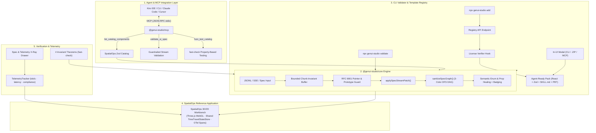

# GenUI Studio (`GenUI-kit`)

<div align="center">

[](./LICENSE)
[](./.kiro/specs/core-skeleton/correctness.md)
[](https://github.com/vercel-labs/json-render)
[](./packages/genui-mcp)
[](./.kiro)
[](./tsconfig.base.json)
[](./package.json)

**The Property-Based Tested & Runtime-Guardrailed Generative UI Engine, CI Validator (`genui-studio validate`), and Model Context Protocol (MCP) Server.**  
*Hardening `@json-render` v0.22.0 for real-world LLM streams (JSONL, SSE `data:`, and whole-Spec snapshots), hook-safe React boundaries, and deterministic schema verification.*

[**Explore SpatialOps (3D/2D Workbench)**](http://localhost:5174) • [**Submission Notes**](./SUBMISSION.md) • [**Kiro Power Manual**](./.kiro/powers/json-render-power/POWER.md)

</div>

---

> [!IMPORTANT]
> **Project Overview & Verification:** For architectural background on the Kiro spec-driven setup, the 5 shrunk `fast-check` counterexamples, and demo workflow, see [**`SUBMISSION.md`**](./SUBMISSION.md).

---

## 📑 Table of Contents

- [Why GenUI Studio Exists](#-why-genui-studio-exists)
- [How GenUI Studio Hardens `@json-render`](#-how-genui-studio-hardens-json-render)
- [System Architecture](#-system-architecture)
- [Monorepo Structure](#-monorepo-structure)
- [Zero-Setup Quickstart](#-zero-setup-quickstart)
- [Core Skeleton Engine (`@genui-studio/core`)](#-core-skeleton-engine-genui-studiocore)
- [Reference Application: SpatialOps (`apps/spatial-ops`)](#-reference-application-spatialops-appsspatial-ops)
- [Model Context Protocol (MCP) Server (`@genui-studio/mcp`)](#-model-context-protocol-mcp-server-genui-studiomcp)
- [Spec Validator CLI & Template Registry (`genui-studio`)](#-spec-validator-cli--template-registry-genui-studio)
- [Property-Based Testing & Runtime Invariants](#-property-based-testing--runtime-invariants)
- [Kiro Spec-Driven Agentic Ecosystem](#-kiro-spec-driven-agentic-ecosystem)
- [License](#-license)

---

## 💡 Why GenUI Studio Exists

Modern AI coding agents and LLM applications are evolving past plain-text chat. Today's agents must stream complex, interactive user interfaces—financial operations dashboards, multi-step checkout flows, incident remediation playbooks, and 3D spatial infrastructure maps.

However, having LLMs emit raw JSX or HTML introduces three catastrophic failure modes:
1. **Catastrophic Whiteouts & React Hydration Crashes:** Fragmented LLM patch streams can inject cyclic element graphs (`RangeError: Maximum call stack size exceeded`), prototype pollution (`__proto__`), or non-finite numbers (`NaN`/`Infinity`), immediately taking down the user's browser tab.
2. **Schema–Component–Prompt Drift:** In traditional setups, React/Three.js components, Zod schemas, action handlers, and AI system prompts (`catalog.prompt()`) quickly drift apart, resulting in hallucinations and broken components.
3. **Agent Integration & Tooling Disconnect:** AI coding agents lack standardized protocols to inspect available catalogs, validate proposed UI specs before streaming, and run property-based fuzz tests.

**GenUI Studio** solves these reliability bottlenecks as a focused hardening layer **on top of [`@json-render`](https://github.com/vercel-labs/json-render)** (`v0.22.0`). Rather than reinventing `@json-render`'s catalog/renderer model, `@genui-studio/core` adds strict DAG/value sanitization, bounded multi-protocol stream compilation (`JSONL`, `SSE data:`, whole-Spec fallback), semantic enum/prop healing, Rules-of-Hooks-safe React fault boundaries, deep-frozen time-travel state management, a CI CLI linter (`genui-studio validate`), and an MCP server (`@genui-studio/mcp`).

> [!NOTE]
> **Production Primitives vs. Reference App & Registry Scaffolding:**  
> - **Production-Hardened Runtime & Developer Tooling:** `@genui-studio/core`, `genui-studio validate` CLI, `@genui-studio/mcp` verification tools (`list_catalog_components`, `validate_ui_spec`, `fuzz_test_catalog`), and the `fast-check` / React DOM test suites.  
> - **Live Local OTLP Observability & Optional Registry Scaffolding:** `apps/spatial-ops` defaults to a real local OpenTelemetry **OTLP/HTTP JSON collector on `:4318`** (`/v1/traces`, `/v1/logs`, `/v1/metrics`) that dynamically synthesizes topologies from incoming OpenTelemetry spans, logs, and utilization metrics (`--demo` or `"Load Sample Demo"` activates `LiveServiceMeshSimulator`); `@genui-studio/mcp`'s telemetry tools (`query_telemetry_metrics`, `fetch_trace_spans`, `execute_remediation`) read live OTLP snapshots (`OtlpSnapshotMcpTelemetryProvider`) by default (`--demo` switches to synthetic fallback data); `validateLicenseToken` defaults to offline `"local-format-demo"` checks unless wired to a server-side `LicenseVerifier`; `@genui-studio/templates` and `apps/studio-hub` are under active development.

---

## 📊 How GenUI Studio Hardens `@json-render`

| Capability / Failure Mode | Raw JSX / HTML Streaming | Base `@json-render` | **GenUI Studio (`GenUI-kit`)** |
| :--- | :--- | :--- | :--- |
| **Cyclic Graph & Recursion Caps** | ❌ Infinite loop whiteout | ⚠️ Vulnerable if unvalidated | ✅ **3-Color DFS DAG Sanitizer** + `maxDepth`/`maxElements`/`maxValueDepth`/`maxValueNodes` |
| **Prototype Pollution & XSS** | ❌ Critical XSS vulnerability | ❌ Vulnerable to `__proto__` | ✅ **RFC 6901 Pointer Guard** (drops `__proto__`, `constructor`, `prototype`; blocks `javascript:`/`vbscript:`/`data:text/html`) |
| **LLM Prop & Enum Drift** | ❌ Throws runtime error | ❌ Strict schema rejection | ✅ **Semantic Case/Separator Enum Healing, Clamping & `<DiagnosticHealedBadge />`** |
| **Hook-Safe Fault Isolation** | ❌ Whole tree crashes | ⚠️ Component error unmounts parent | ✅ **`<SafeElementInvoker>` + `<GenUIElementErrorBoundary>`** (Rules-of-Hooks safe across invalid/valid/error patches) |
| **Non-Finite Floats** | ❌ `NaN`/`Infinity` breaks JSON | ❌ Corrupts downstream state | ✅ **Healed & Normalized** (`-0 -> 0`, `NaN`/`±Infinity -> 0` + diagnostic issue) |
| **Multi-Protocol Chunk Invariance** | ❌ Syntax errors on partial tags | ⚠️ Drops trailing line buffer | ✅ **Chunk-Invariant Compiler** (`JSONL`, **SSE `data:`/`[DONE]`**, **whole-Spec `{ root, elements }`**) + `maxBufferBytes`/`maxTotalStreamBytes`/`maxPatches` |
| **State Mutations & Undo** | ❌ Ad-hoc manual re-renders | ⚠️ Mutable snapshots / key order drift | ✅ **Deep-Frozen `TimeTravelStateStore`** (`deepFreezeValue` + immutable `getHistory()` + `===` structural sharing) |
| **Catalog Digest & Tooling** | ❌ None | ⚠️ Manual prompts | ✅ **FIPS 180-4 SHA-256 Prompt Digest**, **`genui-studio validate` CI CLI**, & **MCP Server (`stdio`)** |
| **Verification Discipline** | ❌ None | ⚠️ Example unit tests | ✅ **4 Property-Based Invariants (`fast-check`)** + Live React DOM (`jsdom`) & Node Tests |

---

## 🏛️ System Architecture



---

## 📂 Monorepo Structure

```text
GenUI-kit/
├── LICENSE                                  # MIT License
├── package.json                             # Root monorepo scripts (dev, mcp, genui-studio, test)
├── pnpm-workspace.yaml                      # Monorepo topology: packages/* & apps/*
├── tsconfig.base.json                       # Shared strict TypeScript compiler configuration
├── SUBMISSION.md                            # Kiroween 2026 Devpost submission & 2m45s video script
├── README.md                                # Master architectural documentation & guide
├── .kiro/                                   # Kiro Spec-Driven Architecture & Customizations
│   ├── settings/
│   │   └── mcp.json                         # Configured MCP Server for Kiro IDE & CLI
│   ├── steering/                            # Permanent architectural rules
│   │   ├── product.md                       # Vision, anti-slop guidelines & telemetry design
│   │   ├── tech.md                          # Grounded @json-render v0.22.0 API reference
│   │   ├── structure.md                     # Monorepo dependency boundaries
│   │   ├── genui-invariants.md              # 7 formal runtime, schema & memory invariants
│   │   └── spatial-3d-rules.md              # React Three Fiber zero-allocation memory rules
│   ├── specs/                               # Formal Specs in EARS syntax
│   │   ├── core-skeleton/                   # Core engine requirements, design, tasks & PBT theorems
│   │   └── app-spatial-warroom/             # SpatialOps 3D/2D topology & telemetry specification
│   ├── hooks/                               # Event-driven agent verification hooks
│   │   ├── catalog-schema-sync.json         # Audits catalog-registry parity on save
│   │   ├── spec-invariants-test.json        # Runs fast-check PBT suite on save
│   │   ├── raw-jsx-guard.json               # Blocks unauthorized JSX/HTML injection
│   │   └── scripts/                         # Executable hook scripts (Node.js)
│   └── powers/
│       └── json-render-power/               # Reusable Kiro Power for generative UI
│           ├── POWER.md                     # Power manual & 5 Golden Rules
│           ├── mcp.json                     # Power MCP configuration
│           └── steering/                    # React-to-catalog & 3D Three.js transformation playbooks
├── packages/
│   ├── genui-core/                          # @genui-studio/core — Core Reusable Skeleton Engine
│   │   └── src/
│   │       ├── catalog/verified-catalog.ts  # FIPS 180-4 SHA-256 fingerprinting & semantic prop healing
│   │       ├── stream/dag-sanitizer.ts      # 3-color DFS cycle severance, depth/node budgets & prototype protector
│   │       ├── stream/stream-compiler.ts    # Chunk-invariant JSONL/SSE/Spec compiler with byte & patch bounds
│   │       ├── state/time-travel-store.ts   # Deep-frozen immutable StateStore with undo/redo
│   │       ├── boundary/safe-renderer.tsx   # Hooks-safe <SafeElementInvoker>, error boundary & <DiagnosticHealedBadge />
│   │       ├── telemetry/telemetry-tracker.ts # Real-time tok/s, latency & compliance tracking
│   │       ├── registry/                    # Template Packs, pluggable LicenseVerifier & Exporter
│   │       └── testing/index.ts             # fast-check arbitraries & runCatalogInvariantSuite()
│   ├── genui-cli/                           # genui-studio — Spec Linter CLI & Template Pack Installer
│   │   └── src/
│   │       ├── cli.ts                       # npx genui-studio validate <file|-> & add <pack> runner
│   │       ├── validate.ts                  # CI spec/JSONL/SSE validator (--catalog, --strict, --json)
│   │       └── installer.ts                 # Pack unpacker, license verification & skill injector
│   ├── genui-mcp/                           # @genui-studio/mcp — Model Context Protocol Server
│   │   └── src/
│   │       ├── server.ts                    # McpServer (3 verification tools + 3 telemetry tools)
│   │       ├── cli.ts                       # Executable JSON-RPC stdio transport runner
│   │       ├── schema-describer.ts          # Zod-to-JSON Schema contract extractor
│   │       └── tools/                       # list/validate/fuzz tools + pluggable telemetry tools
│   └── templates/                           # @genui-studio/templates — Template Registry & Ingestion (WIP)
│       └── src/
│           ├── node/ingest-standalone.ts    # Project ingestion & manifest generator (unverified by default)
│           └── registry-entries.generated.ts # Generated template pack entries
└── apps/
    ├── spatial-ops/                         # SpatialOps: Live OTLP (:4318) 3D/2D Telemetry Workbench
    │   ├── server/                          # Local OTLP/HTTP JSON collector (:4318 /v1/{traces,logs,metrics})
    │   ├── examples/                        # Zero-dependency OTel trace/log/metric emitter script
    │   ├── src/catalog/                     # 15 Hybrid 3D (R3F) + 2D (HUD) Zod Components
    │   ├── src/three/                       # WebGL canvas, OrbitControls, emissive nodes, packet edges
    │   ├── src/telemetry/                   # Dynamic OTLP topology builder, SSE client & --demo simulator
    │   ├── src/components/                  # Spatial X-Ray drawer, export modal
    │   ├── src/data/                        # Cluster data types, seed dataset & SRE mutation engine
    │   └── src/streams/                     # SRE incident stream scenarios & failover playbooks
    └── studio-hub/                          # Studio Hub & Template Workspace App (WIP)
```

---

## ⚡ Zero-Setup Quickstart

The core packages and reference apps run with **zero API keys** and **zero external configuration**.

```bash
# 1. Clone the repository
git clone https://github.com/NOBA235/GenUI-kit.git
cd GenUI-kit

# 2. Install dependencies across all packages and apps (~10 seconds)
pnpm install

# 3. Build all packages and applications
pnpm build

# 4. Launch workspace apps (:5174 SpatialOps, :5175 Studio Hub WIP)
pnpm dev

# 5. Run verified test suites
pnpm --filter @genui-studio/core test
pnpm --filter genui-studio test
pnpm --filter @genui-studio/mcp test
pnpm --filter @genui-studio/spatial-ops test

# 6. Validate a .json, .jsonl, or .sse UI spec in CI
pnpm genui-studio validate path/to/spec.jsonl --strict --json
```

### Application URLs
- **SpatialOps (3D/2D Workbench):** [`http://localhost:5174`](http://localhost:5174)
- **Studio Hub (WIP Storefront):** [`http://localhost:5175`](http://localhost:5175)

---

## 🧩 Core Skeleton Engine (`@genui-studio/core`)

The core engine provides the foundational runtime primitives that make generative UI production-safe:

### 1. 3-Color DFS DAG Sanitizer (`dag-sanitizer.ts`)
Standard tree renderers crash with infinite recursion when an LLM emits cyclic element graphs (e.g. `nodeA -> nodeB -> nodeA`). Our sanitizer runs a strict 3-color (White/Grey/Black) Depth-First Search over the element graph:
- **Cycle Severance:** When a back-edge to an in-flight Grey node is detected, the cyclic child pointer is severed, preventing infinite recursion while preserving the rest of the tree. `inspectSpecGraph()` also halts DFS traversal beyond `maxDepth`.
- **Prototype Pollution & Value Budget Protection:** Rejects keys matching `__proto__`, `prototype`, or `constructor`, strips unsafe URI schemes, and bounds recursive JS values (`maxValueDepth = 32`, `maxValueNodes = 10,000`).
- **Dangling Pointer Removal:** Removes any child keys referencing elements not present in the spec elements map.

### 2. Bounded Multi-Protocol Stream Compiler (`stream-compiler.ts`)
Network packet boundaries and heterogeneous model SDKs emit varied chunk formats. The compiler maintains a chunk-invariant line buffer:
- Supports raw RFC 6902 JSONL patches, **SSE `data:` framing / `[DONE]` / keepalives**, and **single-shot `{ root, elements, state? }` Spec snapshots** normalized through the same safety validators.
- Enforces hard resource caps (`maxBufferBytes`, `maxLineLength`, `maxTotalStreamBytes`, `maxPatches`) while recovering cleanly at the next `\n`.
- Flushes residual buffers upon stream EOF via `finalize()`.

### 3. Deep-Frozen TimeTravelStateStore (`time-travel-store.ts`)
A fast, immutable state container utilizing RFC 6901 JSON Pointers (`/ledger/accounts/0/status`):
- **Structural Sharing & External Immutability:** Preserves reference equality (`===`) on unmodified branches for `useSyncExternalStore` while recursively deep-freezing snapshots (`deepFreezeValue`) and returning frozen shallow snapshots from `getHistory()` so external mutations cannot corrupt store state.
- **Batch Mutation Ordering:** Automatically sorts batch update keys by pointer depth (shallowest first), ensuring parent containers are instantiated before children.
- **Deterministic Undo/Redo:** Bounded snapshot history stack with cascade circuit breaker protection.

### 4. Hook-Safe Telemetry Error Boundary (`safe-renderer.tsx`)
Wraps every rendered node cleanly:
- Isolates the component call inside `<SafeElementInvoker>` under `<GenUIElementErrorBoundary>` so valid/invalid/fault transitions never alter React hook call order inside the parent wrapper and failures never crash sibling trees.
- Displays `<DiagnosticHealedBadge />` with tooltip provenance whenever semantic enum healing or prop clamping repaired a value.

---

## 📱 Reference Application: SpatialOps (`apps/spatial-ops`)

### Aegis 3D Spatial OTLP & Incident Workbench (3D + 2D)
A real-time distributed telemetry and incident workbench combining a **local OpenTelemetry OTLP/HTTP JSON receiver (`:4318`)**, **3D WebGL microservice topology**, **critical-path/tier/health filter toolbar**, and a **2D tactical HUD** over a shared `TimeTravelStateStore`:

```text
Web UI:         http://localhost:5174
OTLP Collector: http://localhost:4318/v1/{traces,logs,metrics}
```

#### Send Real OpenTelemetry Data in 10 Seconds
Point any Node.js, Next.js, Go, or Python service using OpenTelemetry OTLP/HTTP JSON at SpatialOps:

```bash
export OTEL_EXPORTER_OTLP_ENDPOINT="http://localhost:4318"
export OTEL_EXPORTER_OTLP_PROTOCOL="http/json"

# Or emit a sample faulty multi-service trace + log + host utilization metric:
pnpm --filter @genui-studio/spatial-ops demo:emit-otlp -- --faulty

# Start with opt-in in-memory mesh simulator instead of empty OTLP standby:
pnpm --filter @genui-studio/spatial-ops dev:demo
```

- **15 Spatial & Telemetry Components:**
  1. `AegisWarRoomShell`: SRE war-room container orchestrating 3D canvas and HUD.
  2. `ClusterTopologyCanvas`: React Three Fiber WebGL canvas with OrbitControls and Bloom.
  3. `ServiceMeshNode3D`: 3D emissive microservice node with health-driven shaders.
  4. `TrafficFlowEdge3D`: Animated Bezier curves with flowing traffic packet particles.
  5. `BlastRadiusSphere3D`: Volumetric semi-transparent sphere visualizing outage impact.
  6. `RegionZoneBoundary3D`: Spatial wireframe grid delimiting AWS/GCP cloud regions.
  7. `IncidentHeroBanner`: SEV-1 incident header with MTTR clock and active commander.
  8. `ServiceDiagnosticPanel`: Deep-dive inspector for the currently selected 3D node.
  9. `LatencyHistogramCard`: Real-time p50/p95/p99 latency distribution graph.
  10. `ErrorLogTailer`: Streaming log terminal with search and severity filtering.
  11. `BlastRadiusDependencyTree`: Upstream and downstream dependency topology list.
  12. `RunbookActionDesk`: Interactive SRE controls (Circuit Breakers, Failover, Pod Scaling).
  13. `ClusterMetricsGrid`: Cluster-wide CPU, memory, and network saturation dials.
  14. `SreAuditTrailBanner`: Structured audit log recording SRE remediation actions.
  15. `TraceWaterfallViewer`: Distributed trace span timeline with span attribute & SQL error inspection.
- **Dual-Viewport State Coherence:** Adjusting an SRE runbook slider or triggering a remediation in the 2D HUD updates the 3D WebGL scene's emissive node colors, traffic packet velocities, and volumetric blast radius spheres without remounting the Three.js canvas.

---

## 🛠️ Model Context Protocol (MCP) Server (`@genui-studio/mcp`)

GenUI Studio exposes a **Model Context Protocol (MCP)** server over stdio JSON-RPC. Configured out-of-the-box in [`.kiro/settings/mcp.json`](./.kiro/settings/mcp.json), any MCP-compatible agent (Kiro IDE, Kiro CLI, Claude Desktop, Cursor) can interact directly with our component catalogs:

```bash
# Start standalone stdio MCP server
pnpm mcp
```

### Available MCP Tools

#### 1. `list_catalog_components`
Inspects available SpatialOps components and their Zod schemas.
```json
// Input:
{
  "app": "spatial",
  "componentName": "ClusterTopologyCanvas"
}

// Output:
{
  "components": [
    {
      "name": "ClusterTopologyCanvas",
      "description": "3D WebGL scene viewport rendering the distributed microservice mesh with camera controls and memory safety guards.",
      "props": {
        "cameraFov": { "type": "integer", "minimum": 30, "maximum": 90 }
      },
      "fallbackProps": { "cameraFov": 50 }
    }
  ]
}
```

#### 2. `validate_ui_spec`
Validates a proposed Spec DAG or raw RFC 6902 JSONL stream against the target catalog, detects cycles, and provides auto-fix suggestions.
```json
// Input:
{
  "app": "spatial",
  "spec": { "root": "warroom-1", "elements": { ... } },
  "autoFix": true
}

// Output:
{
  "valid": true,
  "issues": [],
  "fixedSpec": { ... }
}
```

#### 3. `fuzz_test_catalog`
Triggers an automated `fast-check` property test run against a component schema or the entire catalog invariant suite.
```json
// Input:
{
  "app": "spatial",
  "componentName": "ClusterTopologyCanvas",
  "numRuns": 50
}

// Output:
{
  "passed": true,
  "numRuns": 50,
  "durationMs": 42
}
```

### Live OTLP & Pluggable Telemetry Provider Tools
In addition to the 3 verification tools above, `@genui-studio/mcp` exposes 3 OpenTelemetry/remediation tools backed by pluggable providers (`setMcpTelemetryProvider`):
- `query_telemetry_metrics`, `fetch_trace_spans`, `execute_remediation`
- By default, `OtlpSnapshotMcpTelemetryProvider` reads real ingested OTLP topology snapshots written by the SpatialOps collector (`~/.genui-studio/otlp-latest-snapshot.json`), falling back cleanly to `DefaultMcpTelemetryProvider` only when running with `--demo` or before live traces arrive.

### Kiro IDE / Claude Desktop MCP Configuration

Add this block to your `.kiro/settings/mcp.json` or `claude_desktop_config.json`:

```json
{
  "mcpServers": {
    "genui-studio": {
      "command": "node",
      "args": ["./packages/genui-mcp/dist/cli.js"],
      "env": { "NODE_ENV": "production" },
      "autoApprove": [
        "list_catalog_components",
        "validate_ui_spec",
        "fuzz_test_catalog"
      ]
    }
  }
}
```

---

## 📦 Spec Validator CLI & Template Registry (`genui-studio`)

GenUI Studio provides a developer CLI for **CI Spec Validation** (`validate`) plus local scaffolding for **Agent-Ready 2D/3D Template Packs** (`add`, `list`, `export`).

### 1. CI/CD Spec & Stream Linter (`npx genui-studio validate`)
Validate `.json`, `.jsonl`, or `.sse` generative UI payloads in pre-commit hooks or CI pipelines:

```bash
# Validate an LLM stream or static spec JSON and output machine-readable diagnostics
npx genui-studio validate ./specs/dashboard.jsonl --allowed=WorkspaceShell,KpiMetricCard --strict --json

# Read from stdin in pipelines (exits non-zero on cycles, XSS URIs, __proto__, or rejected lines)
cat stream.sse | npx genui-studio validate - --max-depth=12
```

### 2. Agent-Ready Template Pack Scaffolding (`npx genui-studio add`)
> [!NOTE]
> By default, `validateLicenseToken()` runs offline in **`"local-format-demo"`** mode (including demo/judge tokens such as `kiroween-2026-judge-pass`). Production commercial deployments should inject a server-side `LicenseVerifier` callback (`options.verifier`) and set `allowDemoPasses: false`. Standalone projects ingested via Mode B (`ingestStandaloneProject`) default to `verified: false` until verified.

Every pack in `packages/genui-core/src/registry/` bundles React/Three.js components, Zod schemas (`catalog.ts`), AI skills (`SKILL.md` + `.kiro/powers/`), and `fast-check` tests.

| Pack ID | Tier | Reference Price | Category | Components | Description |
| :--- | :--- | :--- | :--- | :--- | :--- |
| **`spatial-ops-3d-pro`** | **Pro** | **$79** | Spatial 3D WebGL | 14 Spatial / HUD | Three.js microservice mesh, dual-viewport state sync, failover controls. |
| **`spatial-mesh-starter`** | **Free** | **$0** | Spatial 3D | 5 Spatial Nodes | Interactive WebGL cluster canvas, 3D nodes, and latency histogram cards. |

### 3. CLI Usage (`validate` / `add` / `list` / `export`)

```bash
# Install a free starter pack (no license required)
npx genui-studio add spatial-mesh-starter

# Install a 3D WebGL Pro pack into a target directory (--cwd)
npx genui-studio add spatial-ops-3d-pro --license=kiroween-2026-judge-pass --cwd=./src/components/spatial

# Export a runnable Next.js 15 project .zip
npx genui-studio export spatial-mesh-starter

# Inspect available packs in the registry
npx genui-studio list
```

### 4. In-UI Template Exporter Modal
`apps/spatial-ops` features an interactive **"Export 3D Pack 📦"** button in its navigation header:
- **Tab 1 (CLI Install):** Pre-configured `npx genui-studio add` command with live license token input.
- **Tab 2 (Download `.ZIP`):** Generates and downloads a complete, runnable Next.js / React project zip containing all components, catalogs, tests, and `.kiro` configuration.
- **Tab 3 (MCP Connect):** One-click JSON snippet to configure the template pack catalog in Kiro IDE (`.kiro/settings/mcp.json`) or Claude Desktop.

---

## 🔬 Property-Based Testing & Runtime Invariants

Core packages are tested against **4 property-based invariant suites** defined in [`.kiro/specs/core-skeleton/correctness.md`](./.kiro/specs/core-skeleton/correctness.md) using `fast-check`, alongside unit tests and live React 19 DOM recovery tests (`jsdom`):

| Invariant ID | Tested Property |
| :--- | :--- |
| **`INV-PBT-01`** | **Stream Chunking Invariance:** For any valid `Spec`, splitting its serialized RFC 6902 JSONL / SSE stream across arbitrary random byte chunk cuts or omitting trailing newlines converges to the exact same final `Spec`. |
| **`INV-PBT-02`** | **Adversarial Payload Resilience & DAG Idempotence:** For fuzzed payloads containing `__proto__`, `NaN`/`±Infinity`/`-0`, self-loops (`A -> A`), mutual cycles (`A -> B -> A`), deep nesting, oversized lines, or `javascript:` URIs, the engine never throws an unhandled exception, never pollutes `Object.prototype`, and enforces idempotent sanitization. |
| **`INV-PBT-03`** | **State Pointer Idempotency & Batch Permutation Determinism:** Applying out-of-order parent/child state mutations (`/a` and `/a/b`) converges deterministically regardless of mutation key order, deep-freezes snapshots (`deepFreezeValue`) & `getHistory()`, preserves `===` structural sharing on untouched branches, and inverts cleanly via `undo()`/`redo()`. |
| **`INV-PBT-04`** | **Catalog-to-Prompt Determinism:** Permuting the declaration order of components, Zod shape properties, actions, or custom rules produces the exact same FIPS 180-4 SHA-256 `catalogHash` and byte-for-byte identical AI system prompt. |

### Real Bugs Discovered by `fast-check` Shrinking

| Bug ID | Shrunk Minimal Counterexample | Root Cause | Architectural Resolution |
| :--- | :--- | :--- | :--- |
| **`BUG-PBT-01`** | `fullStream.replace(/\n$/, "")` | When an LLM stream terminates without a trailing newline, the final element was silently dropped. | `GuardrailedStreamCompiler.finalize()` explicitly flushes residual line buffers before final DAG sanitization. |
| **`BUG-PBT-02`** | `{"count": -0}` and `NaN` | Negative zero `-0` and `NaN` values failed strict canonical serialization equality checks. | `deepCloneAndSanitizeValue` normalizes `-0 -> 0`, heals `NaN`/`±Infinity`, and logs a telemetry healing event. |
| **`BUG-PBT-03`** | `children: ["el-1", "el-1"]` & diamond aliasing | Sibling key duplication and shared node references caused duplicate React key warnings and infinite DFS traversal loops. | `sanitizeSpecGraph` maintains a global `mountedNodes` set alongside the DFS recursion stack to enforce a strict tree DAG. |
| **`BUG-PBT-04`** | `store.update({ "/a/b": 99, "/a": { b: 1 } })` | Out-of-order parent and child mutations in a single batch resulted in different final state models depending on object key order. | `TimeTravelStateStore.update()` sorts JSON Pointers by depth (shallowest first) before applying mutations. |
| **`BUG-INT-01`** | Streamed out-of-bounds prop clamping | When the stream compiler clamped an out-of-bounds prop (e.g., 999% discount to 50%), the diagnostic was lost on subsequent patch ticks. | Piped `HealedDiagnosticsByElement` directly to the `<DiagnosticHealedBadge />` component at the render boundary. |

---

## 🤖 Kiro Spec-Driven Agentic Ecosystem

GenUI Studio was built from the ground up using **Kiro's complete Agentic Architecture**:

```text
.kiro/
├── settings/
│   └── mcp.json                         # Configured MCP Server for Kiro IDE & CLI
├── steering/                            # Permanent architectural rules preventing agent amnesia
│   ├── product.md                       # Vision, anti-slop guidelines & telemetry design
│   ├── tech.md                          # Grounded @json-render v0.22.0 API reference
│   ├── structure.md                     # Monorepo dependency boundaries
│   ├── genui-invariants.md              # 7 formal runtime, schema & memory invariants
│   └── spatial-3d-rules.md              # React Three Fiber zero-allocation memory rules
├── specs/                               # Formal Specs in EARS syntax
│   ├── core-skeleton/                   # Requirements, design, tasks & PBT theorems
│   └── app-spatial-warroom/             # SpatialOps 3D WebGL topology & dual-viewport specification
├── hooks/                               # Event-driven agent verification hooks
│   ├── catalog-schema-sync.json         # Audits catalog-registry parity on save
│   ├── spec-invariants-test.json        # Runs fast-check PBT suite on save
│   ├── raw-jsx-guard.json               # Blocks unauthorized JSX/HTML injection
│   └── scripts/                         # Executable hook scripts (Node.js)
└── powers/
    └── json-render-power/               # Reusable Kiro Power for generative UI
        ├── POWER.md                     # Power manual & 5 Golden Rules
        ├── mcp.json                     # Power MCP configuration
        └── steering/                    # React-to-catalog & 3D Three.js transformation playbooks
```

### Event-Driven Agent Hooks (`.kiro/hooks/`)
Three automated hooks run on file save to keep agents strictly aligned:
1. **`catalog-schema-sync`:** Audits Zod schemas against React component prop types to guarantee zero drift.
2. **`spec-invariants-test`:** Triggers the 4-theorem `fast-check` suite whenever core files are edited.
3. **`raw-jsx-guard`:** Automatically blocks any attempt by an agent to inject unvalidated JSX/HTML outside catalog definitions.

---

## 🏆 Documentation & License

- **Overview & Verification Summary:** [**`SUBMISSION.md`**](./SUBMISSION.md)
- **License:** [MIT](./LICENSE)
