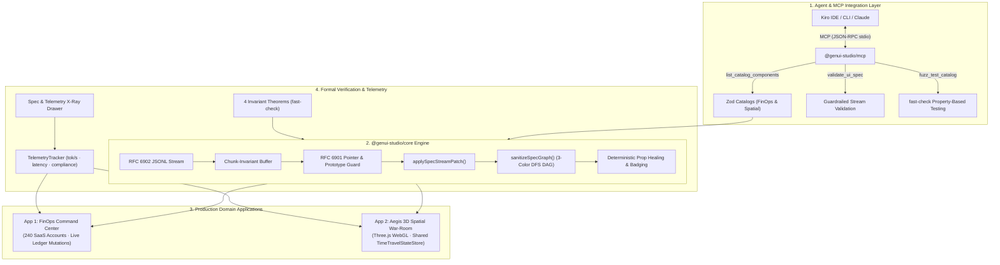

# GenUI Studio (`GenUI-kit`)

[](./LICENSE)
[](https://github.com/vercel-labs/json-render)
[](./.kiro/specs/core-skeleton/correctness.md)
[](./packages/genui-mcp)
[](./.kiro)
[](./tsconfig.base.json)

**GenUI Studio** is a commercial-grade, open-source **Generative UI Skeleton Framework, Verification Workbench & Model Context Protocol (MCP) Server** powered by Vercel's `@json-render` ecosystem (`@json-render/core`, `@json-render/react`, `@json-render/shadcn`, `@json-render/react-three-fiber`, `@json-render/mcp`) and orchestrated via **Kiro Spec-Driven Development**.

> 🏆 **Kiroween 2026 Submission Write-Up:** Read [**`SUBMISSION.md`**](./SUBMISSION.md) for our comprehensive Devpost submission, including the deep dive into Kiro's ecosystem (Specs, Steering, Hooks, Powers, MCP, and PBT), the bugs caught by `fast-check` shrinking, and the complete 2-minute 45-second demo video script.

---

## Why GenUI Studio Exists

Modern AI coding agents and LLM applications need to stream rich, interactive user interfaces—financial operations dashboards, multi-step checkout flows, incident remediation playbooks, and 3D spatial infrastructure maps—rather than walls of static Markdown text. Allowing LLMs to emit raw JSX or HTML is slow, dangerous (XSS / prototype pollution), and prone to runtime whiteouts.

While guardrailed JSON-to-UI (`@json-render`) constrains output via Zod component catalogs, production engineering teams face three critical failure modes:
1. **Schema–Component–Prompt Drift:** Keeping React/Three.js component implementations, Zod catalog schemas, action handlers, and AI system prompts (`catalog.prompt()`) strictly synchronized without manual maintenance.
2. **Adversarial & Hallucinated Stream Topologies:** Guaranteeing that arbitrary, chunk-fragmented RFC 6902 JSONL patch streams emitted by an LLM cannot trigger React hydration crashes, cyclic graph infinite loops (`RangeError: Maximum call stack size exceeded`), prototype pollution (`__proto__`), non-finite float (`NaN`/`Infinity`/`-0`) corruption, or UI deadlocks.
3. **Agent Integration & Tooling Disconnect:** Enabling autonomous coding agents (like Kiro) to inspect available component catalogs, validate proposed UI specs before streaming, and run property-based fuzzing tests over standard protocols like **Model Context Protocol (MCP)**.

**GenUI Studio** solves all three problems at the framework level through a formally verified skeleton core (`@genui-studio/core`), an integrated MCP Server (`@genui-studio/mcp`), and two distinct production showcase applications.

---

## System Architecture



---

## Monorepo Architecture

```text
GenUI-kit/
├── LICENSE                                  # MIT License
├── package.json                             # Root scripts: pnpm dev, pnpm mcp, pnpm test
├── pnpm-workspace.yaml                      # Workspace topology: packages/* & apps/*
├── tsconfig.base.json                       # Shared strict TypeScript compiler configuration
├── SUBMISSION.md                            # Complete Kiroween 2026 Devpost submission & video script
├── README.md                                # Senior-engineer architectural documentation
├── .kiro/                                   # Kiro Spec-Driven Development & Customizations
│   ├── settings/
│   │   └── mcp.json                         # Configured MCP Server for Kiro IDE & CLI
│   ├── steering/                            # Permanent architectural rules
│   │   ├── product.md                       # Vision, anti-slop guidelines & telemetry design
│   │   ├── tech.md                          # Grounded @json-render v0.22.0 API reference
│   │   ├── structure.md                     # Monorepo dependency boundaries
│   │   ├── genui-invariants.md              # 7 formal runtime, schema & memory invariants
│   │   └── spatial-3d-rules.md              # React Three Fiber zero-allocation memory rules
│   ├── specs/                               # Formal Specs in EARS syntax
│   │   ├── core-skeleton/                   # Core engine requirements, design, tasks & PBT theorems
│   │   ├── app-finops-command/              # App 1 specification & mutation requirements
│   │   └── app-spatial-warroom/             # App 2 3D WebGL topology & dual-viewport specification
│   ├── hooks/                               # Event-driven agent verification hooks
│   │   ├── catalog-schema-sync.json         # Audits catalog-registry parity on save
│   │   ├── spec-invariants-test.json        # Runs fast-check PBT suite on save
│   │   ├── raw-jsx-guard.json               # Blocks unauthorized JSX/HTML injection
│   │   └── scripts/                         # Executable hook scripts (Node.js)
│   └── powers/
│       └── json-render-power/               # Reusable Kiro Power for generative UI
│           ├── POWER.md                     # Power manual & 5 Golden Rules
│           ├── mcp.json                     # Power MCP configuration
│           └── steering/                    # React-to-catalog & 3D Three.js transformation playbooks
├── packages/
│   ├── genui-core/                          # @genui-studio/core — Core Reusable Skeleton Engine
│   │   └── src/
│   │       ├── catalog/verified-catalog.ts  # Canonical SHA-256 fingerprinting & prop healing
│   │       ├── stream/dag-sanitizer.ts      # 3-color DFS cycle severance & prototype protector
│   │       ├── stream/stream-compiler.ts    # Chunk-invariant RFC 6902 JSONL compiler
│   │       ├── state/time-travel-store.ts   # Structural-sharing StateStore with undo/redo
│   │       ├── boundary/safe-renderer.tsx   # Per-node error boundary & <DiagnosticHealedBadge />
│   │       ├── telemetry/telemetry-tracker.ts # Real-time tok/s, latency & compliance tracking
│   │       └── testing/index.ts             # fast-check arbitraries & runCatalogInvariantSuite()
│   └── genui-mcp/                           # @genui-studio/mcp — Model Context Protocol Server
│       └── src/
│           ├── server.ts                    # McpServer with list, validate, and fuzz tools
│           ├── cli.ts                       # Executable JSON-RPC stdio transport runner
│           ├── schema-describer.ts          # Zod-to-JSON Schema contract extractor
│           └── tools/                       # list_catalog_components, validate_ui_spec, fuzz_test_catalog
└── apps/
    ├── finops-command/                      # Application #1: FinOps & RevOps Command Center (2D)
    │   ├── src/catalog/                     # 14 Zod Components & React registry
    │   ├── src/components/                  # X-Ray Drawer, live telemetry & chaos injector
    │   ├── src/data/                        # 240-account SaaS ledger with live mutation engine
    │   └── src/streams/                     # RFC 6902 JSONL streaming playbooks & judge presets
    └── spatial-ops/                         # Application #2: Aegis 3D Spatial Incident War-Room (3D + 2D)
        ├── src/catalog/                     # 14 Hybrid 3D (R3F) + 2D (HUD) Zod Components
        ├── src/three/                       # WebGL canvas, OrbitControls, emissive nodes, packet edges
        ├── src/components/                  # Spatial X-Ray drawer, live cluster telemetry
        ├── src/data/                        # 16-microservice topology & SRE mutation engine
        └── src/streams/                     # SRE incident stream scenarios & failover playbooks
```

---

## ⚡ Zero-Setup Judge & Developer Quickstart

The entire monorepo runs with **zero API keys** and **zero external configuration**. All LLM scenarios are bundled with recorded streaming playbooks and live mutation engines.

```bash
# 1. Install all dependencies across all packages and apps (takes ~10 seconds)
pnpm install

# 2. Build the workspace
pnpm build

# 3. Launch BOTH applications in parallel (App 1 on :5173, App 2 on :5174)
pnpm dev

# 4. Run the full test suite (100% green across core, mcp, and both apps)
pnpm test
```

### Direct App URLs
- **App 1 (FinOps Command Center):** [`http://localhost:5173`](http://localhost:5173)
- **App 2 (Aegis 3D Spatial War-Room):** [`http://localhost:5174`](http://localhost:5174)

Each application features a prominent **One-Click App Switcher** in the top navigation bar, allowing seamless switching between the two applications during review.

---

## 🛠️ GenUI Studio MCP Server (`packages/genui-mcp`)

The repository includes a production **Model Context Protocol (MCP)** server configured in [`.kiro/settings/mcp.json`](./.kiro/settings/mcp.json). Any MCP-compatible client (Kiro IDE, Kiro CLI, Claude Desktop, Cursor) can communicate with it over STDIO.

### Available MCP Tools

#### 1. `list_catalog_components`
Inspects available components and their Zod schemas across both apps.
```json
{
  "app": "all",
  "componentName": "KpiMetricCard"
}
```
*Returns: Component descriptions, available slots, full Zod prop contracts, nullability, minimum/maximum bounds, and deterministic fallback props.*

#### 2. `validate_ui_spec`
Validates a proposed Spec DAG or raw RFC 6902 JSONL stream against the target catalog.
```json
{
  "app": "finops",
  "spec": {
    "root": "shell-1",
    "elements": { ... }
  },
  "autoFix": true
}
```
*Returns: Structural graph validation (cycle detection, dangling pointer checks, prototype pollution guard), per-element prop diagnostics, auto-fix suggestions for the LLM, and a 100% render-safe auto-fixed Spec.*

#### 3. `fuzz_test_catalog`
Triggers a live property-based fuzz test against a component schema or the entire 4-theorem catalog invariant suite.
```json
{
  "app": "spatial",
  "componentName": "ClusterTopologyCanvas",
  "numRuns": 50
}
```
*Returns: Property-based testing report with pass/fail status, iteration count, duration, and any shrunk counterexamples.*

### Running the MCP Server
```bash
# Start standalone stdio MCP server
pnpm mcp
```

---

## 🔬 Mathematical Correctness & Property-Based Testing

Every build is verified against **4 formal mathematical theorems** defined in [`.kiro/specs/core-skeleton/correctness.md`](./.kiro/specs/core-skeleton/correctness.md) using `fast-check`:

| Theorem ID | Formal Mathematical Property |
| :--- | :--- |
| **`INV-PBT-01`** | **Stream Chunking Invariance:** For any valid `Spec`, splitting its serialized RFC 6902 JSONL stream across arbitrary random byte chunk cuts or omitting trailing newlines converges to the exact same final `Spec`. |
| **`INV-PBT-02`** | **Adversarial Payload Resilience & DAG Idempotence:** For any fuzzed payload containing `__proto__`, `NaN`/`±Infinity`/`-0`, self-loops (`A -> A`), mutual cycles (`A -> B -> A`), or `javascript:` URIs, the engine never throws an unhandled exception, never pollutes `Object.prototype`, and guarantees idempotent sanitization (`sanitize(sanitize(S)) === sanitize(S)`). |
| **`INV-PBT-03`** | **State Pointer Idempotency & Batch Permutation Determinism:** Applying out-of-order parent/child state mutations (`/a` and `/a/b`) produces identical state models regardless of mutation key order, preserves `===` structural sharing on untouched branches, and inverts cleanly via `undo()`/`redo()`. |
| **`INV-PBT-04`** | **Catalog-to-Prompt Determinism:** Permuting the declaration order of components, Zod shape properties, actions, or custom rules produces the exact same 256-bit `catalogHash` and byte-for-byte identical AI system prompt. |

### Real Bugs Discovered by `fast-check` Shrinking

1. **`BUG-PBT-01` (EOF Stream Chunk Lacking Trailing `\n`):** Fast-check stripped trailing newlines from JSONL lines, causing `parseSpecStreamLine` to drop the final element. Fixed by flushing residual line buffers on `finalize()`.
2. **`BUG-PBT-02` (Negative Zero `-0` and `NaN` Serialization):** Corrupted floats serialized as `{"count": -0}` failed string equality assertions. Fixed by normalizing `-0 -> 0` and healing `NaN`/`Infinity` in `deepCloneAndSanitizeValue`.
3. **`BUG-PBT-03` (Diamond Aliasing & Duplicate Sibling Keys):** Fuzzed specs generated trees where a child was mounted to two separate parents. Fixed by tracking a global `mountedNodes` set during 3-color DFS to guarantee single-mount tree topology.
4. **`BUG-PBT-04` (Batch State Mutation Key-Order Sensitivity):** Mutating `{"/cluster/replicas": 5, "/cluster": { replicas: 3 }}` produced different final states depending on object key order. Fixed by sorting JSON Pointers by depth (shallowest first) before applying updates.
5. **`BUG-INT-01` (Streamed Prop Healing Provenance):** When the stream compiler clamped an out-of-bounds prop, the healing diagnostic was not retained across incremental patch ticks. Fixed by piping `HealedDiagnosticsByElement` directly to the `<DiagnosticHealedBadge />` component.

---

## 📱 The 2 Domain Applications

### App 1: FinOps Command Center (2D)
A high-density B2B SaaS revenue operations dashboard managing 240 seeded customer subscription accounts:
- **14 Zod Components:** `WorkspaceShell`, `SectionGrid`, `KpiMetricCard`, `MrrChurnChart`, `CohortRetentionMatrix`, `AnomalyAlertCard`, `CustomerLedgerTable`, `WebhookStreamTicker`, `IssueRefundCard`, `ExtendTrialCard`, `RetryWebhookCard`, `RetentionDiscountCard`, `RevenueWaterfallCard`, `AuditTrailBanner`.
- **Live Bidirectional Mutations:** Issue partial refunds, apply bounded retention discounts (5%–50%), extend customer trial periods, replay failed Stripe webhooks. All mutations update live Net MRR, Unsettled Balance, and Failed Charge metrics, with 1-click **Time-Travel Undo/Redo**.
- **Adversarial Chaos Injection:** Click **"⚡ Inject Corrupted AI Packet"** to fire prototype pollution attacks, 999% discount props, and cyclic elements directly into the active stream to watch the guardrails clamp, heal, and badge in real time.

### App 2: Aegis 3D Spatial Incident War-Room (3D + 2D)
An autonomous SRE incident command center combining a 3D WebGL microservice mesh with a 2D tactical HUD over a shared `TimeTravelStateStore`:
- **14 Spatial Components:** `AegisWarRoomShell`, `ClusterTopologyCanvas` (Three.js WebGL canvas), `ServiceMeshNode3D`, `TrafficFlowEdge3D`, `BlastRadiusSphere3D`, `RegionZoneBoundary3D`, `IncidentHeroBanner`, `ServiceDiagnosticPanel`, `LatencyHistogramCard`, `ErrorLogTailer`, `BlastRadiusDependencyTree`, `RunbookActionDesk`, `ClusterMetricsGrid`, `SreAuditTrailBanner`.
- **Dual-Viewport Shared State:** Mutating an SRE runbook slider in the 2D HUD updates the 3D WebGL scene's emissive glow, blast radius, and traffic pulse speed in real time at 60fps without remounting the scene.
- **Incident Remediation:** Trip automated circuit breakers, trigger regional cross-datacenter failovers, scale container pod replicas, and execute canary rollbacks with full time-travel audit logging.

---

## 🏆 Kiroween 2026 Submission

For the full competition write-up, Devpost submission text, detailed rubric alignment, and the complete 2-minute 45-second demo video script, refer to:
👉 [**`SUBMISSION.md`**](./SUBMISSION.md)

---

## License

Released under the [**MIT License**](./LICENSE).
