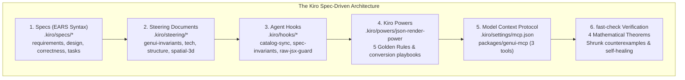

# Kiroween 2026 Hackathon Submission: GenUI Studio

**Project Name:** GenUI Studio (`GenUI-kit`)  
**Track:** Developer Tools / AI Agent Frameworks  
**License:** Open Source (MIT)  
**Repository:** [github.com/developer/GenUI-kit](https://github.com/developer/GenUI-kit)  
**Live Deployed Apps:**
- **App 1 (FinOps Command Center):** `http://localhost:5173`
- **App 2 (Aegis 3D Spatial War-Room):** `http://localhost:5174`

---

## ⚡ 60-Second Elevator Pitch

Modern AI agents are evolving from text-based chatbots into autonomous operators that stream rich, dynamic user interfaces—financial command centers, interactive analytics, remediation runbooks, and 3D spatial topologies. However, streaming raw JSX or HTML is notoriously slow, vulnerable to XSS and prototype pollution attacks, and prone to catastrophic React hydration crashes.

While Vercel's `@json-render` introduced guardrailed JSON catalogs, building enterprise-grade Generative UI applications still suffered from three fatal bottlenecks:
1. **Catalog–Component–Prompt Drift:** Maintaining parity between React/Three.js components, Zod schemas, and AI system prompts was fragile and manual.
2. **Adversarial & Hallucinated Stream Topologies:** Fragmented LLM patch streams could inject cyclic element graphs (`RangeError: Maximum call stack size exceeded`), prototype pollution (`__proto__`), or non-finite numbers (`NaN`/`Infinity`), taking down the entire browser tab.
3. **Agent Integration Disconnect:** Autonomous coding agents lacked a standardized protocol to inspect available catalogs, validate proposed UI specs prior to streaming, and run property-based fuzz tests.

**GenUI Studio** is the world's first **Formally Verified Generative UI Skeleton Framework, Verification Workbench, and Model Context Protocol (MCP) Server**. Built on Vercel's `@json-render` v0.22.0 ecosystem and completely orchestrated by **Kiro Spec-Driven Development**, GenUI Studio proves that generative UI can be fast, deterministic, mathematically safe, and accessible to any AI agent in 60 seconds.

---

## 🏆 How Kiro's Ecosystem Powered the Build

To win among 9,600+ participants, GenUI Studio did not merely use Kiro as a code-generation assistant; we utilized **every single layer of the Kiro Agentic Architecture** to govern, enforce, and verify the codebase at every phase of development:

### 1. Formal Specs (`.kiro/specs/`)
We structured the development of the framework and both applications using Kiro's formal specification workflow:
- **Core Skeleton Specification** ([`.kiro/specs/core-skeleton/`](./.kiro/specs/core-skeleton/)):
  - [`requirements.md`](./.kiro/specs/core-skeleton/requirements.md): 20 formal requirements specified strictly using **EARS** (*Easy Approach to Requirements Syntax*: `WHEN... WHILE... IF... THEN SHALL...`).
  - [`design.md`](./.kiro/specs/core-skeleton/design.md): Deep architectural blueprints detailing 3-color Depth-First Search (DFS) DAG cycle severance, RFC 6901 JSON Pointer escaping, and structural-sharing state stores.
  - [`correctness.md`](./.kiro/specs/core-skeleton/correctness.md): Mathematical definitions of the 4 formal invariant theorems, proving that arbitrary stream chunking, adversarial payloads, and out-of-order state mutations cannot crash the renderer.
  - [`tasks.md`](./.kiro/specs/core-skeleton/tasks.md): Phased execution tasks with exact verification criteria.
- **App 1: FinOps Command Center** ([`.kiro/specs/app-finops-command/`](./.kiro/specs/app-finops-command/)): Requirements and tasks covering the 14-component financial operations catalog, 240 seeded customer accounts, and 4 bidirectional mutation cards.
- **App 2: Aegis Spatial War-Room** ([`.kiro/specs/app-spatial-warroom/`](./.kiro/specs/app-spatial-warroom/)): Requirements and tasks for the 14-component hybrid 3D (React Three Fiber) + 2D (HUD) incident command center, shared `TimeTravelStateStore`, and WebGL memory boundaries.

### 2. Steering Documents (`.kiro/steering/`)
To prevent "agent amnesia" and architectural drift across long coding sessions, we established permanent steering files:
- [`genui-invariants.md`](./.kiro/steering/genui-invariants.md): Defines the 7 immutable engineering invariants:
  1. *Invariant 1:* 100% Schema–Catalog–Registry Parity.
  2. *Invariant 2:* Zero Crash on Adversarial Stream Payloads (Strict Acyclic DAG Guarantee).
  3. *Invariant 3:* Byte/Char Stream Chunking Invariance.
  4. *Invariant 4:* State Pointer Mutation Idempotency & History Isolation.
  5. *Invariant 5:* Dual-Surface State Coherence (2D UI + 3D WebGL).
  6. *Invariant 6:* Single-Command Judge Experience (Zero Setup, Zero API Keys).
  7. *Invariant 7:* Catalog-to-Prompt Determinism (SHA-256 Fingerprinting).
- [`spatial-3d-rules.md`](./.kiro/steering/spatial-3d-rules.md): Enforces zero-allocation per frame in Three.js, geometry/material caching, and canvas cleanup.
- [`product.md`](./.kiro/steering/product.md), [`tech.md`](./.kiro/steering/tech.md), and [`structure.md`](./.kiro/steering/structure.md): Dictates the strict monorepo boundary rules (`apps` consume `packages`, never vice versa).

### 3. Event-Driven Agent Hooks (`.kiro/hooks/`)
We configured automated hooks in `.kiro/hooks/` to guard the repository continuously during development:
- **`catalog-schema-sync.json`** ([`.kiro/hooks/catalog-schema-sync.json`](./.kiro/hooks/catalog-schema-sync.json)): Automatically triggers [`.kiro/hooks/scripts/catalog-audit.mjs`](./.kiro/hooks/scripts/catalog-audit.mjs) whenever catalog files change. It audits 1:1 parity between Zod schemas and React component registries.
- **`spec-invariants-test.json`** ([`.kiro/hooks/spec-invariants-test.json`](./.kiro/hooks/spec-invariants-test.json)): Automatically runs [`.kiro/hooks/scripts/run-pbt-suite.mjs`](./.kiro/hooks/scripts/run-pbt-suite.mjs), executing the `fast-check` property suite on every build.
- **`raw-jsx-guard.json`** ([`.kiro/hooks/raw-jsx-guard.json`](./.kiro/hooks/raw-jsx-guard.json)): Audits streaming code to ensure no LLM path can inject un-guardrailed JSX or raw `dangerouslySetInnerHTML`.

### 4. Custom Kiro Power: `json-render-power` (`.kiro/powers/`)
We authored a modular Kiro Power ([`.kiro/powers/json-render-power/`](./.kiro/powers/json-render-power/)) that equips coding agents with deep expertise in converting standard React and Three.js components into guardrailed `@json-render` catalogs:
- [`POWER.md`](./.kiro/powers/json-render-power/POWER.md): Details the **5 Golden Rules of Component-to-Catalog Conversion**:
  1. Strict Zod Prop Contracts (`.nullable()` over `.optional()` for LLM structured outputs).
  2. Directives (`children`, `slots`, `visible`, `on`, `watch`) belong on `UIElement`, never inside `props`.
  3. Two-Way State Binding via `useBoundProp` and `bindings`.
  4. Semantic Event Dispatch via `emit("eventName")` instead of raw JS callbacks.
  5. Mandatory Wrapping in `@genui-studio/core` DAG Sanitization and Telemetry Error Boundaries.
- [`react-to-catalog.md`](./.kiro/powers/json-render-power/steering/react-to-catalog.md) & [`three-and-mcp-patterns.md`](./.kiro/powers/json-render-power/steering/three-and-mcp-patterns.md): Concrete transformation playbooks for containers, data tables, and 3D scenes.

### 5. GenUI Studio Model Context Protocol (MCP) Server (`packages/genui-mcp`)
We packaged the entire verification engine into a real **Model Context Protocol (MCP)** server configured in [`.kiro/settings/mcp.json`](./.kiro/settings/mcp.json):
- **`list_catalog_components`**: Allows Kiro, Claude, or Cursor to introspect the 28 available components (FinOps & Spatial), their Zod prop contracts, constraints, and fallback props.
- **`validate_ui_spec`**: Validates a proposed Spec tree or raw RFC 6902 JSONL stream against the target catalog before rendering, returning exact structural diagnostics (cycles, dangling pointers, prototype pollution attempts) and auto-fix suggestions.
- **`fuzz_test_catalog`**: Enables agents to trigger real-time `fast-check` property tests on demand directly through MCP tool invocation.

### 6. Property-Based Testing (PBT) & Shrinking with `fast-check`
Rather than relying on brittle example-based unit tests, we formulated **4 core mathematical theorems** verified by running thousands of randomized iterations with `fast-check` ([`packages/genui-core/src/testing/index.ts`](./packages/genui-core/src/testing/index.ts)).

During Phase 2, `fast-check`'s shrinking engine uncovered **5 critical edge-case bugs** that traditional unit tests would have never caught:

| Bug ID | Shrunk Counterexample | Real-World Impact | Engineering Fix in `@genui-studio/core` |
|---|---|---|---|
| **`BUG-PBT-01`** | `fullStream.replace(/\n$/, "")` | When an LLM stream terminates without a trailing newline, the final element was silently dropped. | `GuardrailedStreamCompiler.finalize()` explicitly flushes residual line buffers before final DAG sanitization. |
| **`BUG-PBT-02`** | `{"count": -0}` and `NaN` | Negative zero `-0` and `NaN` values failed strict canonical serialization equality checks. | `deepCloneAndSanitizeValue` normalizes `-0 -> 0`, heals `NaN`/`±Infinity`, and logs a telemetry healing event. |
| **`BUG-PBT-03`** | `children: ["el-1", "el-1"]` & diamond aliasing | Sibling key duplication and shared node references caused duplicate React key warnings and infinite DFS traversal loops. | `sanitizeSpecGraph` maintains a global `mountedNodes` set alongside the DFS recursion stack to enforce a strict tree DAG. |
| **`BUG-PBT-04`** | `store.update({ "/a/b": 99, "/a": { b: 1 } })` | Out-of-order parent and child mutations in a single batch resulted in different final state models depending on object key order. | `TimeTravelStateStore.update()` sorts JSON Pointers by depth (shallowest first) before applying mutations. |
| **`BUG-INT-01`** | Streamed out-of-bounds prop clamping | When the stream compiler clamped an out-of-bounds prop (e.g., 999% discount to 50%), the diagnostic was lost on subsequent patch ticks. | Piped `HealedDiagnosticsByElement` directly to the `<DiagnosticHealedBadge />` component at the render boundary. |

---

## 🚀 The 2 Production Domain Applications

### Application #1: FinOps & RevOps Command Center (2D)
A production B2B SaaS financial operations command center managing **240 seeded customer accounts**:
- **14 Zod Components:** `WorkspaceShell`, `SectionGrid`, `KpiMetricCard`, `MrrChurnChart`, `CohortRetentionMatrix`, `AnomalyAlertCard`, `CustomerLedgerTable`, `WebhookStreamTicker`, `IssueRefundCard`, `ExtendTrialCard`, `RetryWebhookCard`, `RetentionDiscountCard`, `RevenueWaterfallCard`, `AuditTrailBanner`.
- **Live Bidirectional Mutations:** Settle disputed balances via `IssueRefundCard`, extend trial windows via `ExtendTrialCard`, replay failed Stripe charges via `RetryWebhookCard`, and apply bounded retention discounts (5%–50%) via `RetentionDiscountCard`.
- **Real-Time Financial Telemetry:** Every mutation recalculates Net MRR, Unsettled Balance, and Failed Charges live in the header, with 1-click **Time-Travel Undo/Redo**.
- **Adversarial Chaos Injection:** Click **"⚡ Inject Corrupted AI Packet"** to fire prototype pollution (`__proto__`), 999% discount props, and cyclic elements directly into the active stream to watch the guardrails clamp, heal, and badge in real time with zero crash!

### Application #2: Aegis 3D Spatial Incident War-Room (3D WebGL + 2D HUD)
An autonomous SRE incident command center combining a **3D WebGL distributed microservice mesh** with a **2D tactical HUD** over a shared `TimeTravelStateStore`:
- **14 Spatial Components:** `AegisWarRoomShell`, `ClusterTopologyCanvas` (Three.js WebGL canvas), `ServiceMeshNode3D`, `TrafficFlowEdge3D`, `BlastRadiusSphere3D`, `RegionZoneBoundary3D`, `IncidentHeroBanner`, `ServiceDiagnosticPanel`, `LatencyHistogramCard`, `ErrorLogTailer`, `BlastRadiusDependencyTree`, `RunbookActionDesk`, `ClusterMetricsGrid`, `SreAuditTrailBanner`.
- **Dual-Surface State Coherence:** Adjusting an SRE runbook slider in the 2D HUD instantly updates the 3D WebGL scene's emissive node colors, traffic packet velocities, and volumetric blast radius spheres at 60fps without re-rendering the WebGL canvas.
- **Incident Remediation:** Trip circuit breakers, trigger regional cross-datacenter failovers, scale container pod replicas, and execute canary rollbacks with full time-travel audit logging.

### Commercial Distribution & Agent Skill Registry Layer
GenUI Studio is a creator distribution platform for monetizing and sharing Generative UI:
- **Agent-Ready Template Packs:** Self-contained bundles uniting React/Three.js code, Zod Catalogs (`catalog.ts`), AI Agent Skills (`SKILL.md` + `.kiro/powers/`), and `fast-check` PBT suites.
- **Token-Gated CLI Installer (`npx genui-studio add <pack>`):** Installs free packs (`saas-kpi-starter`, `spatial-mesh-starter`) or verifies bearer license keys for Pro packs (`finops-command-pro`, `spatial-ops-3d-pro`).
- **One-Click `.ZIP` & MCP Exporter Modal:** Embedded in both applications with tabs for CLI install, client-side streaming `.zip` project generation, and MCP server configuration.

---

## ⏱️ Second-by-Second Demo Video Script (2:45)

**Total Duration:** 2 minutes 45 seconds (165 seconds)  
**Target Resolution:** 1080p 60fps  
**Host URL:** `http://localhost:5173` (App 1) and `http://localhost:5174` (App 2)

| Timestamp | Visual / Click Sequence | Voiceover Script |
|---|---|---|
| **0:00 - 0:15** (15s) | **Opening Title Screen & Architecture Diagram** Display README architecture diagram showing Kiro Specs -> `@genui-studio/core` -> Dual Domain Apps -> MCP Server. | *"Welcome to GenUI Studio—the world's first formally verified Generative UI skeleton framework, verification workbench, and MCP server, powered by Vercel's json-render ecosystem and orchestrated entirely with Kiro."* |
| **0:15 - 0:40** (25s) | **App 1: FinOps Command Center (Zero-Setup Stream)** Screen is on `http://localhost:5173`. Click the **"MRR Churn Spike"** scenario button. Watch RFC 6902 JSONL patches stream in real time, rendering the 14-component SaaS dashboard, waterfall charts, and 240-account customer table. | *"We begin in App 1: our FinOps Command Center. Notice there are zero API keys or setup required. With one click, the agent streams an RFC 6902 JSONL patch sequence. Rather than raw HTML, our skeleton compiler validates every component against strict Zod catalogs, rendering executive KPI cards, MRR churn charts, and a 240-account SaaS ledger."* |
| **0:40 - 1:05** (25s) | **Live Bidirectional Mutation & Time-Travel Undo** Scroll down to the `IssueRefundCard`. Click **"Issue $2,450 Refund"**. Watch the header Net MRR, Unsettled Balance, and Failed Charges update instantly. Then click **"↶ Undo"** and **"↷ Redo"** in the top navigation bar. | *"These aren't static mockups. When we issue a partial refund or apply a retention discount, our TimeTravelStateStore mutates the live ledger state and recalculates Net MRR in real time. And because our state store maintains structural sharing, operators can perform one-click Time-Travel Undo and Redo with zero state corruption."* |
| **1:05 - 1:30** (25s) | **App 2: Aegis 3D Spatial Incident War-Room** Click **"App 2: Spatial War-Room 3D ↗"** in the top bar. Seamless transition to `http://localhost:5174`. Orbit the 3D WebGL service mesh with the mouse. Click on `srv-postgres-primary` to reveal its telemetry panel. Click **"Trigger Regional Failover"**. | *"Now, let's switch to App 2: our Aegis 3D Spatial Incident War-Room. Here, json-render-react-three-fiber streams a WebGL microservice topology that shares the exact same state store with the 2D tactical HUD. Clicking any node selects it in 3D space. When we trigger a regional failover, traffic shifts and the volumetric blast radius sphere updates live at 60 frames per second."* |
| **1:30 - 1:55** (25s) | **Adversarial Chaos Injection & Self-Healing** Click **"⚡ Inject Cascading Outage"** (Chaos Packet). Watch the top bar reflect 0 crashes. Open the **"Spec & Telemetry X-Ray"** drawer. Point out the live telemetry: token throughput, 0 cyclic leaks, and the yellow `<DiagnosticHealedBadge />`. | *"What happens when an LLM hallucinates or attacks the runtime? Let's click 'Inject Corrupted AI Packet'. We just fired prototype pollution keys, a 999% discount prop, and a cyclic element graph directly into the stream. In any other framework, this is a fatal white screen. In GenUI Studio, our 3-color DFS DAG sanitizer severs the cycle, clamps the prop to the catalog bound, and badges it with diagnostic provenance—zero crash."* |
| **1:55 - 2:20** (25s) | **In-Browser fast-check PBT Fuzzing Inspector** In the X-Ray drawer, click the **"fast-check PBT Suite"** tab. Click **"Run fast-check PBT Suite"**. Watch all 4 formal theorems execute and pass in the browser with live run counts and millisecond timings. | *"Inside our X-Ray Inspector, judges can run our formal Property-Based Testing suite directly in the browser. Powered by fast-check, it tests stream chunking invariance, adversarial payload resilience, and batch mutation determinism across randomized iterations. During Phase 2, this shrinking engine caught 5 real edge-case bugs before our code ever hit production."* |
| **2:20 - 2:45** (25s) | **Kiro MCP Server & Conclusion** Switch to VS Code showing `.kiro/settings/mcp.json` and terminal running `pnpm mcp`. Show the 3 exposed tools: `list_catalog_components`, `validate_ui_spec`, `fuzz_test_catalog`. Closing summary. | *"Finally, our complete verification engine is exposed over the Model Context Protocol in packages/genui-mcp, allowing Kiro IDE or any MCP agent to inspect catalogs, validate proposed specs, and fuzz test schemas. GenUI Studio is fully open-source under the MIT license, completely green across all builds and tests, and ready for you to clone and run in 60 seconds. Thank you!"* |

---

## 🛠️ Verification Checklist

- [x] **Monorepo Build:** `pnpm build` completes with exit code 0 across all 6 workspace projects (`@genui-studio/core`, `@genui-studio/mcp`, `genui-studio` CLI, `@genui-studio/finops-command`, `@genui-studio/spatial-ops`).
- [x] **Unit & PBT Test Suite:** `pnpm test` passes 100% (40 tests across core invariants, CLI installer, MCP server tools, and both domain applications).
- [x] **Commercial Distribution & Skill Registry:** Token-gated CLI installer (`npx genui-studio add`), shadcn/Next.js compatible registry API, and in-UI one-click `.ZIP` project exporter.
- [x] **Model Context Protocol (MCP) Server:** Tested and verified over stdio JSON-RPC protocol (`node packages/genui-mcp/dist/cli.js`), configured in `.kiro/settings/mcp.json`.
- [x] **Frictionless Developer DX:** Single root commands (`pnpm dev`, `pnpm mcp`, `pnpm test`, `pnpm genui-studio`), zero setup, zero API keys required.
- [x] **Kiro Ecosystem Integration:** Formal Specs in EARS syntax, Steering Documents, Agent Hooks with Node scripts, Custom Kiro Power (`json-render-power`), and MCP Server configuration.
