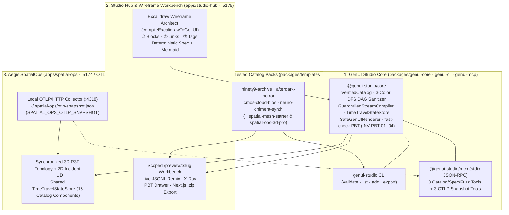

# Kiroween 2026 Hackathon Submission: GenUI Studio (`GenUI-kit`)

**Project Name:** GenUI Studio (`GenUI-kit`)  
**Track:** Developer Tools / AI Agent Frameworks (Skeleton Crew)  
**License:** Open Source (MIT)  
**Repository:** [github.com/NOBA235/GenUI-kit](https://github.com/NOBA235/GenUI-kit)  
**Runtime Prerequisites:** `Node.js >= 22.18.0`, `pnpm@9.15.0` (zero external API keys required)  
**Local Showcase Ports:**
- **Studio Hub & Wireframe Workbench (`apps/studio-hub`):** `http://localhost:5175` (`/` storefront and `/preview/:slug` + `?fullscreen=true` workbench)
- **Aegis SpatialOps (`apps/spatial-ops`):** `http://localhost:5174` (live local OTLP/HTTP JSON collector on `http://localhost:4318/v1/{traces,logs,metrics}`; opt-in `--demo` simulator)

---

## 🎯 One-Sentence Thesis & Four-Stage Architecture Spine

> **One-Sentence Thesis:** **GenUI Studio** is a guardrailed Generative UI compiler, verification engine, and Kiro-orchestrated workbench (`@genui-studio/core`, built on `@json-render` `v0.22.0`) that compiles spatial wireframes and streamed RFC 6902 JSONL patches into DAG-sanitized, property-tested, crash-isolated React and 3D WebGL interfaces across **GenUI Studio Core → Studio Hub & Wireframe Workbench → Aegis SpatialOps → Stress-Tested Catalog Packs**.



---

## 📊 `@json-render` (`v0.22.0`) vs. `@genui-studio/core`

`@json-render/core` and `@json-render/react` (`v0.22.0`) are the upstream packages imported by source (`@json-render/shadcn` and `@json-render/react-three-fiber` are declared in `apps/spatial-ops/package.json` but not imported; `apps/spatial-ops` renders its 3D WebGL scene directly with `@react-three/fiber` and `@react-three/drei`). `@genui-studio/core`, `genui-studio` CLI, `@genui-studio/mcp`, and `apps/studio-hub` add the surrounding visual compiler, runtime defense-in-depth, and verification pipeline:

| Capability / Boundary | Upstream `@json-render/core` & `@json-render/react` (`v0.22.0`) | Added by `@genui-studio/core` & GenUI Studio |
| :--- | :--- | :--- |
| **Visual Wireframe Authoring** | JSON / code-authored `Spec` trees | **Excalidraw Wireframe Architect** (`compileExcalidrawToGenUI` → deterministic `Spec` + `.kiro` Mermaid diagram; zero LLM/network calls inside `compileExcalidrawToGenUI`) |
| **Catalog & Prompt Synchronizer** | `defineCatalog()`, `defineRegistry()`, `catalog.prompt()` | **`createVerifiedCatalog()`** with FIPS 180-4 SHA-256 `catalogHash`, 1:1 schema-to-registry parity check, and deterministic key sorting |
| **Cyclic Graph & Recursion Caps** | `validateSpec()`, `autoFixSpec()` | **3-Color DFS DAG Sanitizer (`sanitizeSpecGraph`)** severing back-edges (`A -> B -> A`) and sibling aliasing, enforcing `maxDepth`, `maxElements`, `maxValueDepth`, and `maxValueNodes` |
| **Prototype Pollution & URI Guard** | Relies on caller hygiene | **RFC 6901 Pointer & String Guard** (`isDangerousKey`, `isSafeJsonPointer`, `isSafeUrl`) blocking `__proto__`, `constructor`, `prototype`, `javascript:`, `vbscript:`, and `data:text/html` |
| **Prop Healing & Float Normalization** | Strict Zod validation | **Semantic Case/Separator Enum Healing, Numeric Clamping, `-0 -> 0` / `NaN` / `±Infinity` Healing & `<DiagnosticHealedBadge />`** |
| **Hook-Safe Fault Isolation** | `<Renderer>`, `StateProvider`, `VisibilityProvider`, `ActionProvider` | **`<SafeGenUIRenderer>` (`<SafeElementInvoker>` + `<GenUIElementErrorBoundary>`)** isolating component throws to `<ElementFaultCard />` while keeping React hook order invariant |
| **Chunk-Invariant Streaming** | `parseSpecStreamLine()`, `applySpecStreamPatch()`, `diffToPatches()` | **`createGuardrailedStreamCompiler()`** with bounded buffers (`maxBufferBytes`, `maxLineLength`, `maxTotalStreamBytes`, `maxPatches`), accepting JSONL, SSE (`data:`/`[DONE]`), or full Spec snapshots across arbitrary byte boundaries |
| **Immutable Time-Travel State** | `StateStore` interface, `getByPath`, `immutableSetByPath`, `flattenToPointers` | **`createTimeTravelStateStore()`** with depth-sorted batch pointer mutations (`/a` before `/a/b`), `deepFreezeValue`, bounded ring buffer (`maxHistory` default `128`), `undo()`/`redo()`/`jumpToSnapshot()`, and watch cascade circuit breaker |
| **CI CLI, MCP & PBT Fuzzing** | Core schema/spec utilities | **`genui-studio` CLI**, **`@genui-studio/mcp`** (`@modelcontextprotocol/sdk` stdio server), and **`@genui-studio/core/testing`** (`fast-check` Arbitraries + `runCatalogInvariantSuite`) |

---

## 🏛️ How the Four Stages Work Together

### Stage 1 — GenUI Studio Core (`packages/genui-core`, `packages/genui-cli`, `packages/genui-mcp`)
- **`@genui-studio/core`:** Provides `createVerifiedCatalog`, `sanitizeSpecGraph` (3-color DFS cycle & sibling-aliasing severance), `createGuardrailedStreamCompiler`, `createTimeTravelStateStore`, `<SafeGenUIRenderer>`, and `@genui-studio/core/testing` (`INV-PBT-01..04`).
- **`genui-studio` CLI (`packages/genui-cli`):** Validates `.json`/`.jsonl`/`.sse` streams in CI (`validate --strict --json`) and lists, scaffolds, or exports template packs (`list`, `add`, `export`).
- **`@genui-studio/mcp` (`packages/genui-mcp`):** Exposes `list_catalog_components`, `validate_ui_spec`, `fuzz_test_catalog`, `query_telemetry_metrics`, `fetch_trace_spans`, and `execute_remediation` over stdio JSON-RPC.

### Stage 2 — Studio Hub & Wireframe Workbench (`apps/studio-hub`, `:5175`)
- **Scoped Multi-Viewport Preview & HUD:** Inspect template packs across `Desktop`, `Tablet`, `Mobile`, and `?fullscreen=true` viewports inside `ScopedTemplateContainer`, stream live RFC 6902 JSONL remixes, run `runCatalogInvariantSuite` in the X-Ray Drawer, and export runnable Next.js `.zip` archives.
- **3-Primitive Deterministic Wireframe Architect ([`WireframeArchitectCanvas.tsx`](./apps/studio-hub/src/components/WireframeArchitectCanvas.tsx) & [`excalidraw-compiler.ts`](./apps/studio-hub/src/lib/excalidraw-compiler.ts)):**
  1. **① Catalog Blocks:** Drawn shapes (`rectangle`, `diamond`, `ellipse`, `frame`) and bound text labels resolve against the active `VerifiedCatalog` via exact component names, keyword synonyms, and containment geometry (`>= 0.75`), sorted top-to-bottom / left-to-right by `(minY, minX)` with UTF-16 code-point tie-breaking (`compareCodePoints`).
  2. **② Directed Interaction Links (`arrow`):** Drawn arrows with `startBinding` and `endBinding` compile into safe RFC 6901 state pointers (`/wireframeBindings/<slug>`), injecting `{ "$state": "/wireframeBindings/<slug>" }` onto the target block's summary prop, seeding `spec.state.wireframeBindings`, and adding a dashed `-.->` edge to the `.kiro/specs/<slug>/design.md` Mermaid diagram.
  3. **③ Tags & Guardrails:** Explicit `customData.catalogComponent` tags override label heuristics only when the component exists in the catalog; unknown components, `isDeleted` shapes, `__proto__`/`constructor` keys, and cycles are stripped before passing through `catalog.validateFull()` / `sanitizeSpecGraph()`.
  - **Strict Scope of Zero-LLM / Zero-Network Claim:** Strictly scoped to `compileExcalidrawToGenUI`, compilation is a synchronous, pure in-memory function making **zero LLM, network, clock, or randomness calls**—verified by [`wireframe-proof.test.ts`](./apps/studio-hub/src/__tests__/wireframe-proof.test.ts) and [`audit-wireframe-compiler.mjs`](./apps/studio-hub/scripts/audit-wireframe-compiler.mjs).

### Stage 3 — Aegis SpatialOps (`apps/spatial-ops`, `:5174` / OTLP `:4318`)
- **Live OTLP Ingestion + Synchronized 3D/2D State:** Ingests standard OTLP/HTTP JSON (`POST /v1/{traces,logs,metrics}`) on `:4318`, driving a 3D WebGL microservice topology (`SpatialSceneCanvas.tsx`) and a 2D incident HUD (`15` catalog components) over a single shared `TimeTravelStateStore`.
- **Shared Snapshot Contract:** Both the SpatialOps collector (`apps/spatial-ops/server/otlp-collector.ts`) and the MCP server (`packages/genui-mcp/src/tools/otlp-snapshot-provider.ts`) read and write `~/.spatial-ops/otlp-snapshot.json` by default and honour `SPATIAL_OPS_OTLP_SNAPSHOT`.

### Stage 4 — Stress-Tested Catalog Packs (`packages/templates` & `@genui-studio/core/registry`)
- **`ninety9-archive`:** 1997 monochrome workstation archive (`34` dossiers, COBOL CRT boot gate, 5-tone monochrome token law).
- **`afterdark-horror`:** Procedural 3D cemetery/crypt exploration (`THREE.InstancedMesh`, AABB+circle sliding collision solver, procedural Web Audio, WCAG flash limits, Swiss editorial convergence).
- **`cmos-cloud-bios`:** 1994 Award BIOS setup utility + 3D motherboard digital twin + deterministic IaC compiler (`docker-compose.yml`, `vercel.json`, `main.tf` with FNV-1a checksum).
- **`neuro-chimera-synth` (`CHIMERA // LAB`):** Bio-synthetic Physarum SQL query optimizer, recursive-descent SQL parser/cost planner, Web Audio sonifier, and offline `kiro-crew-app/` bundle.
- **Registry Packs (`@genui-studio/core/registry`):** `spatial-mesh-starter` and `spatial-ops-3d-pro`.

---

## 🤖 5-Layer Kiro Integration Matrix

| Kiro Layer | Artifacts in Repository | What It Enforces / Provides | Verification Command / Evidence |
| :--- | :--- | :--- | :--- |
| **1. Specs (EARS)** | [`.kiro/specs/core-skeleton/`](./.kiro/specs/core-skeleton/), [`app-spatial-warroom/`](./.kiro/specs/app-spatial-warroom/), [`ninety9-archive/`](./.kiro/specs/ninety9-archive/), [`afterdark/`](./.kiro/specs/afterdark/), [`cmos-cloud-bios/`](./.kiro/specs/cmos-cloud-bios/), [`neuro-chimera-synth/`](./.kiro/specs/neuro-chimera-synth/) | EARS requirements (`WHEN/WHILE/IF ... SHALL`), architecture design docs, `INV-PBT-01..04` correctness theorems, and honest task checklists | `pnpm -r test` (`22` test files, `151` passing tests) |
| **2. Steering** | [`.kiro/steering/`](./.kiro/steering/) (`product.md`, `tech.md`, `structure.md`, `genui-invariants.md`, `spatial-3d-rules.md`, `ninety9-monochrome-rules.md`, `afterdark-3d-horror.md`, `cmos-bios-rules.md`, `chimera-frankenstein-rules.md`) | Global monorepo/invariant rules (`inclusion: always`) + domain-specific 3D, monochrome, BIOS, and bio-solver laws (`inclusion: fileMatch`) | `pnpm -r lint` (shared [`eslint.config.mjs`](./eslint.config.mjs) enforces Invariants 1 & 7 statically) |
| **3. Hooks** | [`.kiro/hooks/`](./.kiro/hooks/) (`catalog-schema-sync.json`, `spec-invariants-test.json`, `raw-jsx-guard.json`, `standalone-dropin-ingest.json`) + `.kiro/hooks/scripts/*.mjs` | Event-driven catalog-to-registry parity audit, `fast-check` PBT invariant runner, raw JSX/HTML guard, and standalone drop-in ingestion | `node .kiro/hooks/scripts/catalog-audit.mjs` & `node .kiro/hooks/scripts/run-pbt-suite.mjs` |
| **4. Powers & Skills** | [`.kiro/powers/json-render-power/`](./.kiro/powers/json-render-power/) (`POWER.md`, `mcp.json`, `steering/*.md`) + per-pack `POWER.md` & `SKILL.md` | 5 Golden Rules for converting React/Three.js components into guardrailed catalogs + reusable agent playbooks | Verified against `@json-render` `v0.22.0` types |
| **5. MCP Server & Kiro Crew** | [`packages/genui-mcp/`](./packages/genui-mcp/), [`.kiro/settings/mcp.json`](./.kiro/settings/mcp.json), [`packages/templates/src/neuro-chimera-synth/kiro-crew-app/`](./packages/templates/src/neuro-chimera-synth/kiro-crew-app/) | 6 stdio JSON-RPC MCP tools (3 catalog/spec/fuzz + 3 OTLP snapshot tools) + `chimera-lab@1.1.0` Kiro Crew bundle (`app.json`, 3 agents, skill, UI bundle, Python hooks) | `node scripts/verify-mcp.mjs` (stdio MCP client) & `chimera-lab.pbt.test.ts` |

### Real Bugs Caught by `fast-check` Shrinking & Determinism Audits
| Bug / Audit | Minimal Counterexample | Real-World Impact | Engineering Fix |
| :--- | :--- | :--- | :--- |
| **`BUG-PBT-01`** | `fullStream.replace(/\n$/, "")` | Streams ending without a trailing `\n` dropped the final element. | `GuardrailedStreamCompiler.finalize()` flushes residual line buffers before final DAG sanitization. |
| **`BUG-PBT-02`** | `{"count": -0}` and `NaN` | `-0` and `NaN` values failed strict canonical serialization equality checks. | `deepCloneAndSanitizeValue` normalizes `-0 -> 0`, heals `NaN`/`±Infinity`, and records diagnostics. |
| **`BUG-PBT-03`** | `children: ["el-1", "el-1"]` & diamond aliasing | Sibling key duplication and shared node references caused React key collisions and DFS traversal loops. | `sanitizeSpecGraph` maintains a global `mountedNodes` set alongside the DFS recursion stack to enforce a strict tree DAG. |
| **`BUG-PBT-04`** | `store.update({ "/a/b": 99, "/a": { b: 1 } })` | Out-of-order parent and child mutations in a single batch depended on object key order. | `TimeTravelStateStore.update()` sorts JSON Pointers by depth (shallowest first) before applying mutations. |
| **`BUG-WF-LOCALE`** | Equal-coordinate blocks `"aa-note"` and `"zz-note"` under Danish (`da`) collation | `compareVisualNodes` used `localeCompare`, causing `"aa"` to sort after `"z"` in `da` vs. before `"z"` in `en-US`. | Replaced `localeCompare` with UTF-16 code-point ordering (`compareCodePoints`) in `excalidraw-compiler.ts`. |

---

## ⚡ Reproducible Verification Commands

```bash
# 1. Install dependencies (Node.js >= 22.18.0, pnpm@9.15.0)
pnpm install --frozen-lockfile

# 2. Check workspace script completeness and run build, typecheck, lint, and tests
node scripts/check-workspace-scripts.mjs
pnpm -r build
pnpm -r typecheck
pnpm -r lint
pnpm -r test

# 3. Execute Kiro hook scripts, real stdio MCP client verification, and Wireframe bundle audit
node .kiro/hooks/scripts/catalog-audit.mjs
node .kiro/hooks/scripts/run-pbt-suite.mjs
node scripts/verify-mcp.mjs
node apps/studio-hub/scripts/audit-wireframe-compiler.mjs
```

---

## ✅ Honest Verified vs. Unverified Status

| Verification Item | Status | Evidence / Reason |
| :--- | :--- | :--- |
| **Workspace Build, Typecheck, Lint & Tests (All 6 Packages)** | **Verified** | `pnpm -r build`, `pnpm -r typecheck`, `pnpm -r lint`, and `pnpm -r test` all exit `0` (`22` test files, `151` passing tests; enforced in `.github/workflows/ci.yml`). |
| **External Package-Consumer Tarball Verification** | **Verified** | `@genui-studio/core`, `@genui-studio/templates`, `genui-studio`, and `@genui-studio/mcp` packed via `pnpm pack`, installed into a clean external project, and verified for ESM imports, `@genui-studio/core/testing` + `fast-check`, NodeNext TypeScript declarations (`--skipLibCheck false`), and CLI `bin` execution. |
| **Wireframe Architect Deterministic Compilation (`compileExcalidrawToGenUI`)** | **Verified** | Excalidraw v2 fixture → golden `Spec` + Mermaid snapshots, 50-run determinism, Danish locale collation invariance, runtime network/clock/randomness tripwires (`wireframe-proof.test.ts`), and static Rollup bundle scan (`audit-wireframe-compiler.mjs`). |
| **MCP Server (`@genui-studio/mcp`) & OTLP `:4318` Snapshot Contract** | **Verified** | All 6 MCP tools verified over stdio JSON-RPC (`scripts/verify-mcp.mjs`); collector and MCP server share `~/.spatial-ops/otlp-snapshot.json` and honour `SPATIAL_OPS_OTLP_SNAPSHOT`. |
| **Kiro Crew (`neuro-chimera-synth/kiro-crew-app`) — State 1: Offline Packaging & Manifest Validation** | **Verified** | `validateCrewBundle` validates all 13 files of `chimera-lab@1.1.0` (`app.json`, 3 agents, `SKILL.md` without BOM, 3 paused crons, hook specs) and rejects malformed manifests with field paths (`chimera-lab.pbt.test.ts`). |
| **Kiro Crew (`neuro-chimera-synth/kiro-crew-app`) — State 2: ESM Bundle & Python Hook Compilation** | **Verified** | `cd ui && npm install && npm run build` produces `dist/index.mjs` (`3,980` bytes; externalizes `react`, `@kirocrew/app-sdk`, `@kirocrew/app-sdk/ui`); `python -m py_compile backend/hooks.py backend/__init__.py` exits `0` and offline `on_startup`/`on_shutdown` checks pass. |
| **Kiro Crew (`neuro-chimera-synth/kiro-crew-app`) — State 3: Live Kiro Crew Gateway Installation & Runtime** | **Unverified** | `kirocrew app install` / `enable`, live dashboard mounting inside a running Kiro Crew host, gateway hook execution, and cron triggers are **unverified** because the `kirocrew` CLI and gateway are not installed in this environment (recorded as `[ ]` in [`.kiro/specs/neuro-chimera-synth/tasks.md`](./.kiro/specs/neuro-chimera-synth/tasks.md#L30)). |
| **External Cloud Control-Plane Mutations & Hosted License Billing** | **Unverified / Local Simulation by Design** | SpatialOps `execute_remediation` and runbook actions mutate local `TimeTravelStateStore` / OTLP state only; `validateLicenseToken` defaults to offline `"local-format-demo"` unless a custom `LicenseVerifier` is supplied. |
