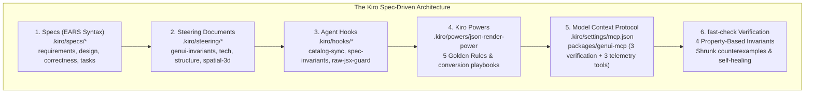

# Kiroween 2026 Hackathon Submission: GenUI Studio

**Project Name:** GenUI Studio (`GenUI-kit`)  
**Track:** Developer Tools / AI Agent Frameworks  
**License:** Open Source (MIT)  
**Repository:** [github.com/NOBA235/GenUI-kit](https://github.com/NOBA235/GenUI-kit)  
**Local Showcase Ports:**
- **SpatialOps (Aegis 3D Spatial Workbench):** `http://localhost:5174` (in-memory simulation default)
- **Studio Hub (WIP Storefront):** `http://localhost:5175`

---

## ⚡ 60-Second Elevator Pitch

Modern AI agents are evolving from text-based chatbots into autonomous operators that stream rich, dynamic user interfaces—financial command centers, interactive analytics, remediation runbooks, and 3D spatial topologies. However, streaming raw JSX or HTML is notoriously slow, vulnerable to XSS and prototype pollution attacks, and prone to catastrophic React hydration crashes.

While Vercel's `@json-render` introduced guardrailed JSON catalogs, building enterprise-grade Generative UI applications still suffered from three fatal bottlenecks:
1. **Catalog–Component–Prompt Drift:** Maintaining parity between React/Three.js components, Zod schemas, and AI system prompts was fragile and manual.
2. **Adversarial & Hallucinated Stream Topologies:** Fragmented LLM patch streams could inject cyclic element graphs (`RangeError: Maximum call stack size exceeded`), prototype pollution (`__proto__`), or non-finite numbers (`NaN`/`Infinity`), taking down the entire browser tab.
3. **Agent Integration Disconnect:** Autonomous coding agents lacked a standardized protocol to inspect available catalogs, validate proposed UI specs prior to streaming, and run property-based fuzz tests.

**GenUI Studio** is a **Property-Based Tested (`fast-check`) & Runtime-Guardrailed Generative UI Reliability Engine, CLI Validator, and Model Context Protocol (MCP) Server**. Built on Vercel's `@json-render` v0.22.0 ecosystem and orchestrated with **Kiro Spec-Driven Development**, GenUI Studio focuses on deterministic stream compilation, DAG & value hardening, hook-safe React fault isolation, and reproducible developer tooling.

---

## 🏆 How Kiro's Ecosystem Powered the Build

To win among 9,600+ participants, GenUI Studio did not merely use Kiro as a code-generation assistant; we utilized **every single layer of the Kiro Agentic Architecture** to govern, enforce, and verify the codebase at every phase of development:

### 1. Formal Specs (`.kiro/specs/`)
We structured the development of the framework and both applications using Kiro's formal specification workflow:
- **Core Skeleton Specification** ([`.kiro/specs/core-skeleton/`](./.kiro/specs/core-skeleton/)):
  - [`requirements.md`](./.kiro/specs/core-skeleton/requirements.md): 20 formal requirements specified strictly using **EARS** (*Easy Approach to Requirements Syntax*: `WHEN... WHILE... IF... THEN SHALL...`).
  - [`design.md`](./.kiro/specs/core-skeleton/design.md): Deep architectural blueprints detailing 3-color Depth-First Search (DFS) DAG cycle severance, RFC 6901 JSON Pointer escaping, and structural-sharing state stores.
  - [`correctness.md`](./.kiro/specs/core-skeleton/correctness.md): Definitions of the 4 property-based invariants (`INV-PBT-01`..`04`) tested via `fast-check` for stream chunking, adversarial payloads, out-of-order state mutations, and catalog determinism.
  - [`tasks.md`](./.kiro/specs/core-skeleton/tasks.md): Phased execution tasks with exact verification criteria.
- **SpatialOps (Aegis 3D Spatial War-Room)** ([`.kiro/specs/app-spatial-warroom/`](./.kiro/specs/app-spatial-warroom/)): Requirements and tasks for the hybrid 3D (React Three Fiber) + 2D (HUD) incident & trace workbench, shared `TimeTravelStateStore`, and WebGL memory boundaries.

### 2. Steering Documents (`.kiro/steering/`)
To prevent "agent amnesia" and architectural drift across long coding sessions, we established permanent steering files:
- [`genui-invariants.md`](./.kiro/steering/genui-invariants.md): Defines the 7 immutable engineering invariants:
  1. *Invariant 1:* 100% Schema–Catalog–Registry Parity.
  2. *Invariant 2:* Zero Crash on Adversarial Stream Payloads (Strict Acyclic DAG Guarantee).
  3. *Invariant 3:* Byte/Char Stream Chunking Invariance.
  4. *Invariant 4:* State Pointer Mutation Idempotency & History Isolation.
  5. *Invariant 5:* Dual-Surface State Coherence (2D UI + 3D WebGL).
  6. *Invariant 6:* Single-Command Judge Experience (Zero Setup, Zero API Keys).
  7. *Invariant 7:* Catalog-to-Prompt Determinism (SHA-256 Fingerprinting).
- [`spatial-3d-rules.md`](./.kiro/steering/spatial-3d-rules.md): Enforces zero-allocation per frame in Three.js, geometry/material caching, and canvas cleanup.
- [`product.md`](./.kiro/steering/product.md), [`tech.md`](./.kiro/steering/tech.md), and [`structure.md`](./.kiro/steering/structure.md): Dictates the strict monorepo boundary rules (`apps` consume `packages`, never vice versa).

### 3. Event-Driven Agent Hooks (`.kiro/hooks/`)
We configured automated hooks in `.kiro/hooks/` to guard the repository continuously during development:
- **`catalog-schema-sync.json`** ([`.kiro/hooks/catalog-schema-sync.json`](./.kiro/hooks/catalog-schema-sync.json)): Automatically triggers [`.kiro/hooks/scripts/catalog-audit.mjs`](./.kiro/hooks/scripts/catalog-audit.mjs) whenever catalog files change. It audits 1:1 parity between Zod schemas and React component registries.
- **`spec-invariants-test.json`** ([`.kiro/hooks/spec-invariants-test.json`](./.kiro/hooks/spec-invariants-test.json)): Automatically runs [`.kiro/hooks/scripts/run-pbt-suite.mjs`](./.kiro/hooks/scripts/run-pbt-suite.mjs), executing the `fast-check` property suite on every build.
- **`raw-jsx-guard.json`** ([`.kiro/hooks/raw-jsx-guard.json`](./.kiro/hooks/raw-jsx-guard.json)): Audits streaming code to ensure no LLM path can inject un-guardrailed JSX or raw `dangerouslySetInnerHTML`.

### 4. Custom Kiro Power: `json-render-power` (`.kiro/powers/`)
We authored a modular Kiro Power ([`.kiro/powers/json-render-power/`](./.kiro/powers/json-render-power/)) that equips coding agents with deep expertise in converting standard React and Three.js components into guardrailed `@json-render` catalogs:
- [`POWER.md`](./.kiro/powers/json-render-power/POWER.md): Details the **5 Golden Rules of Component-to-Catalog Conversion**:
  1. Strict Zod Prop Contracts (`.nullable()` over `.optional()` for LLM structured outputs).
  2. Directives (`children`, `slots`, `visible`, `on`, `watch`) belong on `UIElement`, never inside `props`.
  3. Two-Way State Binding via `useBoundProp` and `bindings`.
  4. Semantic Event Dispatch via `emit("eventName")` instead of raw JS callbacks.
  5. Mandatory Wrapping in `@genui-studio/core` DAG Sanitization and Telemetry Error Boundaries.
- [`react-to-catalog.md`](./.kiro/powers/json-render-power/steering/react-to-catalog.md) & [`three-and-mcp-patterns.md`](./.kiro/powers/json-render-power/steering/three-and-mcp-patterns.md): Concrete transformation playbooks for containers, data tables, and 3D scenes.

### 5. GenUI Studio Model Context Protocol (MCP) Server (`packages/genui-mcp`)
We packaged the verification engine into a **Model Context Protocol (MCP)** server configured in [`.kiro/settings/mcp.json`](./.kiro/settings/mcp.json) with 3 core verification tools plus 3 pluggable SpatialOps telemetry tools:
- **`list_catalog_components`**: Allows Kiro, Claude, or Cursor to introspect the 15 SpatialOps components, their Zod prop contracts, constraints, and fallback props.
- **`validate_ui_spec`**: Validates a proposed Spec tree, RFC 6902 JSONL stream, or SSE stream against the target catalog before rendering, returning exact structural diagnostics (cycles, dangling pointers, prototype pollution attempts) and auto-fix suggestions.
- **`fuzz_test_catalog`**: Enables agents to trigger live `fast-check` property tests directly through MCP tool invocation.
- **Pluggable Telemetry Tools (`query_telemetry_metrics`, `fetch_trace_spans`, `execute_remediation`):** Backed by an in-memory simulated mesh provider by default (`setMcpTelemetryProvider` supports wiring live OTLP / cluster telemetry adapters).

### 6. Property-Based Testing (PBT) & Shrinking with `fast-check`
Rather than relying solely on example-based unit tests, we formulated **4 core property-based invariants** checked across randomized inputs with `fast-check` ([`packages/genui-core/src/testing/index.ts`](./packages/genui-core/src/testing/index.ts)).

During Phase 2, `fast-check`'s shrinking engine uncovered **5 critical edge-case bugs** that traditional unit tests would have never caught:

| Bug ID | Shrunk Counterexample | Real-World Impact | Engineering Fix in `@genui-studio/core` |
|---|---|---|---|
| **`BUG-PBT-01`** | `fullStream.replace(/\n$/, "")` | When an LLM stream terminates without a trailing newline, the final element was silently dropped. | `GuardrailedStreamCompiler.finalize()` explicitly flushes residual line buffers before final DAG sanitization. |
| **`BUG-PBT-02`** | `{"count": -0}` and `NaN` | Negative zero `-0` and `NaN` values failed strict canonical serialization equality checks. | `deepCloneAndSanitizeValue` normalizes `-0 -> 0`, heals `NaN`/`±Infinity`, and logs a telemetry healing event. |
| **`BUG-PBT-03`** | `children: ["el-1", "el-1"]` & diamond aliasing | Sibling key duplication and shared node references caused duplicate React key warnings and infinite DFS traversal loops. | `sanitizeSpecGraph` maintains a global `mountedNodes` set alongside the DFS recursion stack to enforce a strict tree DAG. |
| **`BUG-PBT-04`** | `store.update({ "/a/b": 99, "/a": { b: 1 } })` | Out-of-order parent and child mutations in a single batch resulted in different final state models depending on object key order. | `TimeTravelStateStore.update()` sorts JSON Pointers by depth (shallowest first) before applying mutations. |
| **`BUG-INT-01`** | Streamed out-of-bounds prop clamping | When the stream compiler clamped an out-of-bounds prop (e.g., 999% discount to 50%), the diagnostic was lost on subsequent patch ticks. | Piped `HealedDiagnosticsByElement` directly to the `<DiagnosticHealedBadge />` component at the render boundary. |

---

## 🚀 Reference Application & Registry Tooling

### SpatialOps: Aegis 3D Spatial Incident War-Room (3D WebGL + 2D HUD)
An SRE incident command center combining a **3D WebGL distributed microservice mesh** with a **2D tactical HUD** over a shared `TimeTravelStateStore`:
- **15 Spatial Components:** `AegisWarRoomShell`, `ClusterTopologyCanvas` (Three.js WebGL canvas), `ServiceMeshNode3D`, `TrafficFlowEdge3D`, `BlastRadiusSphere3D`, `RegionZoneBoundary3D`, `IncidentHeroBanner`, `ServiceDiagnosticPanel`, `LatencyHistogramCard`, `ErrorLogTailer`, `BlastRadiusDependencyTree`, `RunbookActionDesk`, `ClusterMetricsGrid`, `SreAuditTrailBanner`, `TraceWaterfallViewer`.
- **Dual-Surface State Coherence:** Adjusting an SRE runbook slider in the 2D HUD updates the 3D WebGL scene's emissive node colors, traffic packet velocities, and volumetric blast radius spheres without re-mounting the WebGL canvas.
- **Incident Remediation:** Trip circuit breakers, trigger regional failovers, scale container pod replicas, and inspect trace waterfalls with full time-travel audit logging.

### Distribution & Agent Skill Registry Layer (CLI + Local Scaffolding)
GenUI Studio includes local CLI tooling and registry primitives ready to connect to a hosted entitlement backend:
- **Agent-Ready Template Packs:** Self-contained bundles uniting React/Three.js code, Zod Catalogs (`catalog.ts`), AI Agent Skills (`SKILL.md` + `.kiro/powers/`), and `fast-check` PBT suites.
- **CLI Spec Validator & Pack Installer (`npx genui-studio validate` / `add` / `export`):** Validates `.json`/`.jsonl`/`.sse` specs in CI/CD (`validate`), installs free starter packs (`spatial-mesh-starter`), and checks Pro packs (`spatial-ops-3d-pro`) using offline format validation (`local-format-demo`) or an injected custom `LicenseVerifier` hook for production billing.
- **One-Click `.ZIP` & MCP Exporter Modal:** Embedded in SpatialOps with tabs for CLI install, client-side streaming `.zip` project generation, and MCP server configuration.

---

## 🛠️ Verification Checklist

- [x] **Monorepo Build & Typecheck:** `pnpm build` and `pnpm typecheck` complete cleanly across workspace packages and apps (`@genui-studio/core`, `@genui-studio/mcp`, `genui-studio` CLI, `@genui-studio/templates`, `spatial-ops`, `studio-hub`).
- [x] **CLI Spec Linter & Registry Scaffolding:** Spec/stream linter (`npx genui-studio validate <file|->`), CLI installer/exporter (`npx genui-studio add|list|export`), and pluggable `LicenseVerifier` hook (defaulting to offline `local-format-demo` mode).
- [x] **Model Context Protocol (MCP) Server:** Tested over stdio JSON-RPC protocol (`node packages/genui-mcp/dist/cli.js`), configured in `.kiro/settings/mcp.json`.
- [x] **Frictionless Developer DX:** Single root commands (`pnpm dev`, `pnpm mcp`, `pnpm test`, `pnpm genui-studio`), zero setup, zero API keys required.
- [x] **Kiro Ecosystem Integration:** Formal Specs in EARS syntax, Steering Documents, Agent Hooks with Node scripts, Custom Kiro Power (`json-render-power`), and MCP Server configuration.
