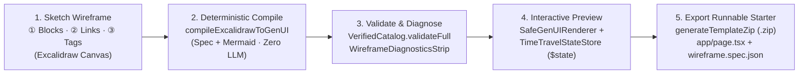

# Kiroween 2026 Hackathon Submission: GenUI Studio (`GenUI-kit`)

**Product:** GenUI Studio — The Excalidraw-to-GenUI Workbench  
**One-Sentence Promise:** **Turn a wireframe into a validated, interactive UI preview—and export a usable React starter.**  
**Track:** Developer Tools / AI Agent Frameworks (Skeleton Crew)  
**License:** Open Source (MIT)  
**Repository:** [github.com/NOBA235/GenUI-kit](https://github.com/NOBA235/GenUI-kit)  
**Runtime Prerequisites:** `Node.js >= 22.18.0`, `pnpm@9.15.0` (zero external API keys required)  
**Primary Workbench URL:** `http://localhost:5175` (`pnpm dev:hub` → click **"Open Sample Wireframe in Workbench"**)

---

## 🎯 Why We Focused on One Clear Product

AI coding tools and prompt-to-UI generators frequently emit fragile JSX or unvalidated JSON specs that fail silently on unknown components, out-of-range props, cyclic parent-child references, or hook-order mismatches.

**GenUI Studio** solves one specific developer job end-to-end:

> **Sketch a wireframe in Excalidraw → deterministically compile it into a validated `@json-render` `Spec` → inspect actionable validation and prop-healing diagnostics → preview the interactive UI live → export a runnable Next.js/React starter.**



---

## ⚡ 60-Second Judge Walkthrough ("The Hard Test")

```bash
# 1. Install and build workspace packages
pnpm install --frozen-lockfile
pnpm -r build

# 2. Launch the Workbench on http://localhost:5175
pnpm dev:hub
```

1. **Open a Sample Wireframe (`Step 1`):** Visit `http://localhost:5175` and click **"Open Sample Wireframe in Workbench"** (`/preview/spatial-mesh-starter?wireframe=sample`, `data-testid="hero-open-sample-wireframe"`).
2. **Compile to a UI Spec (`Step 2`):** `compileExcalidrawToGenUI` ([`excalidraw-compiler.ts`](./apps/studio-hub/src/lib/excalidraw-compiler.ts)) compiles the Excalidraw scene (`① Catalog Blocks`, `② Directed Interaction Links`, `③ Tags & Guardrails`) into a validated GenUI `Spec` + `.kiro/specs/<slug>/design.md` Mermaid diagram with **zero LLM or network calls inside `compileExcalidrawToGenUI`**.
3. **See Actionable Validation Diagnostics (`Step 3`):** `<WireframeDiagnosticsStrip />` ([`WireframeDiagnosticsStrip.tsx`](./apps/studio-hub/src/components/WireframeDiagnosticsStrip.tsx), `data-testid="wireframe-diagnostics-strip"`) immediately explains:
   - `Shape "sample-pricing-rect": tag "PricingTable" is not in the catalog; resolved by label to FeatureGrid.`
   - `MetricStrip.uptimePercent healed 140 → 100`
   - Any blocked `javascript:` URIs, rejected `__proto__` tags, or invalid prop types.
4. **Preview the Result (`Step 4`):** `<SafeGenUIRenderer>` ([`safe-renderer.tsx`](./packages/genui-core/src/boundary/safe-renderer.tsx)) renders the compiled `Spec` with `<DiagnosticHealedBadge />`, hook-safe fiber isolation (`<SafeElementInvoker>`), and live `$state` arrow bindings (`/wireframeBindings/selectedPlan`) over `TimeTravelStateStore`.
5. **Export a Runnable Starter (`Step 5`):** Click **Export** → **Download Next.js Starter (.zip)** ([`exporter.ts`](./packages/templates/src/exporter.ts)). The archive embeds `src/template/wireframe.spec.json` (`WIREFRAME_SPEC_EXPORT_PATH`), `app/page.tsx`, `src/template/catalog.ts`, `wireframe/<slug>.excalidraw.json`, and `.kiro/specs/<slug>/design.md`.

```bash
# Run the automated E2E test of all 5 steps (unpacks the exported .zip to disk and renders its exported app/page.tsx):
pnpm --filter @genui-studio/studio-hub test -- src/__tests__/workbench-journey.e2e.test.tsx
```

---

## 🔧 How the Engine Extends `@json-render` (`v0.22.0`)

`@json-render/core` and `@json-render/react` (`v0.22.0`) provide the upstream catalog, patch primitives, and React renderer. `@genui-studio/core`, `genui-studio` CLI, `@genui-studio/mcp`, and `apps/studio-hub` add the wireframe compiler, runtime safety boundaries, and verification tooling:

| Capability / Boundary | Upstream `@json-render/core` & `@json-render/react` (`v0.22.0`) | Added by `@genui-studio/core` & GenUI Studio Workbench |
| :--- | :--- | :--- |
| **Visual Wireframe Authoring** | JSON / code-authored `Spec` trees | **Excalidraw Wireframe Architect** (`compileExcalidrawToGenUI`), `<WireframeDiagnosticsStrip />`, and runnable Next.js `.zip` export |
| **Catalog & Prompt Synchronizer** | `defineCatalog()`, `defineRegistry()`, `catalog.prompt()` | **`createVerifiedCatalog()`** with SHA-256 `catalogHash`, 1:1 schema-to-registry parity audit, and deterministic key ordering |
| **Cyclic Graph & Recursion Caps** | `validateSpec()`, `autoFixSpec()` | **3-Color DFS DAG Sanitizer (`sanitizeSpecGraph`)** severing back-edges (`A -> B -> A`) and sibling aliasing, enforcing `maxDepth`, `maxElements`, `maxValueDepth`, and `maxValueNodes` |
| **Prototype Pollution & URI Guard** | Relies on caller hygiene | **RFC 6901 Pointer & String Guard** (`isDangerousKey`, `isSafeJsonPointer`, `isSafeUrl`) blocking `__proto__`, `constructor`, `prototype`, `javascript:`, `vbscript:`, and `data:text/html` |
| **Prop Healing & Float Normalization** | Strict Zod validation | **Case/Separator Enum Healing, Numeric Clamping, `-0 -> 0` / `NaN` / `±Infinity` Healing & `<DiagnosticHealedBadge />`** |
| **SSR + Client Fault Isolation** | `<Renderer>`, `StateProvider`, `VisibilityProvider`, `ActionProvider` | **`<SafeGenUIRenderer>` (`<SafeElementInvoker>` + `<GenUIElementErrorBoundary>`)** isolating component faults to `<ElementFaultCard />` while keeping React hook order invariant across SSR and client hydration |
| **Chunk-Invariant Streaming** | `parseSpecStreamLine()`, `applySpecStreamPatch()`, `diffToPatches()` | **`createGuardrailedStreamCompiler()`** with bounded buffers (`maxBufferBytes`, `maxLineLength`, `maxTotalStreamBytes`, `maxPatches`), accepting JSONL, SSE (`data:`/`[DONE]`), or full Spec snapshots |
| **Immutable Time-Travel State** | `StateStore` interface, `getByPath`, `immutableSetByPath`, `flattenToPointers` | **`createTimeTravelStateStore()`** with depth-sorted batch pointer updates (`/a` before `/a/b`), `deepFreezeValue`, `undo()`/`redo()`, and watch cascade circuit breaker |
| **CI CLI, MCP & Property Testing** | Core schema/spec utilities | **`genui-studio` CLI**, **`@genui-studio/mcp`** (`@modelcontextprotocol/sdk` stdio server), and **`@genui-studio/core/testing`** (`fast-check` Arbitraries + `runCatalogInvariantSuite`) |

---

## 🤖 How Kiro Improved Development: Concrete End-to-End Case Study

Instead of adding Kiro files for volume, we used Kiro's **Specs → Steering → Hooks/ESLint → MCP** workflow to design, implement, and verify our core features. Below is one concrete trace showing how Kiro artifacts prevented real regressions:

### Case Study: SSR Hook-Safe Rendering & Wireframe-to-Starter Export
1. **Spec Requirement ([`.kiro/specs/core-skeleton/requirements.md`](./.kiro/specs/core-skeleton/requirements.md) & [`design.md`](./.kiro/specs/core-skeleton/design.md)):** Specified that `<SafeGenUIRenderer>` must isolate per-element faults without violating React's Rules of Hooks across valid, invalid, and SSR/hydration transitions.
2. **Steering Law ([`.kiro/steering/genui-invariants.md`](./.kiro/steering/genui-invariants.md)):** Enforced Invariant 1 (no raw HTML/JSX injection such as `dangerouslySetInnerHTML` or `innerHTML` assignment) and Invariant 7 (hook-order stability via `<SafeElementInvoker>`).
3. **What the Hooks & Linter Caught in Real Time:**
   - **Caught Defect #1 (`safe-renderer.tsx`):** `SafeElementInvoker` previously called `callable(renderProps)` as a plain function during SSR after `useSyncExternalStore`. That ran child hooks on `SafeElementInvoker`'s fiber and broke `React.memo` components. Replacing `callable(renderProps)` with `<ComponentToRender {...renderProps} />` fixed SSR hook execution and `hydrateRoot` parity ([`safe-renderer-dom.test.tsx`](./packages/genui-core/src/__tests__/safe-renderer-dom.test.tsx)).
   - **Caught Defect #2 (`eslint.config.mjs` Invariant 1):** While writing the `hydrateRoot` test in `safe-renderer-dom.test.tsx`, `pnpm -r lint` immediately rejected `container.innerHTML = ssrHtml` under the Invariant 1 AST rule, prompting a safe `DOMParser` + `replaceChildren` implementation.
   - **Caught Defect #3 (`catalog-audit.mjs`):** `.kiro/hooks/scripts/catalog-audit.mjs` (`catalog-schema-sync.json`) scanned `40` source files across `9` catalog definitions and `10` `<SafeGenUIRenderer>` boundaries to ensure zero schema/registry drift.
4. **Verified Result ([`workbench-journey.e2e.test.tsx`](./apps/studio-hub/src/__tests__/workbench-journey.e2e.test.tsx)):** Step 4 renders a custom `HookHero` component (`useState`, `useId`, `useMemo`) through `SafeGenUIRenderer` in SSR, mutates `/wireframeBindings/selectedPlan` on `TimeTravelStateStore`, and Step 5 unpacks the exported `.zip` and renders the exported `app/page.tsx`.

### Workflow Friction & Iteration Log (What We Changed After Review)
| Issue Identified | User / Reviewer Impact | Concrete Engineering Fix |
| :--- | :--- | :--- |
| **Competing product identities** | Visitors couldn't tell if the repo was a UI engine, wireframe tool, marketplace, or SRE dashboard. | Made the **Excalidraw-to-GenUI Workbench** the primary product and front door; demoted `apps/spatial-ops` and the themed packs to optional reference demos and stress-test fixtures. |
| **Static starter export** | Exporting a `.zip` previously exported the template's initial spec rather than the user's compiled wireframe. | Added `buildWireframeExport` (`wireframe-export.ts`) and updated `generateTemplateZip` (`exporter.ts`) to write `src/template/wireframe.spec.json` (`WIREFRAME_SPEC_EXPORT_PATH`) and wire `app/page.tsx` to render it. |
| **Silent wireframe fallbacks** | Unknown component tags or clamped numbers healed silently without explaining why. | Added `<WireframeDiagnosticsStrip />` (`WireframeDiagnosticsStrip.tsx`) and `matchSource` / `propDiagnostics` / `validationIssues` on `ExcalidrawCompileResult`. |
| **Locale-dependent tie-breaking** | `compileExcalidrawToGenUI` used `localeCompare` when sorting equal-coordinate shapes (`"aa"` vs. `"z"` in Danish `da`). | Replaced `localeCompare` with UTF-16 code-point ordering (`compareCodePoints`) in `excalidraw-compiler.ts` ([`wireframe-proof.test.ts`](./apps/studio-hub/src/__tests__/wireframe-proof.test.ts)). |
| **Collector gzip bomb & exposure risk** | `otlp-collector.ts` checked compressed size before `gunzipSync`, used wildcard CORS `*`, and lacked remote-bind/auth guards. | Enforced `gunzipSync(buf, { maxOutputLength: maxBodyBytes })` (`413`), loopback bind guard (`--allow-remote`), loopback CORS reflection, and `SPATIAL_OPS_AUTH_TOKEN` Bearer auth ([`otlp-topology.test.ts`](./apps/spatial-ops/src/__tests__/otlp-topology.test.ts) Test #10). |

---

## 🔒 Threat Model & Supported Deployment Modes

- **Supported Deployment Modes:**
  1. **Local Developer Workbench (`apps/studio-hub` on `:5175`):** Interactive wireframe sketching, compilation, diagnostics, preview, and Next.js `.zip` starter export.
  2. **In-App React Runtime (`@genui-studio/core`):** Client DOM (`createRoot` / `hydrateRoot`) and SSR (`renderToString` / `renderToStaticMarkup`) rendering of untrusted or LLM-streamed `Spec` trees against a trusted developer-defined `ComponentRegistry`.
  3. **CI Spec Linter & Local MCP Server (`genui-studio` CLI & `@genui-studio/mcp`):** Offline CI validation (`genui-studio validate`) and local coding-agent stdio MCP server (`pnpm mcp`).
  4. **Local OTLP Receiver (`apps/spatial-ops` on `127.0.0.1:4318`):** Localhost telemetry visualization. Refuses non-loopback binding unless `--allow-remote` / `SPATIAL_OPS_ALLOW_REMOTE=1` is set; reflects only loopback `Origin` headers by default; caps decompressed gzip payloads at `maxBodyBytes` (`413`); enforces optional `SPATIAL_OPS_AUTH_TOKEN` Bearer auth on `POST /v1/*`, `/api/reset`, and `/api/demo/trace`.
- **Non-Goals / Out of Scope:**
  - Not a multi-tenant public SaaS backend.
  - SpatialOps remediation (`execute_remediation`) is a **local state simulation / advisory tool** (`executionMode: "LOCAL_SIMULATION"` or `"LOCAL_OTLP_SNAPSHOT_ADVISORY"`), never a live cloud control plane.

---

## ✅ Reproducible Verification Commands & Honest Status Table

```bash
pnpm install --frozen-lockfile
node scripts/check-workspace-scripts.mjs
pnpm -r build
pnpm -r typecheck
pnpm -r lint
pnpm -r test
node .kiro/hooks/scripts/catalog-audit.mjs
node .kiro/hooks/scripts/run-pbt-suite.mjs
node scripts/verify-mcp.mjs
node apps/studio-hub/scripts/audit-wireframe-compiler.mjs
```

| Verification Item | Status | Evidence / Scope Boundary |
| :--- | :--- | :--- |
| **5-Step Workbench User Journey (`Sketch → Compile → Validate → Preview → Export`)** | **Verified** | End-to-end test ([`workbench-journey.e2e.test.tsx`](./apps/studio-hub/src/__tests__/workbench-journey.e2e.test.tsx)) compiles the sample sketch, verifies `<WireframeDiagnosticsStrip />` warnings and hostile-input error states, renders hook components + live `$state` bindings, unpacks the exported `.zip`, and renders the exported `app/page.tsx`. |
| **SSR + Client Hydration with Hook-Using & `React.memo` Components** | **Verified** | Tested with `renderToString`, `renderToStaticMarkup`, `hydrateRoot`, and `createRoot` in [`safe-renderer-dom.test.tsx`](./packages/genui-core/src/__tests__/safe-renderer-dom.test.tsx). |
| **Deterministic Zero-LLM Wireframe Compilation (`compileExcalidrawToGenUI`)** | **Verified** | Golden `Spec` + Mermaid snapshots, 50-run determinism, Danish (`da`) collation invariance, runtime network/clock/randomness tripwires ([`wireframe-proof.test.ts`](./apps/studio-hub/src/__tests__/wireframe-proof.test.ts)), and static Rollup bundle audit ([`audit-wireframe-compiler.mjs`](./apps/studio-hub/scripts/audit-wireframe-compiler.mjs)). |
| **Property-Based Tests (`fast-check`) & Workspace CI** | **Verified** | `pnpm -r build/typecheck/lint/test` passes across all 6 packages (`23` test files, `159` passing tests; enforced in `.github/workflows/ci.yml`). `fast-check` suites (`50`–`500` runs per property) provide empirical randomized test coverage, not mathematical proof. |
| **External Package-Consumer Tarball Verification (`pnpm pack`)** | **Verified** | `@genui-studio/core`, `@genui-studio/templates`, `genui-studio`, and `@genui-studio/mcp` installed from `.tgz` tarballs in a clean external project; ESM runtime, `@genui-studio/core/testing` + `fast-check`, NodeNext declarations (`--skipLibCheck false`), and CLI `bin` verified. |
| **OTLP Collector Security Guards (`:4318`) & MCP Snapshot Contract** | **Verified** | Loopback bind guard, loopback CORS reflection, `gunzipSync` `maxOutputLength` decompression bomb cap (`413`), Bearer token auth (`401`), and shared `~/.spatial-ops/otlp-snapshot.json` (`SPATIAL_OPS_OTLP_SNAPSHOT`) verified in [`otlp-topology.test.ts`](./apps/spatial-ops/src/__tests__/otlp-topology.test.ts) and [`verify-mcp.mjs`](./scripts/verify-mcp.mjs). |
| **SpatialOps Remediation & Offline CLI License Check** | **Simulated by Design** | `execute_remediation` and SpatialOps runbooks mutate local `TimeTravelStateStore` / in-memory simulation state only (`LOCAL_SIMULATION` / `LOCAL_OTLP_SNAPSHOT_ADVISORY`); `validateLicenseToken` defaults to offline `"local-format-demo"`. |
| **Kiro Crew (`neuro-chimera-synth/kiro-crew-app`)** | **State 1 & 2 Verified · State 3 Unverified** | **State 1** (offline manifest validation via `validateCrewBundle`) and **State 2** (`dist/index.mjs` 3,980-byte ESM bundle + `hooks.py` `py_compile`) are **verified**. **State 3** (live `kirocrew app install` / gateway runtime) is **unverified** (`[ ]` in [`.kiro/specs/neuro-chimera-synth/tasks.md`](./.kiro/specs/neuro-chimera-synth/tasks.md#L30)) because the `kirocrew` CLI/gateway is not installed in this environment. |
